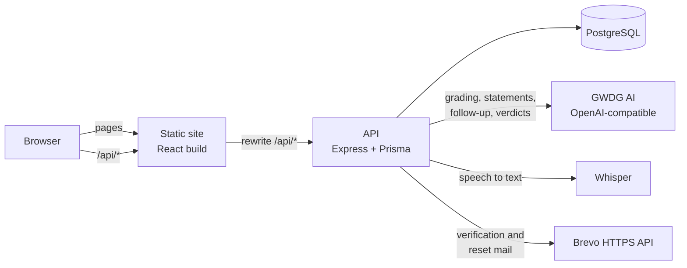

# Blueprint: an architecture case study

How a learning app keeps an AI grader honest, keeps its users' data apart, runs on a free hosting plan, and what
would have to change for it to run on many machines. The system's parts, tables and endpoints are documented in
`HLD.md` and `LLD.md`; this document covers the decisions and the evidence behind them.

## 1. The product in one paragraph

Blueprint turns a learning goal ("Angular in six months") into a city: districts are subjects, buildings are topics,
and sub-topics are the work. The scheduler plans each day's study within the time the learner has. Once a sub-topic
is learned, a spaced-recall engine brings it back: the learner explains it from memory (typed, spoken or sketched),
an AI checks the explanation against a checklist, and the result sets the next review date. The interesting
engineering is in that last step: **an AI's judgement decides when you see a topic again, so it has to be right, and
it has to be checkable.**

## 2. The hard problem: an AI grader you can trust

A large language model is fluent, inconsistent and eager to please. Asked to "grade this explanation", it will
round up, invent quotes, flag true statements as errors, and give different answers to the same input. Blueprint
treats the model as one noisy component and puts rules around it.

| Decision | Why | Where |
|---|---|---|
| **The checklist is written once and locked.** Each sub-topic's checklist (6 to 8 points, by tier: definition, how it works, pitfalls) is versioned. A rebuild makes a new version; earlier reviews keep theirs. | Scores over time compare like with like. | `recall/service.ts` `buildChecklist` |
| **The model only labels; code scores.** Each point is ACCURATE, PARTIAL or MISSED. The score, depth, outcome and next date are worked out in code. | A model's "73 %" is not reproducible; a weighted count is. | `recall/rules.ts` `recallScore`, `depthOf`, `nextSchedule` |
| **The grading model is pinned per checklist, at temperature 0.** | A model upgrade must not quietly change how old topics are judged. | `callGrader` |
| **Every quote must be the learner's own words.** Each credited point carries 5–20 words of evidence. Code checks them against the text, forgiving a slipped word but not invention; a point with a failed quote counts as missed. | The cheapest way to catch a model that "remembers" what the learner should have said. | `verifyGrade`, `quoteMatches` |
| **A flagged mistake is checked a second time.** Each misconception costs 15 %, so a narrow second call confirms each one; unconfirmed ones are dropped. | A first trial flagged true statements about Angular's lifecycle as errors. | `misconceptionCheckPrompt` |
| **Evidence that does not show the point is discounted in code.** In a code-only answer, code cannot show a definition or purpose; a quote that is itself a confirmed mistake is not evidence. | Found by testing: a code-only answer earned credit for "why", and a wrong claim earned partial credit. | `checkEvidence` |
| **The follow-up never changes the score.** After the results, a "senior engineer" asks about the gaps, basics first. Points recalled only when asked are marked as such. | Prompted recall is weaker evidence than unprompted recall. | `probe`, `followup` |
| **Shown text is never graded text.** Plain point statements, the side-by-side view and highlights are all derived for display; none feeds back into a score. | A display feature must never become a grading feature by accident. | `writeStatements`, `answerSpans` |

### 2.1 Changing a prompt is an experiment, not an edit

Prompt changes are tested against real data before they ship, on a copy of the database, saving nothing.

- **A rejected change (grade v5).** Asking the grader also to list misheard words ("type interference" for type
  inference) looked harmless. A paired comparison on 15 real reviews (v4 and v5 on the same text, same model,
  temperature 0) agreed on 99 of 107 points. But on a code-only answer, v5 quoted the checklist's own descriptions as
  "evidence". The quote check rejected all of them, so a correct answer would have dropped from five points to none.
  The grading prompt stayed at v4.
- **A rejected feature ("read as" notes).** Moved to a separate call on the spoken parts only, the same idea still
  failed on real data: it relabelled wrong ideas as mishearings ("Template Ref" read as templateUrl). The feature was
  dropped.
- **A shipped change (point statements).** Generated for 143 points on a copy first, checked for instruction
  wording and length, then copied into the real database only where ID, label and description matched.

The method is the point: back up, copy, run read-only, compare paired results, decide on evidence.

## 3. Architecture at a glance

A modular monolith: one API process with modules for auth, cities, curriculum, schedule, tasks, summary, revision
and recall, one PostgreSQL database, and a static frontend. It runs locally in Docker Compose (Nginx, API, database),
and in production on Render as a Docker web service, a static site and managed Postgres.

The monolith is a choice, not an accident. One person builds and runs it; a single process makes transactions,
tests and deployment simple. The seams that would split later are already module boundaries (section 7).

## 4. Many users, one database

Each user owns one or more cities. Isolation is enforced below the business logic, not inside it:

- **A city-scoped database client.** Request handlers receive a Prisma client bound to one city. Every read, update
  and delete on a city-owned model gets the city added to its filter, and every create gets it set. A service cannot
  reach another city's rows, whatever IDs a request carries (`lib/cityScope.ts`). Account tables are refused by
  this client and handled by the account services with explicit ownership checks.
- **"Today" per city.** Dates matter: a recall is due "tomorrow" in the learner's time zone, not the server's.
  `AsyncLocalStorage` carries the city's time zone through each request and each background job, so `clock.today()`
  is right without passing a zone through every call (`lib/zone.ts`).
- **One shared ledger.** AI usage is counted across cities, because the provider's quota belongs to the API key, not
  to a user.

## 5. Background work and failure

Grading takes from seconds to minutes and the provider is sometimes busy. The request that submits a recall returns
`202 Accepted` at once; grading runs in the background:

- **Retries with backoff while the model is busy** (10 s up to 20 min, about an hour in all), one retry on unusable
  output, then a clear reason for the learner and a "Check again" button. Never another model as a fallback, since
  the checklist's model is pinned.
- **Resume on restart.** A recall that was being graded when the server stopped (a free Render instance sleeps) is
  graded again on the next start.
- **One grade at a time per review**, so a double click cannot grade twice.
- **Idempotent side work.** Point statements are written only where none exist yet, so a retried or duplicated job
  does nothing twice.
- **Transactions where it matters.** Applying a grade writes the results, the review, the schedule, the completed
  task and the logged study time in one transaction.

## 6. Deployment on a free plan

Running on Render's free tier shaped several decisions:

- **No custom backend URL in the frontend.** The static site rewrites `/api/*` to the API, so the browser sees one
  origin, the session cookie stays first-party, and there is no CORS configuration.
- **A same-origin request guard.** State-changing requests must come from the API's own origin, or from exactly the
  frontend's origin in `PUBLIC_URL` (needed because of the rewrite), and carry a custom header. Together with
  SameSite cookies this blocks cross-site request forgery.
- **Client addresses behind proxies.** Sign-in limits are per client address, read from `X-Forwarded-For` only as
  far as the trusted proxies go (`TRUST_PROXY`), so a client cannot choose its own address.
- **Mail over HTTPS.** Free web services cannot open SMTP ports (25, 465, 587). Verification and reset mail goes
  through Brevo's HTTPS API instead. The server checks the key on start without sending anything.
- **Migrations on start, never resets.** Each start applies pending migrations, so a deploy is a push.

## 7. Where it would break at scale

Blueprint is deliberately single-instance. Running several API instances (for availability, or for many users)
would break these assumptions, and each has a known replacement:

| Single-instance assumption | What breaks with several instances | Replacement |
|---|---|---|
| Grading runs in the API process; a `Set` stops double grading; retries wait with timers | Two instances grade one review; a restart loses timers (it resumes from the database, but late) | A durable job queue: a Postgres table claimed with `FOR UPDATE SKIP LOCKED`, or Redis/BullMQ. The job ID is the review ID, so enqueueing is idempotent. |
| Sign-in and resend rate limits live in memory | Each instance counts separately; limits multiply | A shared store (Redis, or a Postgres table with a sliding window) |
| Recall tasks are planned on start (`planAll`) | Every instance plans at once | A scheduled job under a lock (Postgres advisory lock or leader election) |
| Mail is sent inside the request | A provider outage fails sign-up | An outbox table written in the same transaction, sent by a worker with retries |
| The AI quota is checked against a usage table before each call | Concurrent instances race past the limit | A token bucket in one place, reserved before the call |
| Logs are structured JSON lines | Following one recall across instances is hard | A request and job correlation ID, and tracing (OpenTelemetry) |

The two hardest of these are the job queue and exactly-once effects around AI calls. A model call is slow and
costs money, and it is not idempotent. The pattern that fits is at-least-once job delivery with idempotent results:
store the reply keyed by review and prompt version, and make "apply this grade" safe to run twice.

## 8. Testing strategy

- **A deterministic fake AI provider** answers every prompt from simple rules (a point is accurate when its key word
  appears; "Wrong: …" is a misconception). The whole recall flow runs in tests without a network.
- **Integration tests on real PostgreSQL**, in a separate test database: the city scope, transactions and migrations
  are tested as they run, not mocked.
- **Prompt changes are tested on real data** (section 2.1), because the fake provider cannot tell you how a real model
  will react.
- About 280 backend and 260 frontend tests.

## 9. Lessons

1. Treat a model as a noisy sensor: let it label, and let code decide.
2. Make every AI claim checkable. Quotes are the cheapest check there is.
3. A prompt change is a behaviour change. Compare paired outputs on real data before shipping, and be ready to
   say no.
4. Isolation belongs below the business logic: a scoped client is harder to get wrong than a filter in every query.
5. Free hosting is a design constraint worth respecting: it forced the single-origin rewrite and HTTPS mail, which are
   good designs anyway.
