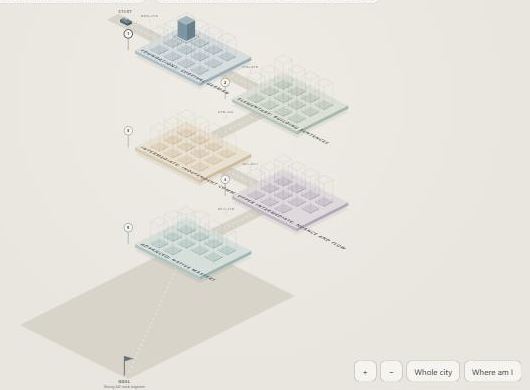

# Blueprint City Engine: Architecture and Implementation Audit

*Read-only audit, 19 November 2026. No source code was changed. Code references are to the working tree of
`feature/multi-user-foundation` at commit 74c65c3, which has uncommitted changes to the AI generation code only; none
of the map files are affected.*

**How the evidence was gathered**

- **Code reading**: every file that sits between an approved curriculum and the drawn map.
- **Running the real layout code**: the frontend's own `layout()`, `zone()`, `districtBox()` and `cityBox()`, run
  against the district shape of every city in the local database (names, column counts, topics and sub-topics, read
  with one `SELECT`).
- **Text measurement**: district label widths measured in the running app with its own CSS (`.dlabel`, Chromium,
  `system-ui` on Windows).
- **Screenshot**: one "Whole city" screenshot of a 5-district city in the running app.

The audit labels each finding as **Confirmed** (seen on screen, or produced by running the real code), **Confirmed by
code** (the code path is unambiguous but was not reproduced in the UI), or **Potential** (not triggered by any current
city, but possible within what the curriculum contract allows).

---

## 1. Architecture overview

One rendering engine draws every city. It was built for the original single curriculum, whose requirements say
"7 platforms in a zigzag (`ORIGINS`) … **Preserve geometry**" (SRS §2, `docs/SRS.md:110`) and "exactly seven districts"
(FR-CUR-01). Multi-city support reuses that engine unchanged. The engine has no city-specific branches, but it still
assumes that a city has exactly seven districts. Most of the defects below come from that one assumption.

The engine has three layers, all on the frontend:

| Layer | File | Job |
|---|---|---|
| Geometry (pure) | `frontend/src/map/geometry.ts` | Turns the ordered districts and topics into map-unit rectangles, a road polyline and bounding boxes |
| Renderer (pure) | `frontend/src/map/render.ts`, `frontend/src/map/vehicle.ts` | Turns the layout plus progress state into one SVG string; places and animates the car |
| Component | `frontend/src/components/CityMap.tsx` | Owns the camera (`viewBox`), input (drag, wheel, pinch, keys), car animation and the topic panel |

The backend never sends coordinates. It sends the **order** of districts and topics (`position`), each district's
**column count** (`cols`), each topic's **sub-topics** (building height) and **progress**. The map is therefore a
deterministic function of the curriculum: the same curriculum and progress always give the same picture.

## 2. City-generation pipeline

```
 City wizard ──► AI generator / template / import
                 backend/src/modules/ai/curriculum/generator.ts   (assemble: keys, colours; layer always 1, cols left unset)
                 backend/src/curriculum/*.ts + engineeringTemplate (Engineering City: explicit cols 3–5, layers 1–5)
                        │  CurriculumDocument (contract v1, JSON)
                        ▼
 CurriculumVersion.content  ──validateCurriculum()──►  PROPOSED ──approve──►
                 backend/src/modules/cities/contract.ts   (≤7 districts, ≤20 topics, ≤20 sub-topics, cols 1–6 optional)
                        │
                        ▼
 applyCurriculum()  backend/src/modules/cities/apply.ts:50
                 District rows: position = index, cols = d.cols ?? clamp(2..6, ceil(√topics))   (apply.ts:58)
                 Topic / Subtopic / Stage rows, ids = city.idPrefix + key
                        │
                        ▼
 GET /api/curriculum (ordered by position)   GET /api/progress (road: currentDistrictIndex, districtFraction)
                 backend/src/modules/curriculum/service.ts:56      backend/src/domain/progress.ts:63
                        │                                                 │
                        ▼                                                 ▼
 AppDataProvider (keyed by city id, Root.tsx:107) ──► App.tsx:73  L = layout(curriculum.districts)
                        │
                        ▼
 layout()  geometry.ts:35  → { blocks (district rectangles), route (buildings in order), W (road waypoints) }
                        │
                        ▼
 CityMap.tsx  renderCity(L, state) → SVG string → <g>.innerHTML ; camera = <svg viewBox>
              carPosition(L, road) / carPath / alongPath for the car
```

**Canonical data structures**

| Structure | Where | Contents |
|---|---|---|
| `CurriculumDocument` | `cities/contract.ts` | The approved curriculum: districts, topics, sub-topics, stages, queues, calendar |
| DB rows | `prisma/schema.prisma` | `District` (`position`, `cols`, `color`, `layer`), `Topic`, `Subtopic`, `Stage` |
| `Curriculum` / `Progress` DTOs | `frontend/src/api/types.ts` | What the map receives |
| `Layout { blocks, route, W }` | `geometry.ts:28` | The only intermediate representation of the map |
| `RenderState` | `render.ts:9` | Floors per topic, selection, current topic and district, car position, month signposts |

**Same engine for every city?** Yes. There is no city-name or template branch anywhere in `map/` or `CityMap.tsx`.
The only template-specific UI is the sidebar's layer headings (`Sidebar.tsx:135`: engineering layer names only when
`city.template === "engineering"`, otherwise "Districts"), and that is already handled correctly.

## 3. Important files

| File | Responsibility |
|---|---|
| `frontend/src/map/geometry.ts` | Constants, `iso()` projection, `layout()`, `districtBox()`, `cityBox()` |
| `frontend/src/map/render.ts` | Road, signposts, platforms and labels, buildings, car, checkpoint badges, depth-sorted draw order |
| `frontend/src/map/vehicle.ts` | Car zone in front of each district, car position, path along the road corners |
| `frontend/src/components/CityMap.tsx` | Camera, fit and focus functions, input handling, car animation, topic panel |
| `frontend/src/App.tsx` | Builds the layout once per curriculum (`useMemo`, line 73), mounts `CityMap` on the City tab |
| `frontend/src/Root.tsx` | Mounts the whole learning app per city (`<AppDataProvider key={city.id}>`, line 107) |
| `frontend/src/lib/layers.ts`, `components/Sidebar.tsx` | Engineering layer names, used only for the engineering template |
| `frontend/src/lib/color.ts` | `mix()` shades from the district colour; ink, paper and accent colours |
| `backend/src/modules/cities/apply.ts` | Writes a curriculum into a city; derives `cols` when the document has none |
| `backend/src/modules/cities/contract.ts` | Size limits that bound what the map has to draw |
| `backend/src/modules/ai/curriculum/generator.ts` | Generated cities: district colours from `COLOURS`, `layer: 1`, no `cols` |
| `backend/src/domain/progress.ts` | Road progress: which district the car is in and how far along it is |

## 4. Hardcoded values inventory

Classification: **D** = intentional design constant, **C** = configurable, **Data** = derived from the curriculum,
**A** = accidental hardcoding (assumes the original 7-district city).

| Value | Where | Class | Why it exists | Limitation |
|---|---|---|---|---|
| `STEP 1.4, FP 0.9, MARGIN 0.8, FH 0.3, BASE 0.1` | `geometry.ts:6` | D | Building pitch, footprint, platform margin, floor height | None by itself; see the size limits in §5 |
| `S = 10` (district spacing) | `geometry.ts:6` | D | Distance between district origins | Caps a district at 5 columns and 5 rows before the car's gap disappears (§5) |
| `TW 32, TH 16, ZU 34` | `geometry.ts:7` | D | 2:1 isometric projection | None |
| `ORIGINS` (7 fixed zigzag positions) | `geometry.ts:8` | D, with an A side effect | Original 7-district design | `layout()` silently drops districts after the 7th (`geometry.ts:37`). Safe today only because the contract also caps districts at 7 (`contract.ts:11`); nothing ties the two numbers together |
| START waypoint `[-4, 3]` | `geometry.ts:55` | D | Road entry before district 1 | None |
| **GOAL waypoint `[3S+3, 3S+9]` = `[33, 39]`** | `geometry.ts:55` | **A** | Placed after the 7th district | For 1–5 districts the last road segment is diagonal and drawn as a huge grey rectangle; for 1–6 districts "Whole city" zooms out to fit empty road (§8, B1 and B2) |
| Road half-width `0.6`, road colours | `render.ts:39–45` | D | Look of the road | Each segment is drawn as its axis-aligned bounding rectangle, which only looks right for straight segments |
| **"Strong full-stack engineer"** under GOAL | `render.ts:53` | **A** | The original curriculum's goal | Shown in every city, for example a German-language city (§8, B3) |
| "START", "GOAL", "SAT " (parallel-stage signposts), "Checkpoint n" | `render.ts:47–52`, `CityMap.tsx:45`, `render.ts:147` | D | Map vocabulary, English only | "SAT" is an unexplained abbreviation outside the original curriculum |
| District label: 15 px bold, letter-spacing .16em, uppercase, no width limit | `styles.css:66`, `render.ts:78–79` | D, with an A side effect | Label along the platform's front edge | Long names run past the platform (§8, B4) |
| `districtBox` heights `z = 3.2 / -0.4 / -1.8` | `geometry.ts:67–68` | A (fixed) | Frames a district for "Where am I" | Assumes buildings no taller than about 12 sub-topics (§8, P3) |
| Camera zoom limits `0.3 … 2.6` | `CityMap.tsx:37` | D | Usable zoom range | "Whole city" cannot fit on map areas shorter than about 410 px (§8, P5) |
| Fit factors `0.8 / 0.78` (district), `0.92` (whole city), `1.05` (building) | `CityMap.tsx:107, 114, 122` | D | Breathing room around framed objects | Leaves only 4% around the whole city; the GOAL caption and checkpoint badge 1 fit only by that margin (P4) |
| Panel offset breakpoint `820 px`, gap `14 px` | `CityMap.tsx:100` | D (mirrors `styles.css` media queries) | Keeps framed objects clear of the topic panel | Duplicated between CSS and TS |
| Wheel zoom `0.0022`, buttons `1.25 / 0.8` | `CityMap.tsx:308, 383–384` | D | Input feel | None |
| Layer names 1–5 | `lib/layers.ts:2–14` | D (engineering only) | Original 4+1 layers | Correctly limited to the engineering template (`Sidebar.tsx:135`) |
| `cols` | DB `District.cols`; `apply.ts:58` derives `clamp(2..6, ceil(√topics))` when the document has none | Data | Grid width per district | The contract allows 1–6 explicitly; 6 columns, or too few columns for many topics, breaks spacing (§5) |
| District colours | Document; generator `COLOURS` (`generator.ts:157`) | Data | Platform and building colours | None |
| Topic order, building count and height | `position`, topics, sub-topics | Data | One building per topic, one floor per sub-topic | Bounded by the contract (≤20 topics, ≤20 sub-topics) |

There are **no city-name conditions** and no other seven-district checks. A search for `=== 7`, `"fe"`, `"ec"` and
"engineer" in `frontend/src` and `backend/src` found only `render.ts:53` and `lib/layers.ts`.

## 5. Spatial layout algorithm

All coordinates are map units, projected by `iso(x, y, z) = [(x − y)·32, (x + y)·16 − z·34]` (`geometry.ts:11`).

**Districts.** District *i* sits at `ORIGINS[i]`: `[0,0], [10,0], [10,10], [20,10], [20,20], [30,20], [30,30]`. That is
a fixed staircase alternating +x and +y steps. A district's platform size depends on its data:

```
width  (x) = 2·MARGIN + (cols − 1)·STEP + FP = 1.1 + 1.4·cols
depth  (y) = 1.1 + 1.4·rows,   rows = ceil(topics / cols)
```

**Buildings.** Topics fill the grid row by row: topic *b* goes to column `b mod cols`, row `floor(b / cols)`, at
`origin + MARGIN + (col, row)·STEP`. The footprint is `FP × FP`; the height is `BASE + subtopics·FH`, filled up to the
number of ticked sub-topics (`render.ts:84–88`). `route` lists every building in road order.

**Road.** The waypoints are `W = START, ORIGINS[i] + (3,3) for each drawn district, GOAL`. The road is drawn **under**
the platforms (draw order `render.ts:157–164`), so it shows only in the gaps between them. That is intentional: the car
drives only in the gap in front of the current district (`vehicle.ts:18–27`):

```
zone(i): from previous platform edge + 0.7 to this platform edge − 0.7  (along the axis of segment W[i] → W[i+1])
zone length = S − extent(previous district) − 1.4 = 8.6 − extent
```

**Size limits that follow from these formulas.** The extent that counts is a district's columns when the next step is +x
(districts 1, 3, 5 and 7) and its rows when the next step is +y (districts 2, 4 and 6).

| Columns or rows | Extent | Effect |
|---|---|---|
| ≤ 5 | ≤ 8.1 | Fine: car zone ≥ 0.5 |
| 6 | 9.5 | No visible gap; the car zone is clamped to length 0, so the car never moves inside that district (`Math.max(end, start)`, `vehicle.ts:26`) |
| ≥ 7 | ≥ 10.9 | The platform overlaps the next district |

Derived `cols` (`apply.ts:58`) stays within 5×5 for every allowed topic count (at most 20 topics gives 5 columns × 4
rows), so AI-generated cities are safe today. Explicit `cols` from a template or import is not: the contract allows
`cols: 6` (zero car zone) and `cols: 1` with up to 20 topics (20 rows, overlapping the next district).

**Determinism.** Placement is fully deterministic: it is a pure function of district order, `cols`, topic count and
sub-topic count.

**Collision detection and layout validation.** There is none, either in `layout()` or in the curriculum contract.

**Map bounding box.** `cityBox(L)` (`geometry.ts:70–75`) is the bounding box of every `districtBox` plus every road
waypoint. `districtBox` uses fixed heights (3.2 above the back corner, 1.8 below) rather than the actual building
heights, and neither box includes the GOAL flag and caption, the START label, the checkpoint badges or the month
signposts.

**What the current cities look like under this engine** (output of the real layout code):

| City (districts) | Whole-city frame | Districts alone | Last road segment |
|---|---|---|---|
| Engineering City (7) | 803 × 1261 px | 794 × 1230 px | straight `[33,33]→[33,39]` |
| Tech City (6) | 714 × 1261 | 659 × 1047 | straight but long `[33,23]→[33,39]` |
| German Language (5) | 758 × 1261 | 704 × 954 | **diagonal** `[23,23]→[33,39]`, drawn as an 11.2 × 17.2 unit rectangle |
| an archived 5-district city | 714 × 1261 | 614 × 887 | **diagonal**, same |
| Angular City (4) | 714 × 1261 | 614 × 750 | **diagonal** `[23,13]→[33,39]`, drawn as an 11.2 × 27.2 unit rectangle |

Every city has the same frame height (1261 px) because the GOAL is fixed at `[33, 39]`.

## 6. Camera and viewport

| Behaviour | Implementation | Assessment |
|---|---|---|
| Camera model | `{cx, cy, k}` in iso pixels; `viewBox = [cx − w/2k, cy − h/2k, w/k, h/k]` (`CityMap.tsx:66–72`) | Simple and correct |
| Screen → world | `zoomAt`: `world = c + (p − size/2)/k`, then the new centre keeps that point fixed (`:132–140`) | Correct |
| Whole city | `cityBox`; `k = clamp(min((w − 2·o.x)·0.92/bw, (h − 2·o.y)·0.92/bh))`, centre shifted by the panel offset (`:118–124`) | Correct maths, but the box includes the far GOAL and leaves out labels and badges (B2, P4) |
| Where am I | Current district from `progress.road`; `fitAll` when every district is passed (`:126–130`) | Correct |
| Focus on a district | `districtBox`, 80% of width and 78% of height, panel offset (`:103–109`) | Fixed box height (P3) |
| Focus on a building | Centre of the footprint at half height, `k ≥ 1.05` (`:111–116`) | Fine |
| First view | Restores `savedView` if there is one, otherwise frames the current district (`:204–220`) | **`savedView` is shared between cities** (B5) |
| Resize (window, sidebar, panel) | `ResizeObserver` calls `applyView`, keeping centre and zoom without refitting (`:336`) | Intentional; no refit on resize |
| Panning bounds | None: drag and wheel can move the city completely off-screen | Potential UX issue, by design |
| Zoom limits | 0.3–2.6 (`:37`) | Whole city cannot fit when the map area is shorter than about 410 px (P5) |
| Draw cost | The whole SVG string is rebuilt and assigned to `innerHTML` on every car-animation frame (`:156–175`, `:192–199`) | Fine at 83 buildings (NFR-06); grows with city size |

**Does the camera account for every drawn object?** No.

- `districtBox` ignores the actual building heights and the checkpoint badge.
- `cityBox` includes road waypoints and the fixed-height district boxes only. It leaves out the GOAL flag (64 px tall),
  the GOAL caption, the START label, the badges and the signposts.
- Measured: the GOAL caption ends 48 px below the frame and badge 1 sits about 27 px left of it. Both stay visible only
  because the 0.92 fit factor leaves 4% of margin, which is about 50 and 29 px here.

## 7. Multi-city state and isolation

| State | Scope | Assessment |
|---|---|---|
| Curriculum, progress, layout `L`, road SVG, `byId`, floors, car position (`carShown`), selection, focus | Per city: the whole learning app is remounted per city (`Root.tsx:107`) and `L` is memoised per curriculum | Isolated |
| District, topic and stage ids | Prefixed per city (`city.idPrefix + key`, `apply.ts:51`); Engineering City keeps prefix "" | Unique across cities, so DOM `data-t` and deep links cannot collide |
| `X-City-Id` request header | Module-level `currentCity` in `api/client.ts`, set from the session | Global by design; the backend checks ownership |
| **Camera `savedView`** | **Module-level variable** (`CityMap.tsx:35`), written on every camera change (`:71`), restored on mount (`:205`) | **Leaks between cities and survives sign-out** (B5) |
| Layout cache | None outside React memos | No leak |
| Different city structures | The engine handles 1–7 districts and any topic count up to the contract limits without crashing | Visual defects for fewer than 7 districts (B1–B3); spacing breaks for explicit `cols` of 6, or too few columns for the topic count (P1) |

## 8. Confirmed bugs and potential problems



*"Whole city" in the running app for a 5-district city: the grey diamond at the bottom is the diagonal last road
segment, GOAL sits far below the city, and several district labels run past their platforms.*

### Confirmed bugs

**B1. The road to GOAL is drawn as a large grey rectangle in cities with 1–5 districts.** *(Confirmed, on screen and by
running the code.)*

- **Cause:** the GOAL waypoint is fixed at `[33, 39]` (`geometry.ts:55`). `roadSVG` draws each segment as its
  axis-aligned bounding rectangle (`render.ts:40–43`), so a diagonal segment becomes an 11 × 17 to 11 × 27 unit
  diamond, with the dashed centre line crossing it diagonally.
- **Affected now:** German Language, Angular City and an archived 5-district city.
- **Also:** when every district is passed, the car parks on that segment (`vehicle.ts:31–34`) and drives to it
  diagonally.

**B2. "Whole city" zooms out to include empty space for every city with fewer than 7 districts.** *(Confirmed by running
the code.)*

- **Cause:** the same fixed GOAL. The frame is always 1261 px tall.
- **Effect:** for Angular City the districts fill only 59% of the frame height. Six-district cities get a long, empty,
  straight road.

**B3. Every city shows "Strong full-stack engineer" under GOAL.** *(Confirmed on screen in the German city.)*

- **Cause:** a literal string at `render.ts:53`. The city's own goal exists (`City.goal`) but is not passed to the map.

**B4. District labels run past their platforms.** *(Confirmed: widths measured in the app's CSS, overflow seen on
screen.)*

- **Cause:** the label runs along the front edge, which is `(width − 0.32) × 35.8 px` long: 128 px for 2 columns, 178
  for 3, 228 for 4, 278 for 5. No length check is made (`render.ts:78–79`).
- **Measured overflows:**
  - Engineering City: "ARCHITECTURE & SYSTEM DESIGN" 313 px on 278; "ENGINEERING CONSOLIDATION" 286 on 178;
    "FRONTEND ENGINEERING" 233 on 228.
  - German Language: "INTERMEDIATE: INDEPENDENT COMMUNICATION" 450 on 228; "FOUNDATIONS: SURVIVAL GERMAN" 323 on 228.
  - Angular City: "ROUTING & NAVIGATION DISTRICT" 322 on 128.
  - Tech City: "ANGULAR FRONTEND DISTRICT" 287 on 178; "INTEGRATION PLAZA" 193 on 128.
- **Why it is worse in new cities:** generated names are longer (the contract allows 60 characters) and generated
  districts often have only 2–3 columns.

**B5. The camera position is shared between cities.** *(Confirmed by code; not reproduced in the UI, to avoid changing
the city selected in the browser.)*

- **Cause:** `savedView` is module-level (`CityMap.tsx:35`). Remounting the app per city (`Root.tsx:107`) does not reset
  it, so the first-view logic (`:204–208`) restores the previous city's centre and zoom instead of framing the new
  city's current district.
- **Effect:** all cities share one coordinate system, so the new city opens on whatever area the old camera showed: a
  different district, or empty ground.
- **Also:** the variable survives sign-out.
- **Intended part:** the camera surviving a switch between the Today and City tabs is intended and should be kept.

### Potential problems (not triggered by any current city)

**P1. District size limits are not enforced.** An explicit `cols: 6` leaves no gap in front of the next district, and
the car stands still there. Too few columns for the topic count (for example `cols: 1` with 7 or more topics) makes
platforms overlap. Derived `cols` is always safe; templates and imports are not. Evidence: the formulas in §5, plus
`contract.ts:45` and `contract.ts:48`.

**P2. The 7-district limit is held in two places that nothing links.** `layout()` drops districts after `ORIGINS.length`
(`geometry.ts:37`), while the contract's `MAX_DISTRICTS = 7` (`contract.ts:11`) is what actually prevents that. Raising
the contract limit would make districts silently disappear from the map. They would still appear in the sidebar,
because `signposts()` and the sidebar use every district.

**P3. Tall buildings are cut off by "Where am I".** `districtBox` assumes a top of `z = 3.2`. A building in the back row
with 13 or more sub-topics rises above the frame. The contract allows 20 sub-topics; the AI prompt asks for at most 8,
and current data has at most 8.

**P4. The whole-city frame does not include labels and badges.** The GOAL caption (48 px) and badge 1 (about 27 px)
fall outside `cityBox` and are visible only because of the 4% fit margin.

**P5. "Whole city" cannot fit on short map areas.** With the current 1261 px frame, the zoom needed falls below the 0.3
minimum when the map area is shorter than about 410 px, for example a phone in landscape or the stacked topic panel on
mobile. Fixing B2 shrinks the frame for smaller cities and reduces this.

**P6. Long road for 6-district cities.** The last segment `[33,23]→[33,39]` is straight but 16 units long. This is part
of B2 rather than a separate rendering bug.

## 9. Test coverage

**Existing map tests (frontend)**

- `__tests__/render.test.ts` (5 tests): SVG escaping, roof caps, the current-building outline, signposts and car, and
  hit areas that stay put when a building lifts.
- `__tests__/vehicle.test.ts` (5 tests): car start, monotonic progress inside the gap, clamping and goal parking, and
  path corners.
- **Both use one fixture** (`__tests__/fixtures.ts`): 7 districts × 5 topics × 4 columns × 3 sub-topics. That is exactly
  the original shape.

**What is missing**

- No test of `layout()` itself: building positions, block sizes, waypoints.
- **No test with fewer than 7 districts.** All of B1–B3 would show up with one.
- No test that every road segment is axis-aligned.
- No `cityBox` or `districtBox` test that checks every drawn object is inside.
- No size-limit tests for 6 columns, few columns with many topics, or 20 sub-topics.
- No `CityMap` component test of any kind: fit, Where am I, `savedView`, city switching, resize, zoom limits.
- No responsive viewport tests.
- No test linking `ORIGINS.length` to the backend's `MAX_DISTRICTS`.
- The backend has contract tests (`tests/unit/contract.test.ts`) but no geometry validation to test.

**Architectural coupling and risky dependencies**

- The seven-district geometry is shared implicitly between `geometry.ts` (`ORIGINS`, GOAL) and `contract.ts`
  (`MAX_DISTRICTS`).
- The panel breakpoint (820 px) is duplicated between `CityMap.tsx` and `styles.css`.
- Generated cities depend on the backend's derived `cols` rule (`apply.ts:58`) to stay within the geometry's 5×5 limit,
  and that rule is undocumented and untested.
- The string renderer cannot measure text, so any label fitting has to use estimated widths or measure once in the
  component.

## 10. Prioritised recommendations

All of these are small and local; none needs a redesign. Each keeps Engineering City's picture identical unless noted.

| # | Change | Fixes | Size | Where |
|---|---|---|---|---|
| 1 | Place GOAL relative to the last district, for example `[lastX, lastY + 6]`. For 7 districts this is exactly today's `[33, 39]` | B1, B2, P6; reduces P5 | 1 line | `geometry.ts:55` |
| 2 | Show the city's goal under GOAL, or nothing, instead of the literal | B3 | Small: pass the text through `renderCity` / `roadSVG` | `render.ts:53`, `CityMap.tsx`, `App.tsx` |
| 3 | Keep the saved camera per city: a `Map<cityId, View>`, or reset when the layout changes, and clear on sign-out | B5 | Small | `CityMap.tsx:35, 71, 205` |
| 4 | Fit district labels to the platform edge: estimate the width, then shrink the font down to a floor, or truncate with an ellipsis and keep the full name in a `<title>` | B4 | Small | `render.ts:78–79` |
| 5 | Clamp the grid in `layout()` so columns and rows both stay ≤ 5 (for ≤ 20 topics, `cols = clamp(ceil(topics / 5), 1, 5)` when the stored value doesn't fit); optionally lower the contract's `cols` maximum to 5 | P1 | Small | `geometry.ts:39–47` (and `contract.ts:45`) |
| 6 | Make the boxes cover what is drawn: `districtBox` top = max(3.2, tallest building + 0.3) plus the badge; `cityBox` adds the GOAL flag and caption, START label and badges | P3, P4 | Small | `geometry.ts:67–75` |
| 7 | Add a test pinning `ORIGINS.length` to 7 with a comment pointing to `MAX_DISTRICTS`, and draw a district beyond `ORIGINS` loudly (console error) rather than silently | P2 | Tiny | tests, `geometry.ts:37` |
| 8 | Allow "Whole city" to go below the 0.3 minimum (for example 0.15 for fits only) | P5 | Tiny | `CityMap.tsx:37, 122` |

**Tests to add alongside the fixes**

- A layout test for 1 to 7 districts: every road segment axis-aligned, GOAL after the last district, no platform
  overlap, every car zone longer than 0.
- A bounds test: every building top, badge and the GOAL caption fall inside `cityBox`.
- A label-fit test using the same width estimate the renderer uses.
- A `CityMap` test: switching city does not restore another city's camera.

**Suggested order:** 1 → 3 → 2 → 4 fix everything visible today. 5 and 6 protect future curricula. 7 and 8 are guards.

### Assumptions and limits of this audit

- Label widths were measured in Chromium on Windows with `system-ui`; other systems' fonts will differ slightly.
- B5 was confirmed from code only.
- Mobile layouts were analysed from the code and formulas, not tested on a device.
- City shapes come from the local development database on 19 November 2026.

---

## 11. Resolution (19 November 2026)

All five confirmed bugs are fixed in the shared engine, and so are P1 (district size limits), P3 (tall buildings) and
P4 (frame contents). P5 (short map areas) is fixed too: the minimum zoom is now 0.15. P2 remains: the contract still
caps cities at 7 districts, but the layout no longer has a 7-district limit of its own. The changes are uncommitted.

| Bug | Fix | Where |
|---|---|---|
| B1 | District positions are calculated (staircase; the step widens only when a platform needs it). GOAL continues straight from the last district's corner. Each road segment is a strip of constant width in any direction | `frontend/src/map/geometry.ts` (`layout`, `spacingAfter`, `roadQuads`) |
| B2 | `cityBox` and `districtBox` contain everything drawn: real building heights, badges, labels, road plus car pulse, signposts, START, GOAL flag and caption. Framing leaves room for the top bar, controls and topic panel | `frontend/src/map/bounds.ts`, `frontend/src/map/camera.ts`, `CityMap.tsx` |
| B3 | The city's own goal, wrapped to at most two lines of 220 px and shortened with "…" if needed; no caption when there is no goal | `frontend/src/map/text.ts` (`wrapCaption`), `render.ts`, `App.tsx` |
| B4 | Labels are measured in the page font and fitted to the platform edge: smaller (down to 12 px), then tighter letter-spacing, then shortened with "…" (full name kept in `aria-label`) | `frontend/src/map/text.ts` (`fitLabel`), `render.ts` |
| B5 | The camera belongs to an account and a city. The session's camera store is cleared on sign-in, sign-out and session expiry; there is no module-level camera any more. First framing waits for the map to have a size | `frontend/src/map/camera.ts`, `state/Session.tsx`, `App.tsx`, `CityMap.tsx` |

**Unchanged:** the original 7-district geometry (pinned by a test: spacing 10 and GOAL at `[33, 39]`), the curriculum
contract and the database.

**Tests:** `geometry.test.ts`, `bounds.test.ts`, `text.test.ts`, `camera.test.ts` and `CityMap.test.tsx`. Screenshots
after the fix are in `docs/images/city-fix-*.jpg`.
