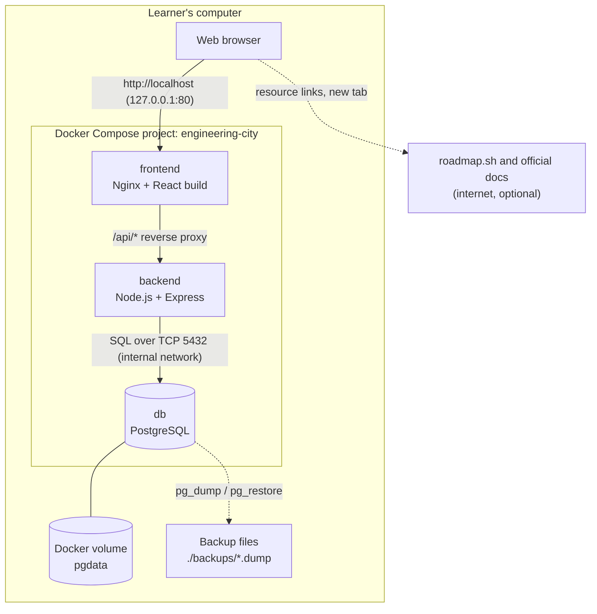
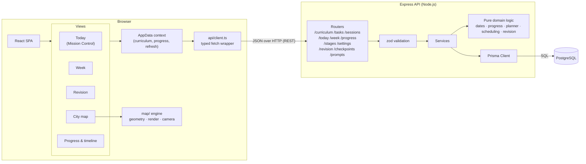
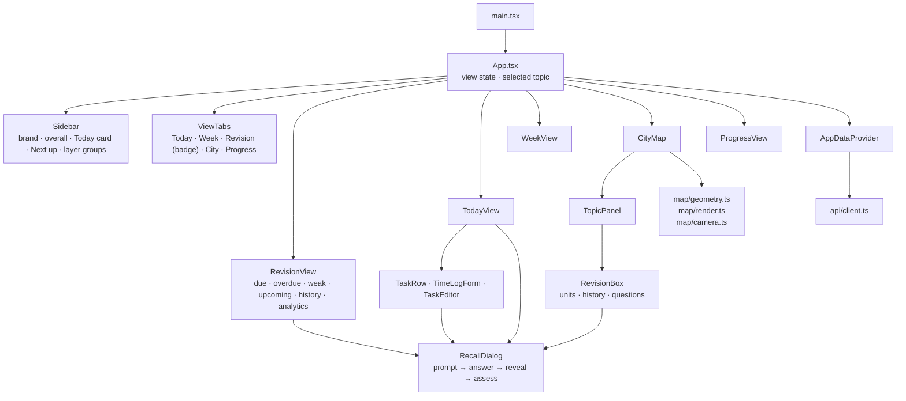
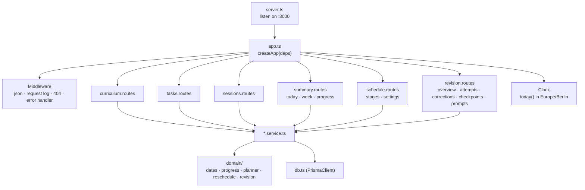
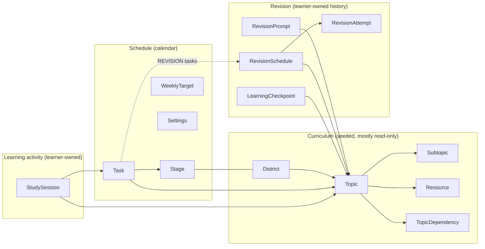
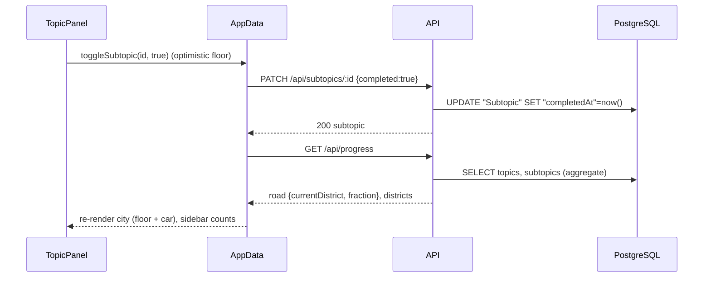
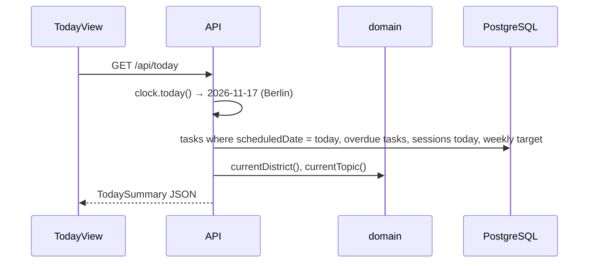
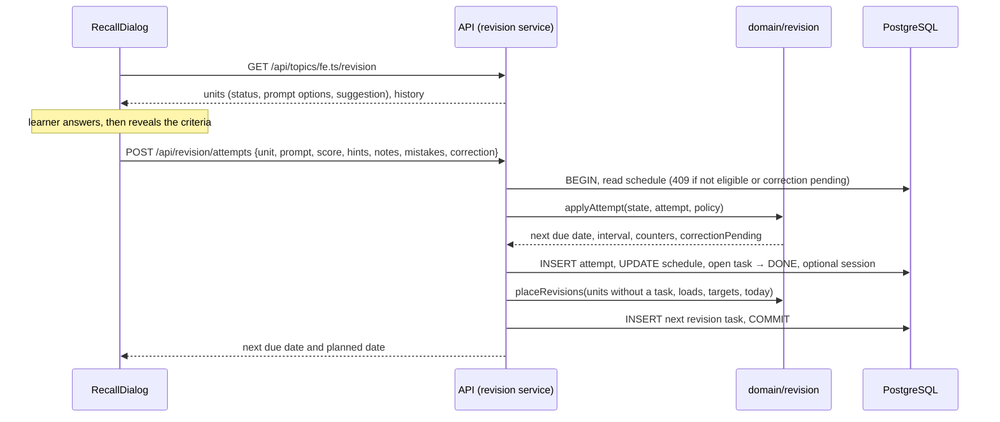
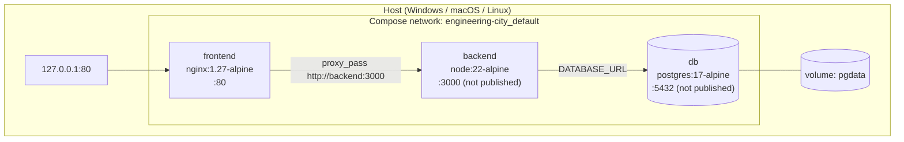
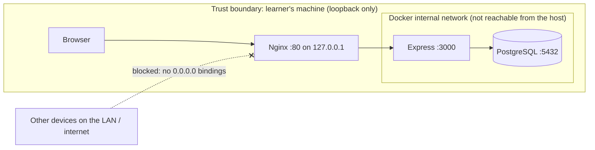

# 1. Introduction

This document describes the architecture that implements the requirements in `SRS.md`. It explains the system's parts, how they communicate, why each technology was chosen, and how the system is deployed and protected. Table, endpoint and module details are in `LLD.md`.

**Architectural style:** a small monolith with three containers: a static frontend served by Nginx, one Express API process and one PostgreSQL database. There are no other services. This is the simplest architecture that meets the requirements (NFR-12).

# 2. System context

| Actor or system | Interaction |
|---|---|
| Learner | Uses the app in a browser at `http://localhost`. This is the only user. |
| Browser | Downloads the static SPA and calls `/api/*` on the same origin. |
| External documentation | Opened only when the learner follows a resource link. The app never calls it. |

# 3. Overall architecture

The main design decision is **pure domain logic**. Date arithmetic, progress scoring, plan generation and rescheduling are pure TypeScript functions with no I/O. Services load rows through Prisma, call these functions and persist the results. As a result, the rules that matter most (BR-01 to BR-20, including the adaptive revision policy) can be unit-tested without a database.

Revision (SRS §3.9) follows the same pattern and adds no new infrastructure: one more router and service, one more pure domain module (`domain/revision.ts`), four tables, and revision tasks that live in the existing `Task` table. The curriculum planner and the revision scheduler stay separate: the planner decides what to learn and runs once; the revision scheduler decides what to retrieve again and runs after each learning or revision event.

# 4. Frontend architecture

| Concern | Decision |
|---|---|
| Framework | React 19 function components and hooks, built by Vite. |
| Styling | The existing CSS (tokens, components) moved into `styles.css` unchanged, plus a few new classes that use the same tokens. No CSS framework. |
| Map | The original SVG-string renderer is ported to typed, pure modules (`geometry.ts`, `render.ts`). `CityMap` owns pan, zoom and fly through refs and injects the rendered SVG into one `<g>`. This keeps the visuals exactly the same and keeps rendering fast. |
| State | React context (`AppDataProvider`) holds the curriculum and progress from the server and exposes `refresh()`. View-local state (the day being viewed, open editors) stays in components. There is no Redux or React Query (C-3). |
| Data flow | Every mutation is a REST call, followed by a re-fetch of the affected summaries. Sub-topic ticks update the UI optimistically for instant floors, and roll back on error. |
| Recall | One `RecallDialog` serves checkpoints, single revisions and interleaved sessions. It is rendered in a portal above the app, keeps the expected answer out of the page until the learner presses *Reveal*, and submits through the same `mutate()` path as every other change. The topic panel keeps a compact *Recall and revision* box per topic; the **Revision** view gives the cross-topic picture (due, overdue, weak, upcoming, history, analytics) and is the one place revision analytics appear, apart from learning and demonstration progress. The tab badge and the sidebar line are derived from the Today summary that is already loaded, so indicators need no extra polling. |
| Routing | A single page with a view switcher. The view is kept in the URL hash (`#/today`, `#/city/be.api`) so that reload and back work without a router library. |

# 5. Backend architecture

| Concern | Decision |
|---|---|
| Runtime | Node.js 22 LTS, TypeScript compiled to ES modules. |
| Framework | Express 5, which forwards rejected promises from async handlers to the error middleware. |
| Layering | Router (HTTP and validation) → service (orchestration and transactions) → domain (pure rules) and Prisma (persistence). |
| Validation | `zod` schemas for params, query strings and bodies. A failure returns `400` with field details. |
| Errors | A typed `HttpError(status, code, message)`. The central handler maps Prisma `P2025` to `404`, and anything else to `500` without leaking internals. |
| Clock | `Clock` is injected into `createApp`. Production uses the system time converted to Berlin. Tests and demos can set `APP_TODAY=YYYY-MM-DD` (FR-CAL-08, AC-08). |
| Seeding | `prisma/seed.ts` upserts the curriculum and its 83 revision prompts, generates the plan only when no plan tasks exist (FR-CUR-09, scheduling rule 7), and backfills revision schedules for anything learned before revision existed. Every step is idempotent. |
| Revision scheduling | Event-driven inside the request that changes learning state: ticking a sub-topic, demonstrating a topic, recording an attempt or confirming a correction runs `syncTopic` (eligibility) and `planOpenRevisions` (placement) in the same transaction. No background jobs or timers are needed. |

# 6. Database architecture

PostgreSQL holds three groups of tables:

The **calendar** (stages, tasks, targets) and **learning progress** (learned sub-topics and topic demonstrations) are stored separately, by design. Calendar dates never change learning state, and the car reads only learning state (FR-CAR-01, FR-CAR-04).

**Revision** is a third, separate dimension. A schedule records whether a unit can still be retrieved; it reads learned state (for eligibility) but never writes it, and nothing in the progress calculation reads revision data (FR-REV-18). Attempts are append-only history.

Derived values such as topic status, hours totals and road progress are **computed at read time** and never stored, so they cannot drift (BR-03). The data is small (83 topics, 342 sub-topics and 542 planned tasks), so these aggregates are cheap.

# 7. Data flow

## 7.1 Ticking a sub-topic

## 7.2 Opening Today

## 7.3 Recording a revision attempt

# 8. Main application components

| Component | Responsibility | Requirements |
|---|---|---|
| Sidebar | Brand, overall progress, Today card, Next up, district cards with building lists | FR-MAP-01, FR-TODAY-01 |
| CityMap | Isometric map, pan, zoom, fly, building selection, car, signposts | FR-MAP-*, FR-CAR-* |
| TopicPanel | Topic details, sub-topic checklist, demonstration, schedule a task | FR-MAP-04/06/10 |
| RevisionBox | Per-unit revision status, *Check* and *Revise*, correction, history, questions | FR-REV-16 |
| RecallDialog | Prompt, answer from memory, reveal, assessment, correction; single unit or interleaved session | FR-REV-06/07/17 |
| RevisionView | Revision section: counts, correction / overdue / due / weak / upcoming lists, session, history, recall analytics, allowance | FR-REV-15, FR-REV-19–21 |
| TodayView | Mission Control: tasks, target, time log, carried over, rest or buffer day | FR-TODAY-* |
| WeekView | Seven-day grid, totals, milestones | FR-WEEK-* |
| ProgressView | Hours, per-district progress, learned vs demonstrated, stage timeline and delays | FR-PROG-*, FR-CAL-05 |
| Curriculum service | Read the curriculum, toggle sub-topics, record demonstrations | FR-CUR-*, BR-13 |
| Task service | CRUD, status changes, reschedule, bulk reschedule | FR-TODAY-04–11, BR-08/10 |
| Session service | Record and delete study time | FR-TODAY-07, BR-11 |
| Summary service | Today, week and progress aggregates | FR-TODAY, FR-WEEK, FR-PROG |
| Schedule service | Stages, weekly targets, settings | FR-CAL-07, FR-SET-* |
| Planner (domain) | Generate the initial plan from the curriculum and stages | §6 of the SRS |
| Revision service | Eligibility sync, placement, attempts, corrections, checkpoints, prompts, topic revision view; read-only overview for the Revision section (`overview.ts`) | FR-REV-01–12, FR-REV-19–21 |
| Revision engine (domain) | `applyAttempt`, `placeRevisions`, `revisionOrder`, `interleave`, status derivation | BR-14–BR-18 |

# 9. Technology choices

| Technology | Why it was chosen | Alternatives rejected |
|---|---|---|
| React + TypeScript + Vite | Required stack. A fast dev server and a small production build. Strong typing for API contracts. | Angular (the learner already knows it; this project practises React). |
| Existing CSS | Preserves the design identity exactly (NFR-09) with no extra dependencies. | Tailwind or UI kits (would restyle the app). |
| SVG string renderer | Matches the original pixel for pixel and renders about 90 buildings in one DOM write. | Three.js or WebGL (forbidden by DESIGN.md), or JSX per polygon (slower and more code, with no benefit). |
| Express 5 | Minimal, well known, and native async error handling. It makes the HTTP layer explicit for learning. | NestJS (more structure than the project needs). |
| PostgreSQL | Required. Relational integrity, `DATE` type, transactions, and it matches the curriculum. | SQLite (would not exercise the database curriculum). |
| Prisma | Required. Typed client, declarative schema and versioned SQL migrations. | Raw `pg` (more boilerplate), TypeORM. |
| zod | Small runtime validation library with inferred TypeScript types. | Hand-written checks, class-validator. |
| Vitest + Supertest | One test runner for both packages. Supertest drives the real Express app. | Jest (slower to configure with ES modules). |
| Docker Compose | One command to start three services. Named volume for persistence. | Kubernetes (forbidden, oversized). |
| Nginx | Serves the static build and reverse-proxies `/api`, so frontend and API share one origin (no CORS). | Serving static files from Express (mixes concerns). |

# 10. REST API communication

- **Base path:** `/api`, on the same origin as the SPA, so CORS is not needed.
- **Format:** JSON (UTF-8). Dates are `YYYY-MM-DD` strings. Timestamps are ISO-8601 UTC strings.
- **Verbs:** `GET` reads, `POST` creates or runs actions, `PATCH` makes partial updates, `DELETE` removes.
- **Status codes:** `200` OK, `201` Created, `204` No Content, `400` validation error, `404` not found, `409` business-rule conflict (for example deleting a plan task), `500` unexpected error.
- **Error body:** `{ "error": { "code": "VALIDATION_ERROR", "message": "...", "details": [...] } }`.
- **Resource groups:** curriculum, tasks, sessions, summaries (today, week, progress), stages, settings, revision (overview, topic revision view, attempts, corrections), checkpoints, prompts, health. All of them are specified in `LLD.md` §4.

# 11. Local Docker deployment

| Service | Image | Start-up |
|---|---|---|
| `db` | `postgres:17-alpine` | Health check `pg_isready`. |
| `backend` | multi-stage `node:22-alpine`, runs as the unprivileged `node` user | Waits for `db` to be healthy, runs `prisma migrate deploy` and the idempotent seed (`node dist/prisma/seed.js`), then starts the server. Health check `GET /api/health`. |
| `frontend` | multi-stage build to `nginx:1.27-alpine` | Waits for the backend to be healthy. Serves `/` and proxies `/api`. |

Start the system with `docker compose up --build` and stop it with `docker compose down`. The data stays in the `pgdata` volume until `docker compose down -v`. `HTTP_PORT` (default 80) changes the loopback port, and `APP_TODAY` pins the clock for demos and tests. Neither is required.

# 12. Security boundaries

| Threat | Mitigation |
|---|---|
| Access from the network | The only published port is `127.0.0.1:80`. The API and the database are not published. |
| Invalid or malicious input | zod validation on every route. Prisma uses parameterised queries. Request body limit 100 kB. |
| XSS through curriculum or task text | React escapes text. The map renderer escapes every string it puts into SVG markup (`esc()`). Resource URLs are restricted to `http(s)` in validation. |
| Leaked secrets | The database password lives only in `.env`, which is git-ignored. `.env.example` uses placeholders. |
| Stack-trace disclosure | The error handler returns generic `500` messages and logs details to the server only. |
| Authentication | Deliberately absent. Single user, loopback only (SRS §9.2). |

# 13. Persistence and backup strategy

- **Primary store:** PostgreSQL data directory on the named volume `pgdata`.
- **Durability:** It survives container rebuilds and `docker compose down`. It is deleted only by `docker compose down -v` or `docker volume rm`.
- **Backup:** `pg_dump -Fc` runs inside the `db` container, and `docker compose cp` copies the file to `./backups/`. This is a logical backup in custom format and is consistent while the app is running. It avoids shell redirection, which corrupts binary output in Windows PowerShell 5.1.
- **Restore:** `docker compose cp` copies the dump into the container, then `pg_restore --clean --if-exists` runs against the database. The exact commands are in the README §4 and were verified by restoring into a scratch database.
- **Recommended cadence:** weekly, after the Saturday review. Keep the last four dumps.
- **Migrations:** Prisma migrations are versioned in `backend/prisma/migrations`. `migrate deploy` applies only the pending ones at start-up and never resets data.
- **Reset:** `docker compose down -v`, then `up`. The seed regenerates the curriculum and plan.
