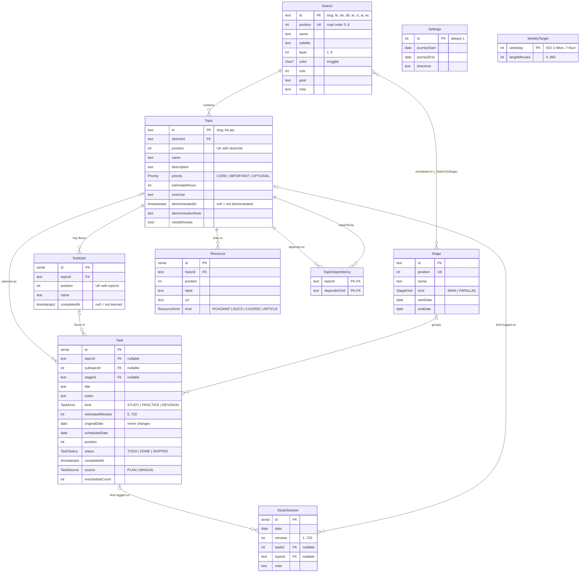

# 1. Introduction

This document specifies how the architecture in `HLD.md` is implemented. It is detailed enough to build and test against: tables, endpoints, payloads, validation, modules, and the exact algorithms for progress, scheduling and the vehicle. Requirement IDs refer to `SRS.md`.

# 2. Database design

## 2.1 Entity relationship diagram



## 2.2 Tables and relationships

| Table | Purpose | Key constraints | Relationships |
|---|---|---|---|
| `District` | One row per city district (7) | PK slug. `position` unique. `color` matches `^#[0-9a-f]{6}$`. `layer` 1–5. | 1:N `Topic`. M:N `Stage`. |
| `Topic` | A building | PK slug. Unique (`districtId`, `position`). `estimatedHours` > 0. | N:1 `District`. 1:N `Subtopic`, `Resource`, `Task`, `StudySession`. Self M:N through `TopicDependency`. |
| `Subtopic` | A floor | Unique (`topicId`, `position`) | N:1 `Topic`, cascade on delete |
| `Resource` | Link for a topic | Unique (`topicId`, `position`) | N:1 `Topic` |
| `TopicDependency` | Prerequisite edge | Composite PK | Both FKs to `Topic`, cascade |
| `Stage` | Calendar period | `endDate` ≥ `startDate` | M:N `District` (implicit table `_DistrictToStage`). 1:N `Task`. |
| `Task` | Scheduled activity | estimate 5–720. `status = DONE` ⇔ `completedAt IS NOT NULL`. `rescheduleCount` ≥ 0. | Optional FKs to `Topic`, `Subtopic`, `Stage` (SET NULL) |
| `StudySession` | Actual time | minutes 1–720 | Optional FKs to `Task` and `Topic` (SET NULL, so time history survives deletion of a manual task) |
| `Settings` | Singleton | `id = 1`. End after start. | — |
| `WeeklyTarget` | Target per ISO weekday | weekday 1–7, minutes 0–960 | — |

**Normalisation.** Every non-key attribute depends on the whole key (3NF). Derived data (topic status, hours totals, road progress, stage status) is not stored. The two intentional redundancies are:

- `Task.originalDate`, which is history and not derivable from anything else (FR-CAL-06).
- `StudySession.topicId`, which is copied from the task so that time stays attributed to a topic after a manual task is deleted.

**Indexes.** `Task(scheduledDate)` for day and week lookups, `Task(status, scheduledDate)` for overdue lookups, `Task(topicId)` and `Task(stageId)` for aggregates, and `StudySession(date)` for daily and weekly sums.

## 2.3 SQL schema (generated migration, abridged)

The authoritative DDL is `backend/prisma/migrations/20261117000000_init/migration.sql`. It is generated by `prisma migrate diff` and extended with the CHECK constraints:

```sql
CREATE TYPE "Priority"   AS ENUM ('CORE','IMPORTANT','OPTIONAL');
CREATE TYPE "TaskStatus" AS ENUM ('TODO','DONE','SKIPPED');
-- ... ResourceKind, StageKind, TaskKind, TaskSource

CREATE TABLE "Topic" (
  "id" TEXT PRIMARY KEY,
  "districtId" TEXT NOT NULL REFERENCES "District"("id") ON DELETE CASCADE,
  "position" INTEGER NOT NULL,
  "name" TEXT NOT NULL, "description" TEXT NOT NULL,
  "priority" "Priority" NOT NULL, "estimatedHours" INTEGER NOT NULL,
  "exercise" TEXT NOT NULL,
  "demonstratedAt" TIMESTAMPTZ(3), "demonstrationNote" TEXT,
  "needsReview" BOOLEAN NOT NULL DEFAULT false,
  UNIQUE ("districtId","position")
);

CREATE TABLE "Task" (
  "id" SERIAL PRIMARY KEY,
  "topicId" TEXT REFERENCES "Topic"("id") ON DELETE SET NULL,
  "subtopicId" INTEGER REFERENCES "Subtopic"("id") ON DELETE SET NULL,
  "stageId" TEXT REFERENCES "Stage"("id") ON DELETE SET NULL,
  "title" TEXT NOT NULL, "notes" TEXT NOT NULL DEFAULT '',
  "kind" "TaskKind" NOT NULL, "estimatedMinutes" INTEGER NOT NULL,
  "originalDate" DATE NOT NULL, "scheduledDate" DATE NOT NULL,
  "position" INTEGER NOT NULL DEFAULT 0,
  "status" "TaskStatus" NOT NULL DEFAULT 'TODO',
  "completedAt" TIMESTAMPTZ(3), "source" "TaskSource" NOT NULL,
  "rescheduleCount" INTEGER NOT NULL DEFAULT 0,
  "createdAt" TIMESTAMPTZ(3) NOT NULL DEFAULT CURRENT_TIMESTAMP,
  "updatedAt" TIMESTAMPTZ(3) NOT NULL
);
CREATE INDEX "Task_status_scheduledDate_idx" ON "Task"("status","scheduledDate");

ALTER TABLE "Task" ADD CONSTRAINT "Task_estimate_range"
  CHECK ("estimatedMinutes" BETWEEN 5 AND 720);
ALTER TABLE "Task" ADD CONSTRAINT "Task_done_has_timestamp"
  CHECK (("status" = 'DONE') = ("completedAt" IS NOT NULL));
ALTER TABLE "StudySession" ADD CONSTRAINT "StudySession_minutes_range"
  CHECK ("minutes" BETWEEN 1 AND 720);
ALTER TABLE "Settings" ADD CONSTRAINT "Settings_singleton" CHECK ("id" = 1);
```

# 3. Curriculum data representation

## 3.1 Source format

The curriculum is authored as typed TypeScript in `backend/src/curriculum/`, with one file per district plus `stages.ts`. The seed script and the tests import it.

```ts
interface TopicDef {
  slug: string;                 // "be.api", stable forever
  name: string;
  description: string;          // 1–3 sentences: what and why
  priority: "CORE" | "IMPORTANT" | "OPTIONAL";
  hours: number;                // whole hours incl. practice
  subtopics: string[];          // floors, in learning order
  exercise: string;             // the demonstration milestone
  resources: { label: string; url: string; kind: ResourceKind }[];
  dependsOn?: string[];         // topic slugs
}
interface DistrictDef {
  slug: string; name: string; subtitle: string; layer: 1|2|3|4|5;
  color: string; cols: number; goal: string; note: string;
  topics: TopicDef[];           // order = building order on the platform
}
interface StageDef {
  slug: string; name: string; kind: "MAIN" | "PARALLEL";
  start: string; end: string;   // YYYY-MM-DD
  districts: string[];
  queue: string;                // planner queue name
  weekdays: number[];           // eligible ISO weekdays (MAIN 1–6, PARALLEL [6])
}
```

## 3.2 Stability rules

- Topic slugs never change. The seed upserts by slug.
- Sub-topics and resources are upserted by (`topicId`, `position`). New ones are appended. When a list shrinks, the extra rows are deleted only if they have no learned state.
- The seed never overwrites learner-owned fields: `completedAt`, `demonstratedAt`, `demonstrationNote`, `needsReview`, any task, or any session.

## 3.3 Planner queues

| Queue | Topics, in order |
|---|---|
| `fe` | Frontend district topics, in order |
| `bedb` | Interleaved backend and database sequence (FR-CUR-05): `be.web`, `be.node`, `db.relational`, `be.express`, `be.api`, `db.sql`, `db.modelling`, `be.prisma`, `db.migrations`, `be.errors`, `db.transactions`, `be.auth`, `be.authz`, `be.security`, `db.indexes`, `be.testing`, `db.operations`, `be.caching`, `be.messaging`, `db.scaling` |
| `ar` | Architecture district topics, in order. Shared by the parallel and main architecture stages. |
| `cl`, `ai`, `ec` | District topics, in order |

Only `CORE` and `IMPORTANT` topics enter a queue.

# 4. REST API specification

Every route is under `/api`. Request and response bodies are JSON. Dates are `YYYY-MM-DD`.

## 4.1 Common types

```ts
type ISODate = string;                       // "2026-11-17"
type TopicStatus = "NOT_STARTED" | "IN_PROGRESS" | "LEARNED" | "DEMONSTRATED";

interface TaskDTO {
  id: number; title: string; notes: string;
  kind: "STUDY" | "PRACTICE" | "REVISION";
  status: "TODO" | "DONE" | "SKIPPED"; source: "PLAN" | "MANUAL";
  estimatedMinutes: number; loggedMinutes: number;
  originalDate: ISODate; scheduledDate: ISODate; rescheduleCount: number;
  completedAt: string | null; overdueDays: number;   // 0 unless overdue
  topic: { id: string; name: string; districtId: string } | null;
  subtopic: { id: number; name: string; completed: boolean } | null;
  stageId: string | null;
}
interface SessionDTO { id: number; date: ISODate; minutes: number;
  taskId: number | null; topicId: string | null; note: string; }
interface ErrorBody { error: { code: string; message: string; details?: unknown } }
```

## 4.2 Endpoints

| Method and path | Purpose | Request | Success | Errors |
|---|---|---|---|---|
| `GET /health` | Liveness and database check | — | `200 {status:"ok", today}` | `503` if the database is down |
| `GET /curriculum` | Full curriculum with learner state | — | `200 CurriculumDTO` | — |
| `PATCH /subtopics/:id` | Learn or unlearn a floor | `{completed: boolean}` | `200 {id, completedAt}` | `400`, `404` |
| `PATCH /topics/:id` | Demonstration and review flag | `{demonstrated?: boolean, demonstrationNote?: string ≤ 500, needsReview?: boolean}` | `200 TopicDTO` | `400`, `404` |
| `GET /today?date=` | Mission Control summary | optional `date` | `200 TodayDTO` | `400` |
| `GET /week?date=` | Week containing `date` (Mon–Sun) | optional `date` | `200 WeekDTO` | `400` |
| `GET /progress` | Progress, road and stage status | — | `200 ProgressDTO` | — |
| `GET /tasks/:id` | One task | — | `200 TaskDTO` | `404` |
| `GET /tasks?from&to&status&topicId` | List tasks | filters are optional; `from`/`to` range is at most 400 days | `200 TaskDTO[]` | `400` |
| `POST /tasks` | Create a manual task | `{title, scheduledDate, estimatedMinutes, kind?, topicId?, subtopicId?, notes?}` | `201 TaskDTO` | `400`, `404` (unknown topic) |
| `PATCH /tasks/:id` | Edit, complete or reschedule | `{title?, notes?, estimatedMinutes?, scheduledDate?, status?}` (at least one field) | `200 TaskDTO` | `400`, `404` |
| `DELETE /tasks/:id` | Delete a manual task | — | `204` | `404`, `409 PLAN_TASK_NOT_DELETABLE` |
| `POST /tasks/reschedule-overdue` | Move overdue tasks forward | `{}` | `200 {moved: [{id, from, to}]}` | — |
| `GET /sessions?from&to` | List study sessions | `from`, `to` | `200 SessionDTO[]` | `400` |
| `POST /sessions` | Record time | `{date, minutes, taskId?, topicId?, note?}` | `201 SessionDTO` | `400` (future date, range), `404` |
| `DELETE /sessions/:id` | Remove a wrong entry | — | `204` | `404` |
| `GET /stages` | Stages | — | `200 StageDTO[]` | — |
| `PATCH /stages/:id` | Edit stage dates | `{startDate?, endDate?}` | `200 StageDTO` | `400` (start > end, outside journey), `404` |
| `GET /settings` | Journey and targets | — | `200 SettingsDTO` | — |
| `PATCH /settings` | Change weekday targets | `{weeklyTargets: [{weekday, targetMinutes}]}` | `200 SettingsDTO` | `400` |

## 4.3 Main response structures

```ts
interface TopicDTO {
  id: string; districtId: string; position: number; name: string;
  description: string; priority: "CORE"|"IMPORTANT"|"OPTIONAL";
  estimatedHours: number; exercise: string; status: TopicStatus;
  demonstratedAt: string|null; demonstrationNote: string|null; needsReview: boolean;
  subtopics: { id: number; position: number; name: string; completedAt: string|null }[];
  resources: { label: string; url: string; kind: string }[];
  dependsOn: string[];
  plannedMinutes: number; loggedMinutes: number;
  firstDate: ISODate|null; lastDate: ISODate|null;  // planned window
}
interface CurriculumDTO {
  districts: (DistrictDTO & { topics: TopicDTO[] })[];
  stages: StageDTO[];
}
interface StageDTO { id: string; position: number; name: string; kind: "MAIN"|"PARALLEL";
  startDate: ISODate; endDate: ISODate; districtIds: string[]; }

interface TodayDTO {
  date: ISODate; today: ISODate; weekday: number;   // viewed date, server's today, ISO 1..7
  isRestDay: boolean; isBufferDay: boolean;
  journey: { start: ISODate; end: ISODate; day: number; totalDays: number;
             status: "BEFORE"|"ACTIVE"|"AFTER" };
  targetMinutes: number;                       // 0 outside the journey
  plannedMinutes: number; actualMinutes: number; doneMinutes: number;
  tasks: TaskDTO[];
  carriedOver: TaskDTO[];                      // only when date = today
  sessions: SessionDTO[];
  stages: StageDTO[];                          // active on this date
  current: { districtId: string|null; topicId: string|null };
  next: { topicId: string; subtopic: string|null } | null;
  reviewTopics: { id: string; name: string; districtId: string }[];
}

interface WeekDTO {
  weekStart: ISODate; weekEnd: ISODate; today: ISODate;
  days: { date: ISODate; weekday: number; inJourney: boolean; isRestDay: boolean;
          targetMinutes: number;                 // 0 outside the journey
          plannedMinutes: number; actualMinutes: number;
          tasksTotal: number; tasksDone: number }[];
  totals: { targetMinutes: number; plannedMinutes: number; actualMinutes: number;
            tasksDone: number; tasksRemaining: number; remainingMinutes: number };
  milestones: { date: ISODate; type: "PRACTICE"|"STAGE_END"; title: string;
                topicId: string|null; stageId: string|null; done: boolean }[];
  // one PRACTICE milestone per topic (its last practice part in the week; done when all parts are done)
  tasks: TaskDTO[];
}

interface ProgressDTO {
  today: ISODate;
  hours: { plannedTotal: number; plannedToDate: number; actualTotal: number;
           thisWeek: number; thisMonth: number };              // minutes
  weekly: { weekStart: ISODate; actualMinutes: number; plannedMinutes: number }[];
  monthly: { month: string; actualMinutes: number; plannedMinutes: number }[];
  districts: { id: string; subtopicsTotal: number; subtopicsLearned: number;
               topicsTotal: number; topicsLearned: number; topicsDemonstrated: number;
               coreTotal: number; coreLearned: number; coreDemonstrated: number;
               roadFraction: number; passed: boolean;
               plannedMinutes: number; actualMinutes: number }[];
  core: { total: number; learned: number; demonstrated: number };
  practice: { total: number; done: number };
  road: { currentDistrictIndex: number;   // 0..6, or 7 when finished
          districtFraction: number;       // 0..1
          overall: number;                // 0..1
          currentTopicId: string|null };
  stages: (StageDTO & { status: "UPCOMING"|"ON_TRACK"|"BEHIND"|"DELAYED"|"COMPLETE";
            delayDays: number; tasksTotal: number; tasksDone: number;
            minutesTotal: number; minutesDone: number;
            overdueTasks: number; bufferDays: number })[];
}
```

# 5. Validation rules

| Field | Rule |
|---|---|
| `:id` (task, session, sub-topic) | positive integer |
| `:id` (topic, stage) | `^[a-z0-9.-]{1,40}$` |
| `date`, `from`, `to`, `scheduledDate`, `startDate`, `endDate` | Must be a real calendar date in `YYYY-MM-DD` format; `2027-02-30` is rejected. |
| `from`/`to` | `from ≤ to`. Span ≤ 400 days. |
| `title` | trimmed, 1–200 characters |
| `notes`, `note`, `demonstrationNote` | ≤ 2,000 / 500 / 500 characters |
| `estimatedMinutes` | integer 5–720 |
| `minutes` (session) | integer 1–720. The session `date` must be ≤ today (Berlin). |
| `status` | `TODO`, `DONE` or `SKIPPED`. `SKIPPED` is allowed for any task. Deletion is only allowed for `MANUAL` tasks. |
| `weeklyTargets` | 1–7 items, unique `weekday` 1–7, `targetMinutes` 0–960 in steps of 15 |
| Stage dates | `startDate ≤ endDate`, both within the journey |
| Unknown body keys | Rejected (`.strict()`), to catch client bugs |

Validation failures return `400 {error:{code:"VALIDATION_ERROR", message, details:[{path, message}]}}`.

# 6. Backend module structure

```text
backend/
├── prisma/
│   ├── schema.prisma
│   ├── migrations/20261117000000_init/migration.sql
│   └── seed.ts                      # upsert curriculum, generate plan once
├── src/
│   ├── server.ts                    # bootstrap: config → prisma → createApp → listen
│   ├── app.ts                       # createApp({prisma, clock}) → express.Application
│   ├── config.ts                    # env parsing (PORT, DATABASE_URL, APP_TODAY)
│   ├── db.ts                        # PrismaClient singleton
│   ├── lib/
│   │   ├── clock.ts                 # Clock interface, berlinToday(), fixed clock
│   │   ├── http.ts                  # HttpError, validate(schema, value), error middleware
│   │   └── schemas.ts               # shared zod primitives (isoDate, id, slug)
│   ├── db.ts                        # PrismaClient factory, ISO date ↔ Date helpers
│   ├── domain/                      # pure, no I/O, unit tested
│   │   ├── dates.ts                 # ISO date arithmetic, weekday, week/month bounds
│   │   ├── progress.ts              # topicStatus, topicScore, districtProgress, road
│   │   ├── planner.ts               # buildPlan(curriculum, stages, targets)
│   │   └── reschedule.ts            # placeOverdue(tasks, load, targets, from)
│   ├── curriculum/                  # seed content
│   │   ├── types.ts  index.ts  stages.ts
│   │   └── frontend.ts backend.ts database.ts architecture.ts cloud.ts ai.ts consolidation.ts
│   └── modules/
│       ├── learning.ts                  # loads learner state per topic for the progress domain
│       ├── curriculum/{routes,service}.ts
│       ├── tasks/{routes,service,mapper}.ts
│       ├── sessions/routes.ts           # routes + small service
│       ├── summary/{routes,service}.ts      # today, week, progress
│       └── schedule/{routes,service}.ts     # stages, settings
└── tests/
    ├── unit/        dates · progress · planner · reschedule · curriculum
    └── integration/ api.test.ts (Supertest + PostgreSQL)
```

Each router builds its handlers from injected dependencies (`{prisma, clock}`), so the tests can pass a fixed clock.

# 7. Frontend component structure

```text
frontend/src/
├── main.tsx                 # mount <App/>
├── App.tsx                  # shell: Sidebar | main (ViewTabs + active view), hash routing
├── styles.css               # original tokens & components + new view styles
├── api/
│   ├── client.ts            # request<T>(), ApiError, endpoint functions
│   └── types.ts             # DTO types (mirror LLD §4)
├── state/
│   └── AppData.tsx          # context: curriculum, progress, refresh(), toggleSubtopic()
├── lib/
│   ├── format.ts            # hours "1 h 30", dates "Tue 17 Nov", month ranges
│   ├── layers.ts            # layer names (05 Consolidation added)
│   └── color.ts             # hx, mix, esc (from original)
├── map/
│   ├── geometry.ts          # constants, iso(), layout(districts) → blocks, waypoints
│   ├── vehicle.ts           # carPosition(layout, road) — pure
│   └── render.ts            # renderCity(layout, state) → SVG string (camera lives in CityMap)
└── components/
    ├── Sidebar.tsx          # brand, overall, TodayCard, NextUp, district cards
    ├── ViewTabs.tsx
    ├── CityMap.tsx          # svg host, camera (view box, fly), input, controls, tooltip, road chip
    ├── TopicPanel.tsx       # building details
    ├── TodayView.tsx        # Mission Control
    ├── TaskRow.tsx          # checkbox, meta, inline log-time / reschedule / edit forms
    ├── WeekView.tsx
    ├── ProgressView.tsx     # hours, districts, learned vs demonstrated, timeline
    ├── ui.tsx               # Bar, Stat, Loading
    └── __tests__/           # vehicle, render, format, TodayView
```

# 8. State management

| State | Owner | Lifetime |
|---|---|---|
| Curriculum and topic learner state | `AppData` context | Loaded at start. Patched optimistically by sub-topic and demonstration toggles. |
| Progress (`ProgressDTO`) | `AppData` | Loaded at start and re-fetched after every mutation (`refresh()`). |
| Today and Week DTOs | `TodayView` / `WeekView` local state | Fetched on mount, on date change and after their own mutations. A `version` counter from `AppData` triggers a re-fetch after mutations made elsewhere. |
| Active view and selected topic | `App`, mirrored in `location.hash` | URL |
| Camera (view box) | `CityMap` ref (not React state) | Component lifetime; avoids re-rendering on every pointer move |
| Open sidebar districts | `Sidebar` local state | Component lifetime |

An optimistic update applies the change locally, sends the request, and on failure restores the previous value and shows an inline error.

# 9. Task completion logic

```text
PATCH /tasks/:id {status}
  status = DONE    → completedAt = now()       (CHECK keeps the pair consistent)
  status = TODO    → completedAt = null
  status = SKIPPED → completedAt = null        (counts as neither done nor remaining)
  never touches Subtopic.completedAt or StudySession   (BR-12)

PATCH /tasks/:id {scheduledDate}
  if scheduledDate ≠ current: rescheduleCount += 1; originalDate unchanged (FR-CAL-06)

DELETE /tasks/:id
  source = PLAN → 409 PLAN_TASK_NOT_DELETABLE (use SKIPPED instead, BR-10)
```

In the UI, a task with a linked sub-topic shows a secondary checkbox, "Sub-topic learned". This keeps the two actions separate but one click apart.

# 10. Study-hour calculation logic

All sums are in minutes. They are converted to hours only for display (`h = m / 60`, one decimal place).

| Quantity | Formula |
|---|---|
| Day target | `WeeklyTarget[weekday].targetMinutes` |
| Day planned | Σ `estimatedMinutes` of tasks with `scheduledDate = d` and `status ≠ SKIPPED` |
| Day actual | Σ `StudySession.minutes` with `date = d` |
| Day done | Σ `estimatedMinutes` of tasks with `scheduledDate = d` and `status = DONE` |
| Week target / planned / actual | Σ over Monday to Sunday (Sunday's target is 0) |
| Remaining (week) | Σ estimate of `TODO` tasks scheduled in the week |
| Planned total | Σ estimate of all non-skipped tasks |
| Planned to date | Σ estimate of non-skipped tasks with `originalDate ≤ today`. Uses the original plan, so it shows schedule drift honestly. |
| Actual total | Σ all sessions |
| Weekly series | Actual and planned per ISO week from the journey start to the current week |
| Monthly series | Actual and planned per calendar month, Nov 2026 – Aug 2027 |
| Topic logged | Σ sessions with `topicId = t` |

# 11. Progress and vehicle logic

## 11.1 Topic status (BR-03)

```ts
function topicStatus(t): TopicStatus {
  if (t.demonstratedAt) return "DEMONSTRATED";
  const learned = t.subtopics.filter(s => s.completedAt).length;
  if (t.subtopics.length > 0 && learned === t.subtopics.length) return "LEARNED";
  if (learned > 0 || t.doneTasks > 0 || t.loggedMinutes > 0) return "IN_PROGRESS";
  return "NOT_STARTED";
}
```

## 11.2 Road progress (BR-04 to BR-06)

```ts
const LEARN_CAP = 0.8;
score(t)            = t.demonstrated ? 1 : LEARN_CAP * learned(t) / subtopics(t)
districtFraction(d) = Σ_core score(t)·hours(t) / Σ_core hours(t)   // 1 when there is no core
passed(d)           = every core topic in d is demonstrated
currentIndex        = first i with !passed(district[i])             // 7 when all are passed
overall             = (currentIndex + (currentIndex < 7 ? districtFraction(current) : 0)) / 7
```

Districts after the current one can have progress (for example Database work during the interleaved stage). That progress is shown in their bars but does not move the car until the earlier checkpoints are passed. The car represents the route travelled, in order.

## 11.3 Vehicle placement on the map

The road polyline is `W = [START, wp(0) … wp(6), GOAL]` with `wp(i) = origin(i) + (3, 3)`. Each segment `W[i] → W[i+1]` is axis-aligned. The car for current district `i` moves inside the visible **gap** in front of district `i`:

```ts
// axis a = "x" when W[i]→W[i+1] changes x, else "y"
zoneStart = i === 0 ? W[0][a] + 0.6 : platform(i-1).max[a] + 0.7
zoneEnd   = platform(i).min[a] - 0.7
pos[a]    = zoneStart + f · (zoneEnd - zoneStart)      // f = districtFraction
pos[other axis] = W[i+1][other axis]
finished  → pos = GOAL − (0, 1.6)
```

A demonstrated topic is drawn at full height with its roof cap, even if some sub-topics are unticked (BR-13). The panel still shows the real sub-topic state.

The car is drawn at depth `x + y` among the buildings, as in the original. Its pulse ring is the only animation. When the fraction changes, the car eases to its new position over 650 ms, or moves instantly under reduced motion.

The **current building** gets a dashed accent outline at its base (FR-MAP-07). **Month signposts**: for each district, the months of its main stage (for example `JAN–MAR`) are written in road-text style next to the gap in front of it. The architecture district also shows `SAT DEC–MAR` for its parallel stage.

# 12. Scheduling and date-handling logic

## 12.1 Dates

- Dates are handled as `YYYY-MM-DD` strings in the domain, and as UTC-midnight `Date` objects only at the Prisma boundary (`@db.Date`). As a result, no time-zone offset can shift a calendar date.
- `berlinToday(now)` = `Intl.DateTimeFormat("en-CA", {timeZone: "Europe/Berlin"}).format(now)`. This handles CET/CEST changes correctly. At 00:30 Berlin time, the date has already moved on, even though UTC is still on the previous day.
- `APP_TODAY` overrides the clock (tests and demos only).
- `isoWeekday(d)` gives 1 (Monday) to 7 (Sunday). `weekStart(d)` is the Monday on or before `d`.

## 12.2 Plan generation (`buildPlan`)

```text
input: stages (with queue, weekdays, start, end), curriculum, dayTarget = 240
reserved = every date covered by a PARALLEL stage on one of its weekdays
claimed = {}                                  # date → minutes used
for queue q in stage order:                   # fe, ar, bedb, cl, ai, ec
  chunks = for each topic in q (CORE|IMPORTANT):
             units = hours·2 (30-min units)
             practice = max(1, round(units·0.3)); study = units − practice
             share study over sub-topics (largest remainder; each ≥ 1 unit)
             emit [STUDY(sub, units)…, PRACTICE(exercise, practice)]
  days = for each stage s with s.queue = q (in position order):
           every date in [s.start, s.end] whose weekday ∈ s.weekdays
           and which is not a reserved parallel Saturday of another queue
  walk days in order; for each day, cap = dayTarget − claimed[day]
    while cap > 0 and chunks remain:
      take = min(chunk.remaining, cap, 120 min)
      emit Task(title = sub-topic name [+ " (part k)"], minutes = take,
                originalDate = scheduledDate = day, stage = s, position = n++)
      chunk.remaining −= take; cap −= take
  if chunks remain after the last day → throw PlanOverflowError(q)
```

Saturdays between 1 Dec 2026 and 31 Mar 2027 are **reserved** for the parallel architecture stage, so `fe` and `bedb` skip them. The architecture main stage continues the same queue from 1 Apr 2027.

## 12.3 Bulk rescheduling (`placeOverdue`)

```text
overdue = TODO tasks with scheduledDate < today, ordered by (originalDate, position)
load[d] = planned minutes on day d (non-skipped tasks)
d = today
for task in overdue:
  while weekday(d) = 7 or load[d] + task.minutes > target(d): d = d + 1
  move task to d; load[d] += task.minutes; rescheduleCount += 1
all updates in one transaction (NFR-11)
```

If a later day is already full, the search continues forward, so tasks drift into the buffer days at the end of the stage. That is exactly what the buffer is for.

## 12.4 Stage status

```text
todo     = stage tasks with status TODO
complete = todo is empty
DELAYED  if !complete and today > end        delayDays = today − end
UPCOMING if today < start
BEHIND   if active and any todo is overdue
ON_TRACK otherwise (COMPLETE when complete)
bufferDays = eligible days in the stage with no tasks originally planned
             (MAIN: Mon–Sat minus reserved Saturdays; PARALLEL: Saturdays)
```

# 13. Error handling

| Layer | Strategy |
|---|---|
| Validation | `validate()` throws `HttpError(400, "VALIDATION_ERROR", details)` |
| Not found | Services throw `HttpError(404, "NOT_FOUND")`. Prisma `P2025` is mapped to 404. |
| Business rules | `HttpError(409, code)`, for example `PLAN_TASK_NOT_DELETABLE` |
| Database CHECK violations | Mapped to 400 `CONSTRAINT_VIOLATION` (should never happen past validation) |
| Unexpected | Logged with the request id. The response is `500 INTERNAL_ERROR` with a generic message. |
| Malformed JSON | `400 INVALID_JSON` |
| Frontend | `ApiError` carries status and code. Views show an inline, non-blocking message ("Couldn't save. Try again"). Optimistic changes roll back. A failed initial load shows a full-panel retry state. |
| Start-up | The backend exits non-zero if migrations fail. Compose restarts it (`restart: unless-stopped`). The seed is idempotent. |

# 14. Testing strategy

| Level | Tool | Scope |
|---|---|---|
| Domain unit | Vitest | `dates` (Berlin edge cases, DST, weekdays, real-date validation), `progress` (status derivation, 80% cap, pass rule, current district), `planner` (no Sundays, ≤ 240/day, ≤ 120/task, stage fit, reserved Saturdays, interleaved order, determinism), `reschedule` (skips Sundays, respects capacity, keeps original dates), curriculum integrity (unique slugs, dependencies resolve, ≥ 1 resource, ≥ 1 sub-topic) |
| API integration | Vitest + Supertest + real PostgreSQL (each run creates its own schema, migrates it with `migrate deploy`, and drops it afterwards) | Seed, then run the SRS workflows: today summary, complete a task, log time, reschedule, overdue bulk move, delete rules, sub-topic toggle → road progress, demonstration → checkpoint, validation errors, stage delay with a fixed clock |
| Frontend unit | Vitest + Testing Library (jsdom) | `vehicle.carPosition` monotonic within the gap, `render` escapes text, `format` helpers, TodayView renders the tasks and the target from a mocked client |
| End-to-end (manual, scripted checklist) | Browser against `docker compose up` | AC-01 to AC-10 in SRS §10, including persistence across `down`/`up` |
| Container smoke | `docker compose ps` health checks, `curl http://localhost/api/health` | AC-01 |

## 14.1 Verification results (implementation, 17 Nov 2026)

| Suite | Result |
|---|---|
| Backend unit (`tests/unit`, 5 files) | 35 / 35 passed |
| Backend API integration (`tests/integration/api.test.ts`) | 16 / 16 passed against PostgreSQL 17 |
| Frontend (`src/__tests__`, 4 files) | 12 / 12 passed |
| Docker | `docker compose up --build` leads to `db`, `backend` and `frontend` all *healthy*. Only `127.0.0.1:80` is published. |
| Browser E2E (separate compose project, built images) | Open app (correct Berlin date) → complete a task → log 90 min → reschedule a task (original date kept) → week totals update → `down`/`up` keeps the data → demonstrate all Frontend core topics → checkpoint 1 ✓ and the car moves to the Backend gap → clock pinned to 2027-01-05 → Frontend stage "Delayed by 5 days", 76 tasks still `TODO`, car unchanged → mobile bottom sheet and deep link |
| Backup and restore | `pg_dump -Fc` and `pg_restore` into a scratch database restored all 542 tasks |
