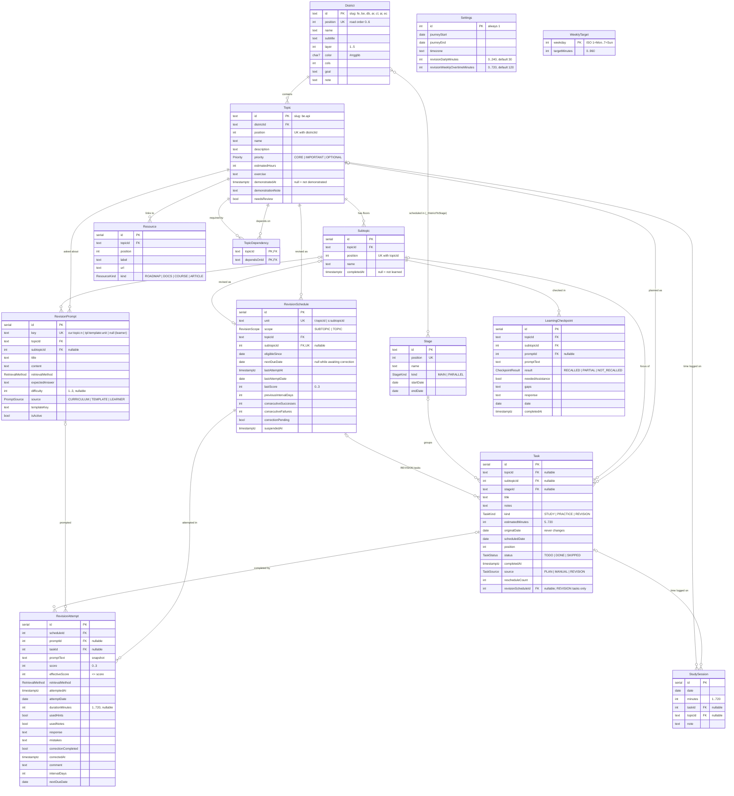

# 1. Introduction

This document specifies how the architecture in `HLD.md` is implemented. It is detailed enough to build and test against: tables, endpoints, payloads, validation, modules, and the exact algorithms for progress, scheduling and the vehicle. Requirement IDs refer to `SRS.md`.

# 2. Database design

## 2.1 Entity relationship diagram



## 2.2 Tables and relationships

| Table | Purpose | Key constraints | Relationships |
|---|---|---|---|
| `District` | One row per city district (7) | PK slug. `position` unique. `color` matches `^#[0-9a-f]{6}$`. `layer` 1–5. | 1:N `Topic`. M:N `Stage`. |
| `Topic` | A building | PK slug. Unique (`districtId`, `position`). `estimatedHours` > 0. | N:1 `District`. 1:N `Subtopic`, `Resource`, `Task`, `StudySession`. Self M:N through `TopicDependency`. |
| `Subtopic` | A floor | Unique (`topicId`, `position`) | N:1 `Topic`, cascade on delete |
| `Resource` | Link for a topic | Unique (`topicId`, `position`) | N:1 `Topic` |
| `TopicDependency` | Prerequisite edge | Composite PK | Both FKs to `Topic`, cascade |
| `Stage` | Calendar period | `endDate` ≥ `startDate` | M:N `District` (implicit table `_DistrictToStage`). 1:N `Task`. |
| `Task` | Scheduled activity | estimate 5–720. `status = DONE` ⇔ `completedAt IS NOT NULL`. `rescheduleCount` ≥ 0. | Optional FKs to `Topic`, `Subtopic`, `Stage` (SET NULL) |
| `StudySession` | Actual time | minutes 1–720 | Optional FKs to `Task` and `Topic` (SET NULL, so time history survives deletion of a manual task) |
| `Settings` | Singleton | `id = 1`. End after start. | — |
| `WeeklyTarget` | Target per ISO weekday | weekday 1–7, minutes 0–960 | — |
| `RevisionPrompt` | Question or challenge for retrieval | `key` unique; `key IS NULL` ⇔ `source = LEARNER`; difficulty 1–3; non-blank title and content | N:1 `Topic` (cascade), optional N:1 `Subtopic` (cascade). 1:N `RevisionAttempt`, `LearningCheckpoint` (SET NULL) |
| `RevisionSchedule` | State of one revision unit | `unit` unique and consistent with scope and ids (CHECK); `subtopicId` unique; counters ≥ 0; `lastScore` 0–3; `nextDueDate IS NOT NULL OR correctionPending` | N:1 `Topic`, optional 1:1 `Subtopic` (cascade). 1:N `RevisionAttempt` (cascade), 1:N `Task` (SET NULL) |
| `RevisionAttempt` | One retrieval attempt (history) | score 0–3, `effectiveScore` 0..score; duration 1–720; `correctedAt` ⇒ `correctionCompleted`; interval ≥ 0 | N:1 schedule; optional prompt and task (SET NULL) |
| `LearningCheckpoint` | Recall check during initial study | — | N:1 `Topic`, `Subtopic` (cascade); optional prompt (SET NULL) |

`Task` gains `revisionScheduleId` (CHECK: only on `kind = REVISION`) with a **partial unique index** `ON "Task"("revisionScheduleId") WHERE status = 'TODO' AND "revisionScheduleId" IS NOT NULL`, so a unit can never have two open revision tasks (REV-13, BR-20). `Settings` gains `revisionDailyMinutes` (0–240).

**Normalisation.** Every non-key attribute depends on the whole key (3NF). Derived data (topic status, hours totals, road progress, stage status) is not stored. The two intentional redundancies are:

- `Task.originalDate`, which is history and not derivable from anything else (FR-CAL-06).
- `StudySession.topicId`, which is copied from the task so that time stays attributed to a topic after a manual task is deleted.
- `RevisionAttempt.promptText`, a snapshot of the question as shown, so editing or switching off a prompt never rewrites history (REV-07).
- `RevisionSchedule.lastScore` and `lastAttemptDate`, copies of the latest attempt kept on the schedule so placement and the Today view need no per-unit history query.
- `RevisionSchedule.unit`, a key derived from scope and ids (CHECK keeps it consistent) that makes "one schedule per unit" a plain unique constraint.

**Indexes.** `Task(scheduledDate)` for day and week lookups, `Task(status, scheduledDate)` for overdue lookups, `Task(topicId)` and `Task(stageId)` for aggregates, `StudySession(date)` for daily and weekly sums, `Task(revisionScheduleId)` and the partial unique index above, `RevisionSchedule(topicId)`, `RevisionAttempt(scheduleId, attemptedAt)` for history and `RevisionAttempt(attemptDate)` for monthly figures.

## 2.3 SQL schema (generated migration, abridged)

The authoritative DDL is `backend/prisma/migrations/20261117000000_init/migration.sql`. It is generated by `prisma migrate diff` and extended with the CHECK constraints:

```sql
CREATE TYPE "Priority"   AS ENUM ('CORE','IMPORTANT','OPTIONAL');
CREATE TYPE "TaskStatus" AS ENUM ('TODO','DONE','SKIPPED');
-- ... ResourceKind, StageKind, TaskKind, TaskSource

CREATE TABLE "Topic" (
  "id" TEXT PRIMARY KEY,
  "districtId" TEXT NOT NULL REFERENCES "District"("id") ON DELETE CASCADE,
  "position" INTEGER NOT NULL,
  "name" TEXT NOT NULL, "description" TEXT NOT NULL,
  "priority" "Priority" NOT NULL, "estimatedHours" INTEGER NOT NULL,
  "exercise" TEXT NOT NULL,
  "demonstratedAt" TIMESTAMPTZ(3), "demonstrationNote" TEXT,
  "needsReview" BOOLEAN NOT NULL DEFAULT false,
  UNIQUE ("districtId","position")
);

CREATE TABLE "Task" (
  "id" SERIAL PRIMARY KEY,
  "topicId" TEXT REFERENCES "Topic"("id") ON DELETE SET NULL,
  "subtopicId" INTEGER REFERENCES "Subtopic"("id") ON DELETE SET NULL,
  "stageId" TEXT REFERENCES "Stage"("id") ON DELETE SET NULL,
  "title" TEXT NOT NULL, "notes" TEXT NOT NULL DEFAULT '',
  "kind" "TaskKind" NOT NULL, "estimatedMinutes" INTEGER NOT NULL,
  "originalDate" DATE NOT NULL, "scheduledDate" DATE NOT NULL,
  "position" INTEGER NOT NULL DEFAULT 0,
  "status" "TaskStatus" NOT NULL DEFAULT 'TODO',
  "completedAt" TIMESTAMPTZ(3), "source" "TaskSource" NOT NULL,
  "rescheduleCount" INTEGER NOT NULL DEFAULT 0,
  "createdAt" TIMESTAMPTZ(3) NOT NULL DEFAULT CURRENT_TIMESTAMP,
  "updatedAt" TIMESTAMPTZ(3) NOT NULL
);
CREATE INDEX "Task_status_scheduledDate_idx" ON "Task"("status","scheduledDate");

ALTER TABLE "Task" ADD CONSTRAINT "Task_estimate_range"
  CHECK ("estimatedMinutes" BETWEEN 5 AND 720);
ALTER TABLE "Task" ADD CONSTRAINT "Task_done_has_timestamp"
  CHECK (("status" = 'DONE') = ("completedAt" IS NOT NULL));
ALTER TABLE "StudySession" ADD CONSTRAINT "StudySession_minutes_range"
  CHECK ("minutes" BETWEEN 1 AND 720);
ALTER TABLE "Settings" ADD CONSTRAINT "Settings_singleton" CHECK ("id" = 1);
```

## 2.4 Revision migration (abridged)

`backend/prisma/migrations/20261118000000_revision/migration.sql` is additive: it creates four enums and four tables, adds two columns and the value `TaskSource.REVISION`, and needs no data migration. Existing learning state is picked up by the seed's backfill (§12.5.9). Migration `20261118120000_revision_weekly_cap` adds `Settings.revisionWeeklyOvertimeMinutes` (default 120, CHECK 0–720). The hand-written part:

```sql
CREATE UNIQUE INDEX "Task_one_open_revision_per_schedule" ON "Task"("revisionScheduleId")
  WHERE "status" = 'TODO' AND "revisionScheduleId" IS NOT NULL;
ALTER TABLE "Task" ADD CONSTRAINT "Task_revision_link_kind"
  CHECK ("revisionScheduleId" IS NULL OR "kind" = 'REVISION');
ALTER TABLE "RevisionSchedule" ADD CONSTRAINT "RevisionSchedule_unit_consistent" CHECK (
  ("scope" = 'TOPIC'    AND "subtopicId" IS NULL     AND "unit" = 't:' || "topicId") OR
  ("scope" = 'SUBTOPIC' AND "subtopicId" IS NOT NULL AND "unit" = 's:' || "subtopicId"));
ALTER TABLE "RevisionSchedule" ADD CONSTRAINT "RevisionSchedule_due_or_correction"
  CHECK ("nextDueDate" IS NOT NULL OR "correctionPending");
ALTER TABLE "RevisionAttempt" ADD CONSTRAINT "RevisionAttempt_score_range"
  CHECK ("score" BETWEEN 0 AND 3 AND "effectiveScore" BETWEEN 0 AND "score");
ALTER TABLE "RevisionPrompt" ADD CONSTRAINT "RevisionPrompt_key_matches_source"
  CHECK (("source" = 'LEARNER') = ("key" IS NULL));
-- plus ranges for difficulty, duration, counters, lastScore and Settings.revisionDailyMinutes
```

Prisma cannot express the partial index; `prisma migrate diff` would offer to drop it in a future generated migration, so generated diffs must be reviewed before they are committed.

# 3. Curriculum data representation

## 3.1 Source format

The curriculum is authored as typed TypeScript in `backend/src/curriculum/`, with one file per district plus `stages.ts`. The seed script and the tests import it.

```ts
interface TopicDef {
  slug: string;                 // "be.api", stable forever
  name: string;
  description: string;          // 1–3 sentences: what and why
  priority: "CORE" | "IMPORTANT" | "OPTIONAL";
  hours: number;                // whole hours incl. practice
  subtopics: string[];          // floors, in learning order
  exercise: string;             // the demonstration milestone
  resources: { label: string; url: string; kind: ResourceKind }[];
  dependsOn?: string[];         // topic slugs
}
interface DistrictDef {
  slug: string; name: string; subtitle: string; layer: 1|2|3|4|5;
  color: string; cols: number; goal: string; note: string;
  topics: TopicDef[];           // order = building order on the platform
}
interface StageDef {
  slug: string; name: string; kind: "MAIN" | "PARALLEL";
  start: string; end: string;   // YYYY-MM-DD
  districts: string[];
  queue: string;                // planner queue name
  weekdays: number[];           // eligible ISO weekdays (MAIN 1–6, PARALLEL [6])
}
```

## 3.2 Stability rules

- Topic slugs never change. The seed upserts by slug.
- Sub-topics and resources are upserted by (`topicId`, `position`). New ones are appended. When a list shrinks, the extra rows are deleted only if they have no learned state.
- The seed never overwrites learner-owned fields: `completedAt`, `demonstratedAt`, `demonstrationNote`, `needsReview`, any task, or any session.

## 3.3 Curriculum revision prompts

`backend/src/curriculum/prompts.ts` holds one topic-level prompt per topic (83), each with a retrieval method, a question that tests how the sub-topics fit together, and evaluation criteria (what a score of 3 covers). The seed upserts them with the key `cur:<topic>:<n>`; it updates the text but never the learner's `isActive` choice. A unit test checks that every topic has exactly one prompt.

The eight templates live in `backend/src/modules/revision/templates.ts`. A template is rendered for a unit ("*Generics (TypeScript)*", or for a topic "*TypeScript, and how Generics, Utility types and Narrowing work together*") and is stored the first time it is used, with the key `tpl:<template>:<unit>`, so attempts can reference it.

## 3.4 Planner queues

| Queue | Topics, in order |
|---|---|
| `fe` | Frontend district topics, in order |
| `bedb` | Interleaved backend and database sequence (FR-CUR-05): `be.web`, `be.node`, `db.relational`, `be.express`, `be.api`, `db.sql`, `db.modelling`, `be.prisma`, `db.migrations`, `be.errors`, `db.transactions`, `be.auth`, `be.authz`, `be.security`, `db.indexes`, `be.testing`, `db.operations`, `be.caching`, `be.messaging`, `db.scaling` |
| `ar` | Architecture district topics, in order. Shared by the parallel and main architecture stages. |
| `cl`, `ai`, `ec` | District topics, in order |

Only `CORE` and `IMPORTANT` topics enter a queue.

# 4. REST API specification

Every route is under `/api`. Request and response bodies are JSON. Dates are `YYYY-MM-DD`.

## 4.1 Common types

```ts
type ISODate = string;                       // "2026-11-17"
type TopicStatus = "NOT_STARTED" | "IN_PROGRESS" | "LEARNED" | "DEMONSTRATED";

interface TaskDTO {
  id: number; title: string; notes: string;
  kind: "STUDY" | "PRACTICE" | "REVISION";
  status: "TODO" | "DONE" | "SKIPPED"; source: "PLAN" | "MANUAL" | "REVISION";
  estimatedMinutes: number; loggedMinutes: number;
  originalDate: ISODate; scheduledDate: ISODate; rescheduleCount: number;
  completedAt: string | null; overdueDays: number;   // 0 unless overdue
  topic: { id: string; name: string; districtId: string } | null;
  subtopic: { id: number; name: string; completed: boolean } | null;
  stageId: string | null;
  revision: { scheduleId: number; scope: "SUBTOPIC" | "TOPIC"; weak: boolean;
              correctionPending: boolean; lastScore: number | null;
              dueDate: ISODate;            // = originalDate
              overdueDays: number } | null; // 0 unless TODO and due date < today
}
interface SessionDTO { id: number; date: ISODate; minutes: number;
  taskId: number | null; topicId: string | null; note: string; }
interface ErrorBody { error: { code: string; message: string; details?: unknown } }
```

## 4.2 Endpoints

| Method and path | Purpose | Request | Success | Errors |
|---|---|---|---|---|
| `GET /health` | Liveness and database check | — | `200 {status:"ok", today}` | `503` if the database is down |
| `GET /curriculum` | Full curriculum with learner state | — | `200 CurriculumDTO` | — |
| `PATCH /subtopics/:id` | Learn or unlearn a floor | `{completed: boolean}` | `200 {id, completedAt}` | `400`, `404` |
| `PATCH /topics/:id` | Demonstration and review flag | `{demonstrated?: boolean, demonstrationNote?: string ≤ 500, needsReview?: boolean}` | `200 TopicDTO` | `400`, `404` |
| `GET /today?date=` | Mission Control summary | optional `date` | `200 TodayDTO` | `400` |
| `GET /week?date=` | Week containing `date` (Mon–Sun) | optional `date` | `200 WeekDTO` | `400` |
| `GET /progress` | Progress, road and stage status | — | `200 ProgressDTO` | — |
| `GET /tasks/:id` | One task | — | `200 TaskDTO` | `404` |
| `GET /tasks?from&to&status&topicId` | List tasks | filters are optional; `from`/`to` range is at most 400 days | `200 TaskDTO[]` | `400` |
| `POST /tasks` | Create a manual task | `{title, scheduledDate, estimatedMinutes, kind?, topicId?, subtopicId?, notes?}` | `201 TaskDTO` | `400`, `404` (unknown topic) |
| `PATCH /tasks/:id` | Edit, complete or reschedule | `{title?, notes?, estimatedMinutes?, scheduledDate?, status?}` (at least one field) | `200 TaskDTO` | `400`, `404`, `409 ATTEMPT_REQUIRED` / `REVISION_NOT_SKIPPABLE` / `REVISION_RECORDED` (revision tasks) |
| `DELETE /tasks/:id` | Delete a manual task | — | `204` | `404`, `409 PLAN_TASK_NOT_DELETABLE`, `409 REVISION_TASK_NOT_DELETABLE` |
| `POST /tasks/reschedule-overdue` | Move overdue tasks forward | `{}` | `200 {moved: [{id, from, to}]}` | — |
| `GET /sessions?from&to` | List study sessions | `from`, `to` | `200 SessionDTO[]` | `400` |
| `POST /sessions` | Record time | `{date, minutes, taskId?, topicId?, note?}` | `201 SessionDTO` | `400` (future date, range), `404` |
| `DELETE /sessions/:id` | Remove a wrong entry | — | `204` | `404` |
| `GET /stages` | Stages | — | `200 StageDTO[]` | — |
| `PATCH /stages/:id` | Edit stage dates | `{startDate?, endDate?}` | `200 StageDTO` | `400` (start > end, outside journey), `404` |
| `GET /settings` | Journey and targets | — | `200 SettingsDTO` | — |
| `PATCH /settings` | Change weekday targets and/or the revision allowances | `{weeklyTargets?: [{weekday, targetMinutes}], revisionDailyMinutes?: 0–240, revisionWeeklyOvertimeMinutes?: 0–720}` (steps of 5) | `200 SettingsDTO` | `400` |
| `GET /revision/overview` | Revision section (read-only) | — | `200 RevisionOverviewDTO` | — |
| `GET /topics/:id/revision` | Revision view of one topic | — | `200 TopicRevisionDTO` | `404` |
| `POST /revision/attempts` | Record an assessed attempt | `{topicId, subtopicId?, promptId \| templateKey, retrievalMethod, score 0–3, usedHints, usedNotes, correctionCompleted?, durationMinutes?, response?, mistakes?, comment?}` | `201 AttemptResultDTO` | `400` (no gap for score 0–1, prompt of another unit), `404`, `409 NOT_ELIGIBLE`, `409 CORRECTION_REQUIRED`, `409 ALREADY_ATTEMPTED_TODAY` |
| `POST /revision/attempts/:id/correction` | Confirm the correction of a failed attempt | `{mistakes?}` | `200 {id, correctionCompleted, nextDueDate, nextTaskDate}` | `404`, `409 NOTHING_TO_CORRECT` |
| `POST /checkpoints` | Record a recall check | `{topicId, subtopicId, promptId \| templateKey, result, neededAssistance, gaps?, response?}` | `201 CheckpointDTO` | `400`, `404` |
| `POST /prompts` | Add a learner question | `{topicId, subtopicId?, title?, content, retrievalMethod, expectedAnswer, difficulty?}` | `201 PromptDTO` | `400`, `404` |
| `PATCH /prompts/:id` | Edit a learner question, or switch any prompt on/off | any of `title, content, retrievalMethod, expectedAnswer, difficulty, isActive` | `200 PromptDTO` | `404`, `409 PROMPT_READ_ONLY` |
| `DELETE /prompts/:id` | Delete an unused learner question | — | `204` | `404`, `409 PROMPT_READ_ONLY`, `409 PROMPT_IN_USE` |

## 4.3 Main response structures

```ts
interface TopicDTO {
  id: string; districtId: string; position: number; name: string;
  description: string; priority: "CORE"|"IMPORTANT"|"OPTIONAL";
  estimatedHours: number; exercise: string; status: TopicStatus;
  demonstratedAt: string|null; demonstrationNote: string|null; needsReview: boolean;
  subtopics: { id: number; position: number; name: string; completedAt: string|null }[];
  resources: { label: string; url: string; kind: string }[];
  dependsOn: string[];
  plannedMinutes: number; loggedMinutes: number;
  firstDate: ISODate|null; lastDate: ISODate|null;  // planned window
}
interface CurriculumDTO {
  districts: (DistrictDTO & { topics: TopicDTO[] })[];
  stages: StageDTO[];
}
interface StageDTO { id: string; position: number; name: string; kind: "MAIN"|"PARALLEL";
  startDate: ISODate; endDate: ISODate; districtIds: string[]; }

interface TodayDTO {
  date: ISODate; today: ISODate; weekday: number;   // viewed date, server's today, ISO 1..7
  isRestDay: boolean; isBufferDay: boolean;
  journey: { start: ISODate; end: ISODate; day: number; totalDays: number;
             status: "BEFORE"|"ACTIVE"|"AFTER" };
  targetMinutes: number;                       // 0 outside the journey
  plannedMinutes: number; actualMinutes: number; doneMinutes: number;
  tasks: TaskDTO[];
  carriedOver: TaskDTO[];                      // only when date = today
  sessions: SessionDTO[];
  stages: StageDTO[];                          // active on this date
  current: { districtId: string|null; topicId: string|null };
  next: { topicId: string; subtopic: string|null } | null;
  reviewTopics: { id: string; name: string; districtId: string }[];
  revision: {
    plannedMinutes: number; learningMinutes: number; dailyAllowanceMinutes: number;
    competing: boolean;                        // target > 0 and learning + revision > target
    dueCount: number; overdueCount: number; weakCount: number; awaitingCorrection: number;
    backlog: { count: number; oldestDue: ISODate|null };  // due by this date, planned later
    optional: TaskDTO[];                       // up to 20 of the backlog (offered as optional)
    sessionTaskIds: number[];                  // open revision tasks today + carried over, prioritised and interleaved
  };
}

interface WeekDTO {
  weekStart: ISODate; weekEnd: ISODate; today: ISODate;
  days: { date: ISODate; weekday: number; inJourney: boolean; isRestDay: boolean;
          targetMinutes: number;                 // 0 outside the journey
          plannedMinutes: number; actualMinutes: number;
          tasksTotal: number; tasksDone: number;
          revisionTasks: number; revisionPlannedMinutes: number; revisionDoneMinutes: number }[];
  totals: { targetMinutes: number; plannedMinutes: number; actualMinutes: number;
            tasksDone: number; tasksRemaining: number; remainingMinutes: number };
  revision: { plannedMinutes: number; doneMinutes: number;
              dueThisWeek: number;             // revision tasks whose due date is in the week
              overdue: number };               // open revision tasks due before today (all weeks)
  milestones: { date: ISODate; type: "PRACTICE"|"STAGE_END"; title: string;
                topicId: string|null; stageId: string|null; done: boolean }[];
  // one PRACTICE milestone per topic (its last practice part in the week; done when all parts are done)
  tasks: TaskDTO[];
}

interface ProgressDTO {
  today: ISODate;
  hours: { plannedTotal: number; plannedToDate: number; actualTotal: number;
           thisWeek: number; thisMonth: number };              // minutes
  weekly: { weekStart: ISODate; actualMinutes: number; plannedMinutes: number }[];
  monthly: { month: string; actualMinutes: number; plannedMinutes: number }[];
  districts: { id: string; subtopicsTotal: number; subtopicsLearned: number;
               topicsTotal: number; topicsLearned: number; topicsDemonstrated: number;
               coreTotal: number; coreLearned: number; coreDemonstrated: number;
               roadFraction: number; passed: boolean;
               plannedMinutes: number; actualMinutes: number }[];
  core: { total: number; learned: number; demonstrated: number };
  practice: { total: number; done: number };
  road: { currentDistrictIndex: number;   // 0..6, or 7 when finished
          districtFraction: number;       // 0..1
          overall: number;                // 0..1
          currentTopicId: string|null };
  stages: (StageDTO & { status: "UPCOMING"|"ON_TRACK"|"BEHIND"|"DELAYED"|"COMPLETE";
            delayDays: number; tasksTotal: number; tasksDone: number;
            minutesTotal: number; minutesDone: number;
            overdueTasks: number; bufferDays: number })[];
  revision: { attempts: number; successful: number;        // score >= 2
              distribution: [number, number, number, number]; checkpoints: number;
              activeUnits: number; dueToday: number; overdue: number; awaitingCorrection: number;
              dailyAllowanceMinutes: number;
              monthly: { month: string; attempts: number; successful: number; averageScore: number|null }[];
              weakUnits: { scheduleId: number; topicId: string; subtopicId: number|null; scope: string;
                           label: string; lastScore: number|null; consecutiveFailures: number;
                           nextDueDate: ISODate|null }[] };
}

interface TopicRevisionDTO {
  topicId: string; today: ISODate;
  policy: { subtopicMinutes: number; topicMinutes: number; dailyBudgetMinutes: number };
  units: {                                     // [whole topic, ...sub-topics in order]
    unit: string; scope: "TOPIC"|"SUBTOPIC"; subtopicId: number|null; label: string;
    learned: boolean; eligible: boolean;
    schedule: { id: number; status: "SCHEDULED"|"DUE"|"OVERDUE"|"AWAITING_CORRECTION"|"SUSPENDED";
                nextDueDate: ISODate|null; lastAttemptDate: ISODate|null; lastScore: number|null;
                consecutiveSuccesses: number; consecutiveFailures: number; weak: boolean;
                correctionPending: boolean; pendingAttemptId: number|null;
                openTask: { id: number; scheduledDate: ISODate }|null; attempts: number } | null;
    options: { promptId: number|null; templateKey: string|null; source: "CURRICULUM"|"TEMPLATE"|"LEARNER";
               title: string; content: string; retrievalMethod: string; expectedAnswer: string;
               difficulty: number|null; isActive: boolean; uses: number; lastUsedDate: ISODate|null }[];
    suggested: number;                         // index into options: least used, then least recently used
  }[];
  attempts: AttemptDTO[];                      // newest first, all units of the topic
  checkpoints: CheckpointDTO[];                // newest 30
  prompts: PromptDTO[];                        // curriculum and learner prompts
}

interface RevisionUnitRowDTO {
  scheduleId: number; topicId: string; topicName: string; districtId: string;
  subtopicId: number|null; scope: "SUBTOPIC"|"TOPIC"; label: string;
  status: "SCHEDULED"|"DUE"|"OVERDUE"|"AWAITING_CORRECTION";
  nextDueDate: ISODate|null; overdueDays: number;
  lastAttemptDate: ISODate|null; lastScore: number|null; consecutiveSuccesses: number;
  weak: boolean; correctionPending: boolean; pendingAttemptId: number|null;
  openTask: { id: number; scheduledDate: ISODate }|null;
}
interface RevisionOverviewDTO {
  today: ISODate; upcomingDays: 14; dailyAllowanceMinutes: number;
  counts: { due: number; overdue: number; upcoming: number; later: number; weak: number;
            awaitingCorrection: number; active: number; paused: number };
  overdue: RevisionUnitRowDTO[];               // due < today, by revision priority (weak first)
  due: RevisionUnitRowDTO[];                   // due = today
  upcoming: RevisionUnitRowDTO[];              // today < due <= today + 14, by date
  weak: RevisionUnitRowDTO[];                  // any status
  awaitingCorrection: RevisionUnitRowDTO[];
  session: { topicId: string; scope: string; subtopicId: number|null }[];  // overdue + due, not blocked, interleaved
  history: (AttemptDTO & { topicId: string; topicName: string })[];        // newest 50
  checkpoints: { id: number; topicId: string; topicName: string; subtopicId: number; label: string;
                 result: string; neededAssistance: boolean; gaps: string; date: ISODate }[]; // newest 20
}

interface AttemptResultDTO {
  attempt: AttemptDTO; nextDueDate: ISODate|null; nextTaskDate: ISODate|null;
  correctionPending: boolean; intervalDays: number; effectiveScore: number;
}
```

# 5. Validation rules

| Field | Rule |
|---|---|
| `:id` (task, session, sub-topic) | positive integer |
| `:id` (topic, stage) | `^[a-z0-9.-]{1,40}$` |
| `date`, `from`, `to`, `scheduledDate`, `startDate`, `endDate` | Must be a real calendar date in `YYYY-MM-DD` format; `2027-02-30` is rejected. |
| `from`/`to` | `from ≤ to`. Span ≤ 400 days. |
| `title` | trimmed, 1–200 characters |
| `notes`, `note`, `demonstrationNote` | ≤ 2,000 / 500 / 500 characters |
| `estimatedMinutes` | integer 5–720 |
| `minutes` (session) | integer 1–720. The session `date` must be ≤ today (Berlin). |
| `status` | `TODO`, `DONE` or `SKIPPED`. `SKIPPED` is allowed for any task. Deletion is only allowed for `MANUAL` tasks. |
| `weeklyTargets` | 1–7 items, unique `weekday` 1–7, `targetMinutes` 0–960 in steps of 15 |
| Stage dates | `startDate ≤ endDate`, both within the journey |
| `revisionDailyMinutes` | integer 0–240 in steps of 5 |
| Attempt | `score` 0–3; `retrievalMethod` one of the six methods; exactly one of `promptId` / `templateKey` (`^[a-z]{1,20}$`, must name a template); the prompt must belong to the same unit; `mistakes` required for score 0–1; `durationMinutes` 1–720; `response` ≤ 5,000, `mistakes` ≤ 2,000, `comment` ≤ 1,000 |
| Checkpoint | `subtopicId` must belong to `topicId`; `result` `RECALLED`/`PARTIAL`/`NOT_RECALLED`; exactly one prompt reference |
| Prompt | `content` 5–2,000 characters, `expectedAnswer` 1–4,000, `title` ≤ 120, `difficulty` 1–3 |
| Unknown body keys | Rejected (`.strict()`), to catch client bugs |

Validation failures return `400 {error:{code:"VALIDATION_ERROR", message, details:[{path, message}]}}`.

# 6. Backend module structure

```text
backend/
├── prisma/
│   ├── schema.prisma
│   ├── migrations/20261117000000_init/migration.sql
│   ├── migrations/20261118000000_revision/migration.sql
│   └── seed.ts                      # upsert curriculum + prompts, generate plan once, backfill revision
├── src/
│   ├── server.ts                    # bootstrap: config → prisma → createApp → listen
│   ├── app.ts                       # createApp({prisma, clock}) → express.Application
│   ├── config.ts                    # env parsing (PORT, DATABASE_URL, APP_TODAY)
│   ├── db.ts                        # PrismaClient singleton
│   ├── lib/
│   │   ├── clock.ts                 # Clock interface, berlinToday(), fixed clock
│   │   ├── http.ts                  # HttpError, validate(schema, value), error middleware
│   │   └── schemas.ts               # shared zod primitives (isoDate, id, slug)
│   ├── db.ts                        # PrismaClient factory, ISO date ↔ Date helpers
│   ├── domain/                      # pure, no I/O, unit tested
│   │   ├── dates.ts                 # ISO date arithmetic, weekday, week/month bounds
│   │   ├── progress.ts              # topicStatus, topicScore, districtProgress, road
│   │   ├── planner.ts               # buildPlan(curriculum, stages, targets)
│   │   ├── reschedule.ts            # placeOverdue(tasks, load, targets, from)
│   │   └── revision.ts              # REVISION_POLICY, applyAttempt, placeRevisions, interleave, status
│   ├── curriculum/                  # seed content
│   │   ├── types.ts  index.ts  stages.ts  prompts.ts
│   │   └── frontend.ts backend.ts database.ts architecture.ts cloud.ts ai.ts consolidation.ts
│   └── modules/
│       ├── learning.ts                  # loads learner state per topic for the progress domain
│       ├── curriculum/{routes,service}.ts
│       ├── tasks/{routes,service,mapper}.ts
│       ├── sessions/routes.ts           # routes + small service
│       ├── summary/{routes,service}.ts      # today, week, progress
│       ├── schedule/{routes,service}.ts     # stages, settings
│       └── revision/{routes,service,templates,overview}.ts  # eligibility, placement, attempts, checkpoints, prompts, overview
└── tests/
    ├── unit/        dates · progress · planner · reschedule · revision · curriculum
    └── integration/ api.test.ts · revision.test.ts (Supertest + PostgreSQL)
```

Each router builds its handlers from injected dependencies (`{prisma, clock}`), so the tests can pass a fixed clock.

# 7. Frontend component structure

```text
frontend/src/
├── main.tsx                 # mount <App/>
├── App.tsx                  # shell: Sidebar | main (ViewTabs + active view), hash routing
├── styles.css               # original tokens & components + new view styles
├── api/
│   ├── client.ts            # request<T>(), ApiError, endpoint functions
│   └── types.ts             # DTO types (mirror LLD §4)
├── state/
│   └── AppData.tsx          # context: curriculum, progress, refresh(), toggleSubtopic()
├── lib/
│   ├── format.ts            # hours "1 h 30", dates "Tue 17 Nov", month ranges
│   ├── layers.ts            # layer names (05 Consolidation added)
│   └── color.ts             # hx, mix, esc (from original)
├── map/
│   ├── geometry.ts          # constants, iso(), layout(districts) → blocks, waypoints
│   ├── vehicle.ts           # carPosition(layout, road) — pure
│   └── render.ts            # renderCity(layout, state) → SVG string (camera lives in CityMap)
└── components/
    ├── Sidebar.tsx          # brand, overall, TodayCard, NextUp, district cards
    ├── ViewTabs.tsx
    ├── CityMap.tsx          # svg host, camera (view box, fly), input, controls, tooltip, road chip
    ├── TopicPanel.tsx       # building details
    ├── TodayView.tsx        # Mission Control
    ├── TaskRow.tsx          # checkbox (or revision mark + Revise), meta, inline log-time / reschedule / edit forms
    ├── RevisionBox.tsx      # topic panel: units, Check / Revise / Corrected, history, questions
    ├── RecallDialog.tsx     # prompt → answer → reveal → assess → correct; single unit or session
    ├── RevisionView.tsx     # Revision section: lists, session, history, recall analytics, allowances
    ├── RevisionStatus.tsx   # shared status vocabulary (one primary state + Weak flag)
    ├── WeekView.tsx
    ├── ProgressView.tsx     # hours, districts, learned vs demonstrated, timeline
    ├── ui.tsx               # Bar, Stat, Loading
    └── __tests__/           # vehicle, render, format, TodayView, RecallDialog, RevisionView, RevisionStatus
```

# 8. State management

| State | Owner | Lifetime |
|---|---|---|
| Curriculum and topic learner state | `AppData` context | Loaded at start. Patched optimistically by sub-topic and demonstration toggles. |
| Progress (`ProgressDTO`) | `AppData` | Loaded at start and re-fetched after every mutation (`refresh()`). |
| Today and Week DTOs | `TodayView` / `WeekView` local state | Fetched on mount, on date change and after their own mutations. A `version` counter from `AppData` triggers a re-fetch after mutations made elsewhere. |
| Active view and selected topic | `App`, mirrored in `location.hash` | URL |
| Camera (view box) | `CityMap` ref (not React state) | Component lifetime; avoids re-rendering on every pointer move |
| Open sidebar districts | `Sidebar` local state | Component lifetime |

An optimistic update applies the change locally, sends the request, and on failure restores the previous value and shows an inline error.

# 9. Task completion logic

```text
PATCH /tasks/:id {status}
  status = DONE    → completedAt = now()       (CHECK keeps the pair consistent)
  status = TODO    → completedAt = null
  status = SKIPPED → completedAt = null        (counts as neither done nor remaining)
  never touches Subtopic.completedAt or StudySession   (BR-12)

PATCH /tasks/:id {scheduledDate}
  if scheduledDate ≠ current: rescheduleCount += 1; originalDate unchanged (FR-CAL-06)

DELETE /tasks/:id
  source = PLAN → 409 PLAN_TASK_NOT_DELETABLE (use SKIPPED instead, BR-10)
  source = REVISION → 409 REVISION_TASK_NOT_DELETABLE

Revision tasks (revisionScheduleId set): status follows attempts only
  PATCH {status: DONE}    → 409 ATTEMPT_REQUIRED (completed only by POST /revision/attempts, FR-REV-08)
  PATCH {status: SKIPPED} → 409 REVISION_NOT_SKIPPABLE (it stays due; move it instead)
  PATCH {status: TODO}    → 409 REVISION_RECORDED (a recorded revision is history; reopening it
                            would also collide with the next cycle's open task)
  PATCH {scheduledDate}   → allowed; originalDate (= due date) unchanged, so it stays overdue (REV-18)
  POST /revision/attempts → open task: status DONE, completedAt = now, scheduledDate = today
                            (counted on the day it was done; early or late)
  Title in TaskDTO        → derived from the unit's current names ("Revise: <sub-topic>"), not stored text
```

In the UI, a task with a linked sub-topic shows a secondary checkbox, "Sub-topic learned". This keeps the two actions separate but one click apart.

# 10. Study-hour calculation logic

All sums are in minutes. They are converted to hours only for display (`h = m / 60`, one decimal place).

| Quantity | Formula |
|---|---|
| Day target | `WeeklyTarget[weekday].targetMinutes` |
| Day planned | Σ `estimatedMinutes` of tasks with `scheduledDate = d` and `status ≠ SKIPPED` |
| Day actual | Σ `StudySession.minutes` with `date = d` |
| Day done | Σ `estimatedMinutes` of tasks with `scheduledDate = d` and `status = DONE` |
| Week target / planned / actual | Σ over Monday to Sunday (Sunday's target is 0) |
| Remaining (week) | Σ estimate of `TODO` tasks scheduled in the week |
| Planned total | Σ estimate of all non-skipped tasks |
| Planned to date | Σ estimate of non-skipped tasks with `originalDate ≤ today`. Uses the original plan, so it shows schedule drift honestly. |
| Actual total | Σ all sessions |
| Weekly series | Actual and planned per ISO week from the journey start to the current week |
| Monthly series | Actual and planned per calendar month, Nov 2026 – Aug 2027 |
| Topic logged | Σ sessions with `topicId = t` |

# 11. Progress and vehicle logic

## 11.1 Topic status (BR-03)

```ts
function topicStatus(t): TopicStatus {
  if (t.demonstratedAt) return "DEMONSTRATED";
  const learned = t.subtopics.filter(s => s.completedAt).length;
  if (t.subtopics.length > 0 && learned === t.subtopics.length) return "LEARNED";
  if (learned > 0 || t.doneTasks > 0 || t.loggedMinutes > 0) return "IN_PROGRESS";
  return "NOT_STARTED";
}
```

## 11.2 Road progress (BR-04 to BR-06)

```ts
const LEARN_CAP = 0.8;
score(t)            = t.demonstrated ? 1 : LEARN_CAP * learned(t) / subtopics(t)
districtFraction(d) = Σ_core score(t)·hours(t) / Σ_core hours(t)   // 1 when there is no core
passed(d)           = every core topic in d is demonstrated
currentIndex        = first i with !passed(district[i])             // 7 when all are passed
overall             = (currentIndex + (currentIndex < 7 ? districtFraction(current) : 0)) / 7
```

Districts after the current one can have progress (for example Database work during the interleaved stage). That progress is shown in their bars but does not move the car until the earlier checkpoints are passed. The car represents the route travelled, in order.

## 11.3 Vehicle placement on the map

The road polyline is `W = [START, wp(0) … wp(6), GOAL]` with `wp(i) = origin(i) + (3, 3)`. Each segment `W[i] → W[i+1]` is axis-aligned. The car for current district `i` moves inside the visible **gap** in front of district `i`:

```ts
// axis a = "x" when W[i]→W[i+1] changes x, else "y"
zoneStart = i === 0 ? W[0][a] + 0.6 : platform(i-1).max[a] + 0.7
zoneEnd   = platform(i).min[a] - 0.7
pos[a]    = zoneStart + f · (zoneEnd - zoneStart)      // f = districtFraction
pos[other axis] = W[i+1][other axis]
finished  → pos = GOAL − (0, 1.6)
```

A demonstrated topic is drawn at full height with its roof cap, even if some sub-topics are unticked (BR-13). The panel still shows the real sub-topic state.

The car is drawn at depth `x + y` among the buildings, as in the original. Its pulse ring is the only animation. When the fraction changes, the car eases to its new position over 650 ms, or moves instantly under reduced motion.

The **current building** gets a dashed accent outline at its base (FR-MAP-07). **Month signposts**: for each district, the months of its main stage (for example `JAN–MAR`) are written in road-text style next to the gap in front of it. The architecture district also shows `SAT DEC–MAR` for its parallel stage.

# 12. Scheduling and date-handling logic

## 12.1 Dates

- Dates are handled as `YYYY-MM-DD` strings in the domain, and as UTC-midnight `Date` objects only at the Prisma boundary (`@db.Date`). As a result, no time-zone offset can shift a calendar date.
- `berlinToday(now)` = `Intl.DateTimeFormat("en-CA", {timeZone: "Europe/Berlin"}).format(now)`. This handles CET/CEST changes correctly. At 00:30 Berlin time, the date has already moved on, even though UTC is still on the previous day.
- `APP_TODAY` overrides the clock (tests and demos only).
- `isoWeekday(d)` gives 1 (Monday) to 7 (Sunday). `weekStart(d)` is the Monday on or before `d`.

## 12.2 Plan generation (`buildPlan`)

```text
input: stages (with queue, weekdays, start, end), curriculum, dayTarget = 240
reserved = every date covered by a PARALLEL stage on one of its weekdays
claimed = {}                                  # date → minutes used
for queue q in stage order:                   # fe, ar, bedb, cl, ai, ec
  chunks = for each topic in q (CORE|IMPORTANT):
             units = hours·2 (30-min units)
             practice = max(1, round(units·0.3)); study = units − practice
             share study over sub-topics (largest remainder; each ≥ 1 unit)
             emit [STUDY(sub, units)…, PRACTICE(exercise, practice)]
  days = for each stage s with s.queue = q (in position order):
           every date in [s.start, s.end] whose weekday ∈ s.weekdays
           and which is not a reserved parallel Saturday of another queue
  walk days in order; for each day, cap = dayTarget − claimed[day]
    while cap > 0 and chunks remain:
      take = min(chunk.remaining, cap, 120 min)
      emit Task(title = sub-topic name [+ " (part k)"], minutes = take,
                originalDate = scheduledDate = day, stage = s, position = n++)
      chunk.remaining −= take; cap −= take
  if chunks remain after the last day → throw PlanOverflowError(q)
```

Saturdays between 1 Dec 2026 and 31 Mar 2027 are **reserved** for the parallel architecture stage, so `fe` and `bedb` skip them. The architecture main stage continues the same queue from 1 Apr 2027.

## 12.3 Bulk rescheduling (`placeOverdue`)

```text
overdue = TODO tasks with scheduledDate < today, ordered by (originalDate, position)
load[d] = planned minutes on day d (non-skipped tasks)
d = today
for task in overdue:
  while weekday(d) = 7 or load[d] + task.minutes > target(d): d = d + 1
  move task to d; load[d] += task.minutes; rescheduleCount += 1
all updates in one transaction (NFR-11)
```

If a later day is already full, the search continues forward, so tasks drift into the buffer days at the end of the stage. That is exactly what the buffer is for.

Overdue **revision** tasks are excluded from this walk. After the learning tasks are placed, `replaceOverdueRevisions` re-places them with `placeRevisions` (§12.5.4), using their due date for priority, and keeps that due date as the original date. Both steps share one transaction with a 60-second limit, because a long break can leave hundreds of tasks to move.

## 12.4 Stage status

```text
todo     = stage tasks with status TODO
complete = todo is empty
DELAYED  if !complete and today > end        delayDays = today − end
UPCOMING if today < start
BEHIND   if active and any todo is overdue
ON_TRACK otherwise (COMPLETE when complete)
bufferDays = eligible days in the stage with no tasks originally planned
             (MAIN: Mon–Sat minus reserved Saturdays; PARALLEL: Saturdays)
```

## 12.5 Revision engine (`domain/revision.ts`, `modules/revision/service.ts`)

### 12.5.1 Policy

| Constant (`REVISION_POLICY`) | Value | Meaning |
|---|---:|---|
| `firstIntervalDays` | 1 | First sub-topic revision: the day after it is learned |
| `topicFirstIntervalDays` | 3 | First topic revision after it becomes eligible |
| `failIntervalDays` | 1 | After a score of 0–1 |
| `partialIntervalDays` | 3 | After a score of 2 |
| `successLadder` | 7, 14, 30 | After the 1st, 2nd, 3rd consecutive 3 |
| `maxIntervalDays` | 60 | Cap after the ladder |
| `weakAfterFailures` | 2 | Consecutive 0–1 scores that flag a unit as weak |
| `subtopicMinutes` / `topicMinutes` | 10 / 20 | Revision task estimates |
| `dailyBudgetMinutes` | 30 | Over-target revision minutes a day; live value `Settings.revisionDailyMinutes` |
| `weeklyOvertimeMinutes` | 120 | Over-target revision minutes a week; live value `Settings.revisionWeeklyOvertimeMinutes` |
| `horizonDays` | 400 | How far ahead placement looks |

### 12.5.2 Eligibility (`syncTopic`)

```text
learnedDates = Berlin dates of the topic's learned sub-topics, ascending
for each sub-topic s:  since = learned ? date(s.completedAt) : null
topic unit:            since = min(learnedDates[1], date(demonstratedAt))   (either may be missing)
for each unit u:
  since and no schedule      → create {unit, scope, eligibleSince: since, nextDueDate: since + first interval}
  since and suspended        → resume (suspendedAt = null; due date and history unchanged)
  no since and active        → suspendedAt = now; delete the unit's open REVISION task
```

It runs in the same transaction as `PATCH /subtopics/:id` and `PATCH /topics/:id {demonstrated}`, followed by `planOpenRevisions`.

### 12.5.3 Next due date (`applyAttempt`, pure)

```text
effective = (score = 3 and (usedHints or usedNotes)) ? 2 : score
elapsed   = lastAttemptDate ? date − lastAttemptDate : 0
effective ≤ 1:  successes = 0; failures += 1; interval = 1
                correctionPending = not correctionCompleted
                nextDue = (score = 0 and correctionPending) ? null : date + 1
effective = 2:  failures = 0 (successes kept); interval = 3; nextDue = date + 3
effective = 3:  failures = 0; k = successes
                interval = k < 3 ? [7, 14, 30][k] : min(max(previousInterval, elapsed) × 2, 60)
                successes = k + 1; nextDue = date + interval
weak = failures ≥ 2
```

`submitAttempt` runs in one transaction. It first locks the unit's schedule row (`SELECT … FOR UPDATE`), so concurrent submissions for one unit run one after the other. It refuses a unit that has no active schedule (`409 NOT_ELIGIBLE`), a pending correction (`409 CORRECTION_REQUIRED`) or an attempt already recorded today (`409 ALREADY_ATTEMPTED_TODAY`), resolves the prompt (a template is stored on first use), applies the rule, inserts the attempt with the prompt text and the resulting interval, updates the schedule, completes the unit's open task, records a study session when a duration is given, and calls `planOpenRevisions`.

`correctAttempt` locks the schedule row too, then marks the attempt corrected (`correctionCompleted`, `correctedAt`); score, effective score and the schedule's success and failure counts are unchanged (SRS BR-21). If it is the latest attempt and the schedule is waiting, the schedule's correction flag is cleared and a missing due date becomes `today + 1`, then placement runs.

### 12.5.4 Placement (`placeRevisions`, pure)

```text
candidates = active schedules with a due date and no open task
order: (weak and due < today) first, then dueDate, lastScore (none last), lastAttemptDate, id
free(d)  = target(d) − learning(d) − revision(d)
over(d)  = max(0, learning(d) + revision(d) − target(d))
for c in candidates (in that order):
  from = max(c.dueDate, today)
  repeat until placed or beyond today + 400:
    days = study days from `from` to Saturday of from's week (never Sunday, never target 0)
    d = first day in days with c.minutes ≤ free(d)                              -- no over-target time
    if none: d = first day in days with
               revision(d) + c.minutes ≤ max(dailyAllowance, target(d) − learning(d))
               and Σ_week over + (over(d) after − over(d) before) ≤ weeklyAllowance
    if none: from = next Monday
  create REVISION task {originalDate: c.dueDate, scheduledDate: d, estimate: c.minutes}
  revision(d) += c.minutes
```

`learning` and `revision` are the non-skipped minutes per day of tasks without and with a revision link. With both allowances at 0 the rule never plans a day beyond its target (strict mode). Learning tasks are only read, never changed. Existing revision tasks are not moved by later placements.

### 12.5.5 Read models

- **Status** (`displayStatus`): suspended → `SUSPENDED`; no due date → `AWAITING_CORRECTION`; due < today → `OVERDUE`; due = today → `DUE`; otherwise `SCHEDULED`.
- **Prompt suggestion**: among the unit's active options (curriculum, then learner prompts, then the eight templates), the one with the fewest uses (attempts and checkpoints), then the oldest last use. A recall check opens on the *Explain* template.
- **Today**: `optional` lists revision tasks due by the viewed date but planned later; on Sunday they are presented as optional. `competing` is true when the day has a target and learning plus revision exceeds it.
- **Session** (`interleave`): today's and carried-over open revision tasks, ranked like placement, then reordered so that consecutive items come from different topics when possible.

### 12.5.6 Status vocabulary (frontend `RevisionStatus`)

```text
primary = Paused                 if the unit is suspended
        | Correct the gap first  if correctionPending
        | Done today             if completed today (task DONE, or last attempt today and next due later)
        | N days overdue         if nextDueDate < today
        | Due today              if nextDueDate = today
        | Next <date>            otherwise
flag    = Weak                   if consecutiveFailures ≥ 2 (independent of primary)
```

### 12.5.7 Revision section and indicators

`revisionOverview` loads the active schedules once (with topic, sub-topic, open task and latest attempt id) and derives every list from them, so the section and the scheduler cannot disagree. Overdue, due and weak lists use `revisionOrder` (the placement priority); upcoming is ordered by date; the session is `interleave(overdue + due without pending corrections)`. It runs no writes. The tab badge (`dueCount`, `overdueCount`) and the sidebar line come from `TodayDTO.revision`, which the app already reloads after every mutation.

### 12.5.8 Separation from progress

`topicAggregates` excludes tasks with a revision link from a topic's planned minutes, done-task count and planned window. `topicStatus`, `districtFraction` and `roadProgress` never read revision tables. A study session recorded with an attempt carries the topic id, so it counts as actual time for that topic and day.

### 12.5.9 Backfill

`backfillRevision` (called by the seed on every start) runs `syncTopic` for every topic with a learned sub-topic, a demonstration or an existing schedule, then `planOpenRevisions`, in one transaction. It is idempotent: a second run creates nothing (integration test). On 18 Nov 2026 it scheduled 4 revision tasks for the 3 sub-topics learned on the live database.

# 13. Error handling

| Layer | Strategy |
|---|---|
| Validation | `validate()` throws `HttpError(400, "VALIDATION_ERROR", details)` |
| Not found | Services throw `HttpError(404, "NOT_FOUND")`. Prisma `P2025` is mapped to 404. |
| Business rules | `HttpError(409, code)`, for example `PLAN_TASK_NOT_DELETABLE`, `ATTEMPT_REQUIRED`, `REVISION_NOT_SKIPPABLE`, `REVISION_TASK_NOT_DELETABLE`, `NOT_ELIGIBLE`, `CORRECTION_REQUIRED`, `NOTHING_TO_CORRECT`, `PROMPT_READ_ONLY`, `PROMPT_IN_USE` |
| Database CHECK violations | Mapped to 400 `CONSTRAINT_VIOLATION` (should never happen past validation) |
| Unexpected | Logged with the request id. The response is `500 INTERNAL_ERROR` with a generic message. |
| Malformed JSON | `400 INVALID_JSON` |
| Frontend | `ApiError` carries status and code. Views show an inline, non-blocking message ("Couldn't save. Try again"). Optimistic changes roll back. A failed initial load shows a full-panel retry state. |
| Start-up | The backend exits non-zero if migrations fail. Compose restarts it (`restart: unless-stopped`). The seed is idempotent. |

# 14. Testing strategy

| Level | Tool | Scope |
|---|---|---|
| Domain unit | Vitest | `dates` (Berlin edge cases, DST, weekdays, real-date validation), `progress` (status derivation, 80% cap, pass rule, current district), `planner` (no Sundays, ≤ 240/day, ≤ 120/task, stage fit, reserved Saturdays, interleaved order, determinism), `reschedule` (skips Sundays, respects capacity, keeps original dates), `revision` (rules A–D, ladder and cap, elapsed-interval doubling, hints/notes count as 2, score 0 waits for correction, weak flag, status derivation, Sunday and allowance placement, buffer-day capacity, priority order, determinism, interleaving), curriculum integrity (unique slugs, dependencies resolve, ≥ 1 resource, ≥ 1 sub-topic, exactly one prompt per topic) |
| API integration | Vitest + Supertest + real PostgreSQL (each run creates its own schema, migrates it with `migrate deploy`, and drops it afterwards) | Seed, then run the SRS workflows: today summary, complete a task, log time, reschedule, overdue bulk move, delete rules, sub-topic toggle → road progress, demonstration → checkpoint, validation errors, stage delay with a fixed clock. `revision.test.ts` runs the revision specification's scenarios A–G (SRS AC-12 to AC-18) plus topic-level eligibility, weak units, overdue re-placement, suspension and resumption, prompt management, validation, the configurable allowance, idempotent re-seeding and the one-open-task index. |
| Frontend unit | Vitest + Testing Library (jsdom) | `vehicle.carPosition` monotonic within the gap, `render` escapes text, `format` helpers, TodayView renders the tasks and the target from a mocked client, revision rows (no tick box, *Revise*, weak and overdue markers, session button, competing notice), RecallDialog (answer hidden until revealed, gap required for 0–1, payload, checkpoint mode, not-eligible message) |
| End-to-end (manual, scripted checklist) | Browser against `docker compose up` | AC-01 to AC-18 in SRS §10, including persistence across `down`/`up` |
| Container smoke | `docker compose ps` health checks, `curl http://localhost/api/health` | AC-01 |

## 14.1 Verification results (implementation, 17 Nov 2026)

| Suite | Result |
|---|---|
| Backend unit (`tests/unit`, 5 files) | 35 / 35 passed |
| Backend API integration (`tests/integration/api.test.ts`) | 16 / 16 passed against PostgreSQL 17 |
| Frontend (`src/__tests__`, 4 files) | 12 / 12 passed |
| Docker | `docker compose up --build` leads to `db`, `backend` and `frontend` all *healthy*. Only `127.0.0.1:80` is published. |
| Browser E2E (separate compose project, built images) | Open app (correct Berlin date) → complete a task → log 90 min → reschedule a task (original date kept) → week totals update → `down`/`up` keeps the data → demonstrate all Frontend core topics → checkpoint 1 ✓ and the car moves to the Backend gap → clock pinned to 2027-01-05 → Frontend stage "Delayed by 5 days", 76 tasks still `TODO`, car unchanged → mobile bottom sheet and deep link |
| Backup and restore | `pg_dump -Fc` and `pg_restore` into a scratch database restored all 542 tasks |

## 14.2 Verification results (revision and active recall, 18 Nov 2026)

| Suite | Result |
|---|---|
| Backend unit (`tests/unit`, 6 files) | 54 / 54 passed (18 new revision tests, 1 new curriculum test) |
| Backend API integration (`api.test.ts`, `revision.test.ts`) | 30 / 30 passed against PostgreSQL 17 (14 new) |
| Frontend (`src/__tests__`, 5 files) | 16 / 16 passed (4 new) |
| Type checks | `tsc --noEmit` clean in both packages |
| Migration on live data | Backup taken first (`backups/engineering-city-20261118-pre-revision.dump`, verified with `pg_restore --list`). `migrate deploy` applied `20261118000000_revision`; the 542 planned tasks and 3 learned sub-topics were untouched; the backfill created 4 schedules and 4 revision tasks; 83 curriculum prompts seeded. |
| Browser E2E (separate compose project on port 8091, clock pinned per step) | 18 Nov: recall check on an unlearned sub-topic (*Partly* + gap) → learned status unchanged → tick two sub-topics → panel shows *Next 19 Nov* for both and *Next 21 Nov* for the whole topic. 19 Nov: Today shows 2 revision units, 20 min and the competing notice → interleaved session → prompt rotation skips the template already used → score 3 → *next due 26 Nov* → score 0 → Save blocked until the gap is written → awaiting correction → *Corrected* in the panel → next due 20 Nov; history lists check and attempts. Week and Progress show revision minutes, counts and score distribution. Saturday-learned sub-topic → Sunday Today: rest day, no target, revision listed as optional and planned for Monday. Phone width: dialog is a full-width bottom sheet with no horizontal scroll. |

## 14.3 Verification results (revision experience enhancement, 18 Nov 2026)

| Suite | Result |
|---|---|
| Backend (unit + integration) | 85 / 85 passed (new: Revision section overview: one list per unit, weak-first order, session contents, history order, read-only) |
| Frontend | 18 / 18 passed (new: Revision view lists, early revision, correction action, session start) |
| Type checks | `tsc --noEmit` clean in both packages |
| Browser (demo stack on port 8091, clock pinned to Sat 21 Nov) | Revision tab badge *2* in accent (one overdue); summary *2 revisions due now*; Overdue lists Utility types "1 day overdue (due 20 Nov) · last 19 Nov: Struggled"; Due today lists the whole-topic unit; Upcoming lists Generics with *Revise early*; history shows attempts and the recall check across topics; recall analytics appear only here; Today rows carry Study / Practice / Revision tags and revision rows show only *Revise* and *Reschedule*. |
| Regression fixed | New CSS classes `.dist` and `.dbar` collided with the sidebar's district card classes and changed the sidebar bars and building lists; renamed to `.scores` / `.sbar`. Every new class was checked against the original stylesheet. |

## 14.4 Verification results (revision refinement, 18 Nov 2026)

| Suite | Result |
|---|---|
| Backend (unit + integration) | 93 / 93 passed. New: placement uses free time first, weekly over-target cap, strict mode, no Monday pile-up of Sunday revisions; missing / negative / fractional score refused; manual move keeps the due date and overdue count; concurrent double submission records one attempt and one open task, and completes the right task; a recorded revision cannot be reopened (`409 REVISION_RECORDED`); confirming a correction leaves score, success and failure counts unchanged and the next 3 starts at 7 days; learning and demonstration untouched; revision titles follow a curriculum rename; Week over-target minutes equal planned − target per day and stay within 120; strict mode keeps the day within 240. |
| Frontend | 20 / 20 passed. New: three-step flow, inputs kept across Back/Continue, no score preselected and Save disabled with a hint, criteria hidden again on Retrieve, status ordering for overlapping states, kind tags. |
| Live data | Backup `backups/engineering-city-20261118-pre-weekly-cap.dump` (verified), then migration `20261118120000_revision_weekly_cap` applied; plan untouched. |
| Browser (demo stack, clock 23 Nov) | Revision badge *1*; Start session opens Retrieve with the step indicator, question and answer only; Compare shows the answer beside the criteria; Assess has no selected score and a disabled Save with "Choose a score to save."; Back twice keeps the answer and hides the criteria again. Units revised today offer no new attempt. |
