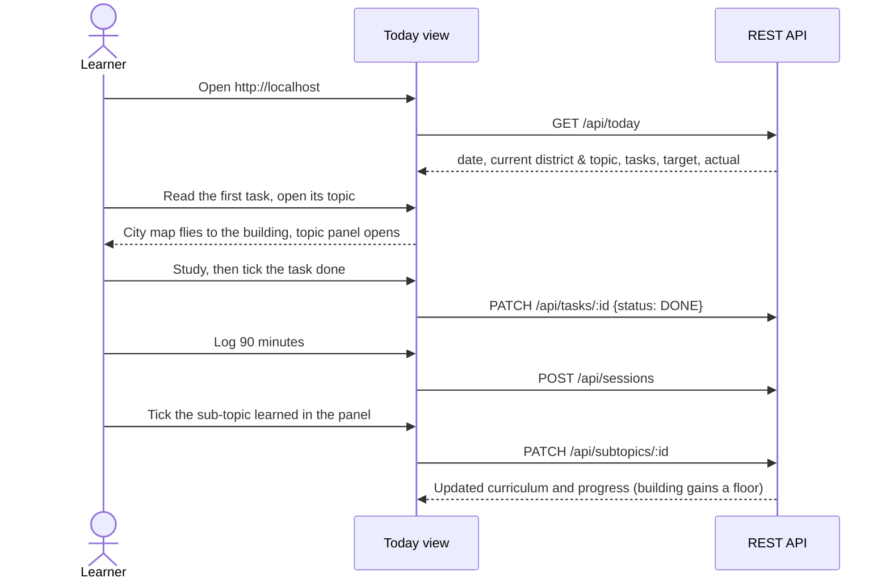

# 1. Introduction

## 1.1 Purpose

This document specifies the requirements for **Engineering City**, a local-first, single-user web application that turns a researched nine-month software-engineering curriculum into a daily, executable plan, and makes long-term progress visible through the existing isometric "city" map.

The SRS is the reference for the High-Level Design (`HLD.md`) and the Low-Level Design (`LLD.md`). Requirement identifiers (for example `FR-TODAY-03`) are used in both of those documents and in the test plan.

## 1.2 Project overview

Engineering City already exists as a single self-contained HTML page: an isometric city in which each **district** is a skill domain, each **building** is a topic and each ticked **sub-topic** adds a floor. A car on the road marks the district the learner is working in. Progress lives in `localStorage`.

This project turns that page into a maintainable full-stack application:

- **React + TypeScript (Vite)** frontend that keeps the existing visual identity and map engine.
- **Node.js + Express** REST backend.
- **PostgreSQL** database accessed through **Prisma**.
- The whole system runs locally through **Docker Compose** at `http://localhost`.

## 1.3 Objectives

| ID | Objective |
|---|---|
| OBJ-1 | Provide a **researched learning direction** for 17 Nov 2026 – 17 Aug 2027, built from the roadmap.sh Backend, System Design and AI Engineer roadmaps and the learner's existing curriculum. |
| OBJ-2 | Break the direction into **daily assignments** that fit a four-hour study day, Monday to Saturday. |
| OBJ-3 | Help the learner **execute and track** the plan: complete tasks, record time, reschedule honestly. |
| OBJ-4 | Make **demonstrated learning progress** visible on the map, separately from the calendar. |
| OBJ-5 | Serve as a realistic practice project in full-stack development, database engineering, software architecture and Docker. |

## 1.4 Problem statement

The learner often gets distracted by new technologies, AI news and uncertainty about career direction. Without a fixed, researched plan, every study session starts with a decision about *what* to study, and that decision is where focus is lost.

Engineering City removes that daily decision. When it is opened on any day it answers five questions:

1. Am I following the right learning direction?
2. What should I study today?
3. What am I expected to complete this week?
4. How much progress have I made?
5. What comes next?

## 1.5 Intended audience and users

- **Single user:** the learner (a software-engineering student). They are the only user. There are no roles, accounts or sign-in.
- **Readers of this document:** the learner as developer and maintainer of the system.

## 1.6 Definitions

| Term | Meaning |
|---|---|
| District | A skill domain (for example Backend Engineering). Rendered as a raised platform on the map. Seven in total. |
| Topic / building | A unit of curriculum within a district. Rendered as a building. |
| Sub-topic / floor | A concept within a topic. Each sub-topic marked as learned adds one floor to the building. |
| Classification | `CORE`, `IMPORTANT` or `OPTIONAL`. Only core topics move the car. |
| Learned | All sub-topics of a topic are marked as learned (learning activity completed). |
| Demonstrated | The learner confirms they independently completed the topic's practical exercise (skill demonstrated). Adds a roof cap. |
| Stage | A calendar period of the roadmap (for example *Backend + Database, Jan – Mar 2027*). |
| Task / assignment | A scheduled study activity on a specific date, with an estimate in minutes. |
| Study session | A recorded block of actual study time on a date. |
| Study day | Monday to Saturday. Sunday is a rest day. |
| Buffer day | A study day inside a stage that has no planned tasks; reserved for catching up. |
| Berlin date | The calendar date in the `Europe/Berlin` time zone. |

## 1.7 References

| Reference | Location |
|---|---|
| Existing application | `Engineering City — Full-stack Roadmap.html` |
| Visual specification | `DESIGN.md` |
| Backend roadmap | `Roadmaps/backend.pdf`, <https://roadmap.sh/backend> |
| System Design roadmap | `Roadmaps/system-design.pdf`, <https://roadmap.sh/system-design> |
| AI Engineer roadmap | `Roadmaps/ai-engineer.pdf`, <https://roadmap.sh/ai-engineer> |

# 2. Overall description

## 2.1 Product perspective

Engineering City is a self-contained monolithic web application that runs on the learner's own computer. It has no cloud components, no remote services and no external authentication. After the Docker images are built, it works offline; only external documentation links need the internet.

## 2.2 Existing system: what is preserved and what changes

An inspection of the current HTML artifact found:

| Aspect | Current state | Decision |
|---|---|---|
| Visual identity | Muted colour tokens, single accent `#3f5a66`, system font stack, isometric 2:1 projection | **Preserve exactly** (`DESIGN.md` §2–§3). |
| Map engine | Pure functions that emit SVG strings (`box`, `platform`, `building`, `badge`, road, car), pan/zoom with a view box, a 650 ms fly animation | **Preserve**, ported to typed TypeScript modules. |
| Districts | 7 platforms in a zigzag (`ORIGINS`), 4 layers | **Preserve geometry**. The districts are renamed to the seven required districts (§3.1); *Practices* is replaced by *Engineering Consolidation*, and *Data* becomes *Database*. A fifth layer, *05 Consolidation*, is added. |
| Buildings | One per topic, floor per ticked item, dashed target outline, roof cap when complete | **Preserve**. The roof cap now means *demonstrated* (§3.6). |
| Topic data | Hard-coded `DISTRICTS` array with names, items and district-level resources | **Replace** with a researched curriculum stored in PostgreSQL. |
| Sidebar | Overall progress, Next up, layer groups with district cards | **Preserve** and add a compact *Today* card. |
| Detail panel | Stripe, kicker, title, floors, checklist, goal box, resources, prev/next | **Preserve** and extend with description, hours, classification, status, exercise and demonstration. |
| Progress | `localStorage` set of item IDs | **Replace** with PostgreSQL persistence. |
| Car | Static in the gap before the first incomplete district | **Make interactive**: it advances with demonstrated core progress (§3.6). |
| Calendar | None | **Add** stages, daily tasks, weekly schedule and month signposts on the road. |

## 2.3 Constraints

| ID | Constraint |
|---|---|
| C-1 | Stack: React, TypeScript, Vite, the existing CSS, Node.js, Express, PostgreSQL, Prisma, REST, Docker, Docker Compose. |
| C-2 | One repository with `frontend/` and `backend/`. A monolithic backend. |
| C-3 | No microservices, Kubernetes, cloud hosting, Redis, Kafka, message brokers or complex state-management libraries in the application. |
| C-4 | Services are bound to `127.0.0.1` only. |
| C-5 | No paid or third-party services. No LLM integration in the application. |
| C-6 | Time zone `Europe/Berlin`. The current date is always derived from the clock, never hard-coded. |

## 2.4 Assumptions

- The learner has Docker Desktop installed and port 80 is free on the machine. If it isn't, `HTTP_PORT` in `.env` selects another loopback port.
- The learner already has some Angular and NestJS experience, so frontend and backend fundamentals can be revised quickly.
- University coursework in software architecture runs from December 2026.

# 3. Functional requirements

Each requirement has a priority: **M** (must), **S** (should) or **C** (could).

## 3.1 Curriculum (FR-CUR)

| ID | Requirement | Pri |
|---|---|---|
| FR-CUR-01 | The system shall hold a curriculum of exactly seven districts, in this road order: Frontend Engineering, Backend Engineering, Database, Software Architecture and System Design, Cloud Engineering, AI Engineering, Engineering Consolidation. | M |
| FR-CUR-02 | Each topic shall have a name, short description, ordered sub-topics, estimated study hours, classification (Core / Important / Optional), practical exercise, resources and optional dependencies on other topics. | M |
| FR-CUR-03 | Each topic shall include at least one resource link, taken from the roadmap.sh references or official documentation. | M |
| FR-CUR-04 | The curriculum shall be delivered as seed data, so that the learner never has to search elsewhere to know what to study. | M |
| FR-CUR-05 | Backend and Database topics shall be sequenced alternately: backend fundamentals → database fundamentals → API development → SQL and relationships → backend/database integration → transactions → authentication → indexes and performance → advanced backend. | M |
| FR-CUR-06 | Redis and message brokers shall appear only as curriculum topics, classified no higher than Important. | M |
| FR-CUR-07 | System-design topics shall follow the structure of the System Design roadmap. Cloud design patterns are overview topics, and implementing every pattern is not required. | M |
| FR-CUR-08 | The AI Engineering district shall follow the structure of the AI Engineer roadmap. | M |
| FR-CUR-09 | Re-seeding shall update curriculum text without losing the learner's progress. | S |

## 3.2 Engineering map (FR-MAP)

| ID | Requirement | Pri |
|---|---|---|
| FR-MAP-01 | The map shall preserve the existing isometric projection, district zigzag, road, platforms, building shading, checkpoint badges and colour tokens. | M |
| FR-MAP-02 | The map shall support drag to pan, scroll to pan, Ctrl/Cmd + scroll and pinch to zoom (0.3–2.6), plus **+**, **−**, **Whole city** and **Where am I** controls. | M |
| FR-MAP-03 | Clicking or pressing Enter on a building shall open the topic panel. | M |
| FR-MAP-04 | The topic panel shall show the topic name, description, sub-topics (checkable), estimated hours, classification, learning status, practical exercise, resources, dependencies, completion status and the district goal. | M |
| FR-MAP-05 | A building's height shall equal the number of learned sub-topics. A dashed outline shall show the finished height. | M |
| FR-MAP-06 | A demonstrated topic shall show a roof cap (and is drawn at full height). A learned but undemonstrated topic shall show full floors without a cap. | M |
| FR-MAP-07 | The current building shall be marked with a subtle accent outline at its base. | M |
| FR-MAP-08 | Completed districts shall show a ✓ checkpoint, the current district an ink ring, and later districts a thin tinted ring. | M |
| FR-MAP-09 | Stage months shall be shown on the road as small signposts in road-text style. | S |
| FR-MAP-10 | The topic panel shall let the learner add a topic task to a chosen date (for example to schedule an optional topic). | S |

## 3.3 Vehicle progression (FR-CAR)

| ID | Requirement | Pri |
|---|---|---|
| FR-CAR-01 | The car's position shall be computed only from **learning progress** on **core** topics, never from the calendar. | M |
| FR-CAR-02 | A district's checkpoint shall be passed only when every core topic in that district is **demonstrated**. | M |
| FR-CAR-03 | Within the current district, the car shall advance toward the checkpoint in proportion to that district's weighted core progress (§5.4). | M |
| FR-CAR-04 | A passed deadline shall never complete a district or move the car. | M |
| FR-CAR-05 | When all districts are passed, the car shall stand at the goal flag. | M |
| FR-CAR-06 | Overall road progress shall be shown as a percentage. | M |

## 3.4 Daily Mission Control (FR-TODAY)

| ID | Requirement | Pri |
|---|---|---|
| FR-TODAY-01 | The Today view shall show today's Berlin date, the current district and current topic. | M |
| FR-TODAY-02 | It shall list today's assigned tasks with their estimated time, topic and status. | M |
| FR-TODAY-03 | It shall show the daily target (four hours from Monday to Saturday), the actual time recorded today and the remaining assignments. | M |
| FR-TODAY-04 | The learner shall be able to mark a task complete or reopen it. Tasks shall never be completed automatically. | M |
| FR-TODAY-05 | The learner shall be able to edit a task's title, notes and estimate. | M |
| FR-TODAY-06 | The learner shall be able to reschedule a task to another date. | M |
| FR-TODAY-07 | The learner shall be able to record time spent, with or without a linked task, and delete a wrong entry. | M |
| FR-TODAY-08 | Each task shall link to its curriculum topic on the map. | M |
| FR-TODAY-09 | Unfinished tasks from earlier days shall be listed as *carried over*, with the number of days overdue. | M |
| FR-TODAY-10 | The learner shall be able to move all carried-over tasks to the next study days with spare capacity, in one explicit action. | S |
| FR-TODAY-11 | The learner shall be able to add a manual task. | S |
| FR-TODAY-12 | The learner shall be able to browse to previous and next days. | S |
| FR-TODAY-13 | On a Sunday or buffer day, the view shall offer optional activities (carried-over tasks, topics marked for review) without showing a target or a deficit. | M |

## 3.5 Weekly schedule (FR-WEEK)

| ID | Requirement | Pri |
|---|---|---|
| FR-WEEK-01 | The default weekly targets shall be 4 h Monday to Saturday and 0 h (rest) on Sunday, giving 24 h a week. | M |
| FR-WEEK-02 | The Week view shall show for each day the planned hours, actual hours, completed and remaining tasks. | M |
| FR-WEEK-03 | It shall show the weekly totals: target hours, planned hours, actual hours, completed assignments and remaining work. | M |
| FR-WEEK-04 | It shall list upcoming milestones: practice tasks this week and stage deadlines in the next 14 days. | M |
| FR-WEEK-05 | Sunday shall never contribute to the target or show a shortfall. Time recorded on Sunday counts as actual time. Days outside the journey have no target. | M |
| FR-WEEK-06 | The learner shall be able to change the per-weekday target minutes. | C |

## 3.6 Calendar and timeline (FR-CAL)

| ID | Requirement | Pri |
|---|---|---|
| FR-CAL-01 | The journey shall start on 17 Nov 2026 and end on 17 Aug 2027. | M |
| FR-CAL-02 | The initial stages shall be: Frontend (17 Nov – 31 Dec 2026), Architecture coursework (parallel, Saturdays, 1 Dec 2026 – 31 Mar 2027), Backend + Database (1 Jan – 31 Mar 2027), Architecture consolidation (1 Apr – 15 May 2027), Cloud (16 May – 19 Jun 2027), Applied AI (20 Jun – 24 Jul 2027), Engineering Consolidation (25 Jul – 17 Aug 2027). | M |
| FR-CAL-03 | An initial plan of tasks shall be generated from the curriculum into the stages. Core and important topics are scheduled; optional topics are not. | M |
| FR-CAL-04 | The plan shall never assign tasks to Sundays, exceed a day's target, or create a task longer than 2 hours. | M |
| FR-CAL-05 | When a stage's end date passes with unfinished tasks, the system shall show the stage as delayed by N days, keep the unfinished tasks and never mark them done. | M |
| FR-CAL-06 | Every task shall keep its original planned date. Rescheduling changes only the scheduled date and increments a reschedule counter. | M |
| FR-CAL-07 | The learner shall be able to edit stage dates. | S |
| FR-CAL-08 | "Today" shall be computed from the server clock in `Europe/Berlin`. | M |

## 3.7 Progress tracking (FR-PROG)

| ID | Requirement | Pri |
|---|---|---|
| FR-PROG-01 | Show the total planned hours and the total actual hours. | M |
| FR-PROG-02 | Show the weekly and monthly actual hours for the journey so far. | M |
| FR-PROG-03 | Show progress per district: sub-topics learned, topics learned, topics demonstrated, and core topics demonstrated. | M |
| FR-PROG-04 | Show the number of completed core topics and completed practical assignments. | M |
| FR-PROG-05 | Always show *learning activity completed* (learned) separately from *skill independently demonstrated*. | M |
| FR-PROG-06 | Progress visuals shall be simple bars and numbers. There shall be no XP, badges, streaks or rankings. | M |
| FR-PROG-07 | Show stage status: on track, delayed (by N days) or complete. | M |

## 3.8 Settings (FR-SET)

| ID | Requirement | Pri |
|---|---|---|
| FR-SET-01 | Store the journey start, journey end and time zone. | M |
| FR-SET-02 | Store the per-weekday target minutes (FR-WEEK-06). | M |

# 4. Non-functional requirements

| ID | Category | Requirement |
|---|---|---|
| NFR-01 | Deployment | `docker compose up --build` starts the database, backend and frontend. The application is served at `http://localhost`. |
| NFR-02 | Security | Published ports bind to `127.0.0.1` only. PostgreSQL is not published to the host. |
| NFR-03 | Offline | No runtime dependency on internet services. No web fonts, CDNs or analytics. |
| NFR-04 | Persistence | Data survives `docker compose down` and `up` (named volume). It is lost only after `down -v`. |
| NFR-05 | Backup | Documented `pg_dump` backup and `pg_restore` restore commands. |
| NFR-06 | Performance | Typical API responses take under 200 ms locally. Map interactions run at 60 fps on a typical laptop, for 7 districts and 83 buildings. |
| NFR-07 | Accessibility | Buildings, badges and controls are keyboard reachable with descriptive labels. Animation is reduced under `prefers-reduced-motion`. Text contrast meets WCAG AA. |
| NFR-08 | Responsiveness | Usable from 360 px wide (drawer sidebar, bottom-sheet panel) up to desktop. |
| NFR-09 | Visual identity | Complies with `DESIGN.md`: one accent colour, muted district colours, no glows, confetti or bounce. |
| NFR-10 | Maintainability | TypeScript strict mode, input validation at the API boundary, versioned migrations, automated tests for the domain logic and the API. |
| NFR-11 | Reliability | Invalid input never corrupts data. Multi-row updates such as bulk rescheduling run in a transaction. |
| NFR-12 | Simplicity (YAGNI) | No features beyond those listed in §3. |

# 5. Business rules

| ID | Rule |
|---|---|
| BR-01 | **Study days** are Monday to Saturday. Sunday is a rest day with a 0-minute target. |
| BR-02 | The daily target is 240 minutes on study days. The weekly target is the sum of the weekday targets (default 1,440 minutes). |
| BR-03 | **Topic status** is derived, not stored: `DEMONSTRATED` if a demonstration is recorded; else `LEARNED` if all sub-topics are learned; else `IN_PROGRESS` if any sub-topic is learned, any linked task is done or any time is recorded; else `NOT_STARTED`. |
| BR-04 | **Core topic score:** demonstrated → 1.0, otherwise 0.8 × (learned sub-topics ÷ sub-topics). Learning without demonstration never exceeds 80%. |
| BR-05 | **District road progress** = Σ(score × estimated hours) ÷ Σ(estimated hours) over the district's core topics. A district is passed when all of its core topics are demonstrated. |
| BR-06 | **Current district** = the first district in road order that is not passed. **Overall road progress** = (passed districts before the current one + current district progress) ÷ 7. |
| BR-07 | **Current topic** = the topic of the first unfinished task today. If there is none, the first non-demonstrated core topic of the current district. |
| BR-08 | A task is **overdue** when its status is `TODO` and its scheduled date is before today. |
| BR-09 | A stage is **delayed** when today is after its end date and it still has `TODO` tasks. Delay = today − end date, in days. A stage is **complete** when it has no `TODO` tasks. |
| BR-10 | Plan tasks (generated) cannot be deleted. They can be skipped. Manual tasks can be deleted. |
| BR-11 | A study session is 1–720 minutes on a single date. Sessions are not limited per day. |
| BR-12 | Marking a task done does not mark any sub-topic as learned, and does not record time. Each is an explicit learner action. |
| BR-13 | Demonstration is explicit and reversible. It may be recorded before all sub-topics are learned, for knowledge the learner already has. |

# 6. Scheduling requirements

1. The plan generator walks every stage in order and fills its eligible days, from the start date to the end date, with task chunks:
   - **Main stages** use all study days, except Saturdays that are claimed by a parallel stage.
   - The **parallel architecture stage** uses only Saturdays from 1 Dec 2026 to 31 Mar 2027.
2. Each scheduled topic is split as follows. About 30% of its estimated time becomes a **practice** task for the topic's exercise. The rest is shared across its sub-topics as **study** tasks, in 30-minute units.
3. A chunk is at most 120 minutes and never crosses the remaining capacity of a day. A sub-topic that needs more time becomes "Part 1", "Part 2" and so on.
4. Study days in a stage that are left after its topics are planned are **buffer days**.
5. All architecture topics form one queue. The parallel Saturdays take topics from the start of the queue, and the April–May stage continues where they stopped.
6. The plan must fit: the total planned time of a stage never exceeds its capacity. This is enforced by an automated test. The generated figures are in Appendix A.1: 679 h planned out of 940 h of capacity, in 542 tasks.
7. The plan is generated once, at first seed. It is never regenerated over existing tasks.
8. **Bulk rescheduling** (FR-TODAY-10) walks the overdue tasks in their original order and places each on the first study day from today onward whose planned minutes plus the task's estimate fit within the day target. Sundays are never used.

# 7. Data requirements

| Entity | Key data | Persistence rule |
|---|---|---|
| District | slug, road position, name, subtitle, layer, colour, columns, goal, note | Seeded; text updatable by re-seed |
| Topic | slug, district, position, name, description, classification, hours, exercise, demonstration timestamp and note, review flag | Seeded; learner-owned fields never overwritten |
| Sub-topic | topic, position, name, learned timestamp | Seeded; learned state never overwritten |
| Resource | topic, label, URL, kind | Seeded |
| Topic dependency | topic, prerequisite topic | Seeded |
| Stage | slug, name, kind (main/parallel), start, end, districts | Seeded; dates editable |
| Task | topic?, sub-topic?, stage?, title, notes, kind, estimate, original date, scheduled date, status, completed timestamp, source, reschedule count | Plan tasks generated once; then learner-owned |
| Study session | date, minutes, task?, topic?, note | Learner-owned |
| Settings | journey start/end, time zone | Seeded singleton |
| Weekly target | weekday (1–7), target minutes | Seeded; editable |

All dates are calendar dates (`DATE`) interpreted in `Europe/Berlin`. All timestamps are stored in UTC (`TIMESTAMPTZ`).

# 8. User workflows

## 8.1 Morning check-in (primary workflow)

## 8.2 Demonstrate a skill

The learner opens a topic panel, completes the practical exercise outside the app, then presses **Mark as demonstrated** and optionally adds a note (for example a repository link). The building gets its roof cap. If this was the last core topic of the district, the checkpoint shows ✓ and the car moves on to the next district's road.

## 8.3 Falling behind

On a later day, unfinished tasks appear under **Carried over** with their days overdue. The learner either reschedules a single task to a chosen date or presses **Move carried-over tasks forward**, which places them on the next days with free capacity. The original planned dates remain visible as "planned 12 Jan".

## 8.4 Sunday

The Today view shows "Rest day". It lists optional revision: carried-over tasks and topics marked *needs review*. There is no target bar and no shortfall.

## 8.5 Weekly review

On Saturday or Sunday the learner opens **Week**: planned vs actual per day, completed assignments, remaining work and next week's milestones.

# 9. Scope

## 9.1 In scope

Curriculum, map with vehicle progression, Today, Week, Progress and timeline views, tasks, study sessions, stages and settings, local Docker deployment, backup and restore, and documentation.

## 9.2 Explicit exclusions (YAGNI)

AI chatbot or LLM features; AI-generated plans; multiple users, registration or login; social sharing; gamification, XP, badges, streaks or leaderboards; notifications; cloud sync or hosting; a mobile app; calendar integrations (iCal, Google); general note-taking; project-management features unrelated to the journey; analytics that do not support a learning decision; Redis, message brokers, microservices or Kubernetes in the application.

# 10. Acceptance criteria

| ID | Criterion | Verifies |
|---|---|---|
| AC-01 | `docker compose up --build` on a clean machine results in a working app at `http://localhost` within the build time. The app is not reachable from other machines. | NFR-01, NFR-02 |
| AC-02 | Opening the app shows today's Berlin date and today's tasks. | FR-TODAY-01/02, FR-CAL-08 |
| AC-03 | Each of the seven districts can be reached on the map and in the sidebar. Each building opens a panel with description, sub-topics, hours, classification, status and resources. | FR-MAP-03/04 |
| AC-04 | Completing a task persists after a page reload and after `docker compose down` and `up`. | FR-TODAY-04, NFR-04 |
| AC-05 | Recorded time appears in today's actual hours and in the week view. | FR-TODAY-07, FR-WEEK-02 |
| AC-06 | Rescheduling an overdue task moves it to the new date and keeps the original date and an incremented counter. | FR-TODAY-06, FR-CAL-06 |
| AC-07 | Learning every sub-topic of a core topic advances the car but does not pass the checkpoint. Demonstrating all core topics of the district passes the checkpoint and moves the car to the next district. | FR-CAR-01–03 |
| AC-08 | Setting the clock after a stage's end date with tasks left shows "Delayed by N days" and leaves those tasks as `TODO`. | FR-CAL-05, FR-CAR-04 |
| AC-09 | No generated task falls on a Sunday. No study day is planned beyond 240 minutes. No task is longer than 120 minutes. Every stage plan fits its capacity. | FR-CAL-04 |
| AC-10 | Sundays show no target and no shortfall. | FR-TODAY-13, FR-WEEK-05 |
| AC-11 | The backend unit and integration tests and the frontend tests pass. | NFR-10 |

# Appendix A — Curriculum and plan

The curriculum is the researched learning direction (OBJ-1). It was built from the three roadmap.sh references (`Roadmaps/backend.pdf`, `system-design.pdf`, `ai-engineer.pdf`) plus the learner's existing Engineering City content for frontend and cloud. The roadmaps are treated as references for technical coverage, not as mandatory checklists.

**Classification rules**

- **Core:** needed to build and reason about a production full-stack application with the chosen stack, or central to the district's goal. Core topics drive the car.
- **Important:** commonly needed in industry, scheduled in the plan, but not required to pass a checkpoint (for example Redis, message brokers, DDD, Kubernetes basics).
- **Optional:** useful context, not scheduled (for example GraphQL/gRPC, NoSQL landscape, multimodal AI, infrastructure as code, fine-tuning). It is available in the curriculum and can be added to a day manually.

**Roadmap coverage decisions**

| Roadmap section | Where it lives | Decision |
|---|---|---|
| Backend: Internet, HTTP, DNS, hosting, browsers | Backend › How the web works | Core |
| Backend: pick a language | Node.js runtime | Node.js + TypeScript only. Other languages excluded. |
| Backend: relational databases | Database district | PostgreSQL only. MySQL, MS SQL and Oracle excluded. |
| Backend: APIs (REST, JSON, OpenAPI) | REST API design | Core. GraphQL and gRPC are Optional. SOAP is excluded. |
| Backend: authentication (JWT, OAuth, cookie, token, OpenID) | Authentication, Authorisation | Core / Important. SAML excluded. |
| Backend: caching (Redis, CDN, client) | Caching with Redis; Architecture › Caching strategies | Important (FR-CUR-06). Memcached excluded. |
| Backend: web security, hashing, OWASP, CORS, CSP | Web security; Authentication | Core |
| Backend: testing, CI/CD | Backend testing; Cloud › CI/CD | Core |
| Backend: ORMs, ACID, transactions, N+1, normalisation, indexes, replication, sharding, CAP | Prisma and data access; Database district | Core; scaling is Important |
| Backend: architectural patterns, GoF, DDD, TDD, CQRS, event sourcing, twelve-factor | Architecture district | Core / Important |
| Backend: containers, web servers, Kubernetes | Cloud district | Core; Kubernetes is Important |
| Backend: message brokers (RabbitMQ, Kafka) | Message brokers | Important (FR-CUR-06) |
| Backend: search engines (Elasticsearch, Solr), service mesh, LXC | — | Excluded: no current need |
| Backend: NoSQL (document, key-value, column, graph, time series) | NoSQL landscape | Optional |
| Backend: real-time (WebSockets, SSE, polling) | Real-time communication | Optional |
| Backend: building for scale, mitigation, observability | Architecture › Reliability patterns, Monitoring | Core |
| System Design: introduction, performance vs scalability, latency vs throughput, CAP, consistency and availability patterns | System design fundamentals; Consistency and availability | Core |
| System Design: DNS, CDN, load balancers, application layer, microservices, service discovery | Networking and communication; Load balancing and scaling; Architectural styles | Core |
| System Design: databases (replication, federation, sharding, denormalisation, SQL tuning, NoSQL) | Data at scale | Core |
| System Design: caching (types, strategies) | Caching strategies | Core |
| System Design: asynchronism, idempotency, communication (HTTP, TCP, UDP, RPC, REST, gRPC, GraphQL) | Asynchronism; Networking and communication | Core |
| System Design: performance antipatterns | Performance antipatterns | Optional |
| System Design: monitoring | Monitoring and observability | Core |
| System Design: cloud design patterns (design and implementation, data management, messaging) | Cloud design patterns | Important, overview only (FR-CUR-07) |
| System Design: reliability patterns (circuit breaker, retry, bulkhead, throttling, health endpoint, compensating transaction) | Reliability patterns | Core |
| AI Engineer: introduction, roles, AI vs ML engineer | AI engineering foundations | Core |
| AI Engineer: LLMs, inference, training, pre-trained models, OpenAI/Claude/Gemini, open-source models, Hugging Face, Ollama | LLM fundamentals; Models and providers | Core / Important |
| AI Engineer: prompt engineering, token management, pricing | Prompt engineering; Calling LLM APIs | Core |
| AI Engineer: AI safety and ethics, prompt injection, moderation, bias | AI safety and security | Core |
| AI Engineer: embeddings, semantic search, use cases, vector databases | Embeddings; Vector databases | Core |
| AI Engineer: RAG, chunking, retrieval, RAG vs fine-tuning, LangChain/LlamaIndex | RAG; AI agents | Core / Important |
| AI Engineer: agents, ReAct, function calling, Assistants API | Structured outputs and tool calling; AI agents | Core / Important |
| AI Engineer: multimodal (vision, Whisper, DALL·E, TTS) | Multimodal AI | Optional |
| AI Engineer: AI code editors, development tools | — | Excluded: tooling, not engineering skill |

## A.1 Plan capacity (generated from the planner)

| Stage | Study days | Capacity | Planned | Load | Last planned day |
|---|---:|---:|---:|---:|---|
| Frontend Engineering | 35 | 140 h | 102 h | 73% | 2026-12-18 |
| Architecture coursework (Saturdays) | 17 | 68 h | 68 h | 100% | 2027-03-27 |
| Backend + Database | 64 | 256 h | 175 h | 68% | 2027-03-03 |
| Architecture consolidation | 39 | 156 h | 74 h | 47% | 2027-04-22 |
| Cloud Engineering | 30 | 120 h | 90 h | 75% | 2027-06-11 |
| Applied AI Engineering | 30 | 120 h | 108 h | 90% | 2027-07-21 |
| Engineering Consolidation | 20 | 80 h | 62 h | 78% | 2027-08-12 |
| **Total** | | **940 h** | **679 h** | | 542 tasks |

## A.2 Curriculum by district (generated from `backend/src/curriculum`)

| District | Topics | Core | Important | Optional | Sub-topics | Hours (all) | Hours (planned) |
|---|---:|---:|---:|---:|---:|---:|---:|
| Frontend Engineering | 13 | 9 | 3 | 1 | 50 | 106 | 102 |
| Backend Engineering | 14 | 9 | 3 | 2 | 57 | 114 | 103 |
| Database | 9 | 6 | 2 | 1 | 35 | 78 | 72 |
| Architecture & System Design | 17 | 13 | 3 | 1 | 72 | 147 | 142 |
| Cloud Engineering | 9 | 7 | 1 | 1 | 45 | 98 | 90 |
| AI Engineering | 15 | 10 | 3 | 2 | 60 | 119 | 108 |
| Engineering Consolidation | 6 | 5 | 1 | 0 | 23 | 62 | 62 |

### A.3.1 Frontend Engineering

| Topic | Class | Hours | Sub-topics | Builds on |
|---|---|---:|---|---|
| TypeScript | Core | 10 | Generics; Utility types; Narrowing and discriminated unions; Async programming with promises; Modules and project config | — |
| Angular fundamentals | Core | 12 | Components and inputs/outputs; Templates and control flow; Dependency injection; Directives; Pipes | fe.ts |
| Reactivity | Core | 12 | Signals and computed values; Effects; RxJS observables and operators; Interop between signals and RxJS | fe.ng-fundamentals |
| Angular architecture | Core | 8 | Feature-based structure; Standalone components; Smart vs presentational components; Lazy loading | fe.ng-fundamentals |
| Forms | Core | 8 | Reactive forms; Built-in and custom validators; Dynamic form arrays | fe.ng-fundamentals |
| Routing | Core | 6 | Routes and parameters; Guards; Resolvers; Nested routes | fe.ng-architecture |
| API integration | Core | 8 | HttpClient; Interceptors; Error handling; Loading and empty states | fe.reactivity |
| State management | Important | 6 | Signal-based services; Store concepts (NgRx SignalStore); Choosing where state lives | fe.reactivity |
| UI engineering | Core | 8 | Responsive layout with grid and flexbox; Accessibility and ARIA; Keyboard navigation and focus; Reusable component APIs | — |
| Frontend testing | Core | 10 | Unit tests for services and pipes; Component tests; Mocking HTTP; End-to-end tests with Playwright | fe.http |
| Performance | Important | 6 | Change detection and zoneless; Rendering and deferrable views; Bundle analysis and optimisation | fe.ng-architecture |
| React with TypeScript | Important | 8 | Components and JSX; State and hooks; Effects and data fetching; Vite tooling | fe.ts |
| Browser fundamentals | Optional | 4 | Critical rendering path; Event loop in the browser; Storage and caching | — |

### A.3.2 Backend Engineering

| Topic | Class | Hours | Sub-topics | Builds on |
|---|---|---:|---|---|
| How the web works | Core | 6 | HTTP requests and responses; DNS and domain names; HTTPS and TLS basics; Hosting and the request lifecycle | — |
| Node.js runtime | Core | 10 | Event loop; Asynchronous I/O and promises; Streams and buffers; Modules and npm; Processes and environment variables | — |
| Express fundamentals | Core | 8 | Routing; Middleware; Request and response lifecycle; Error-handling middleware; Project structure in TypeScript | be.node |
| REST API design | Core | 12 | Resources and HTTP methods; Status codes and error contracts; Pagination, filtering and sorting; Input validation with zod; OpenAPI specifications | be.express |
| Prisma and data access | Core | 10 | Prisma schema and models; Migrations workflow; Relation queries; The N+1 problem; Seeding data | be.api, db.modelling |
| Errors and logging | Core | 6 | Typed errors and error contracts; Central error handler; Structured logging | be.express |
| Authentication | Core | 12 | Password hashing with bcrypt or argon2; Cookie-based sessions; JWT access and refresh tokens; OAuth 2.0 and OpenID Connect concepts | be.api, db.transactions |
| Authorisation | Important | 5 | Role-based access control; Ownership and resource checks; Authorisation middleware | be.auth |
| Web security | Core | 8 | OWASP Top 10; CORS; Security headers and CSP; Rate limiting; Secrets management | be.auth |
| Backend testing | Core | 10 | Unit tests with Vitest; Integration tests with Supertest; Test databases and fixtures; Functional and end-to-end tests | be.api |
| Caching with Redis | Important | 8 | Cache-aside pattern; TTL and invalidation; Redis data structures; Rate limiting with Redis | be.api |
| Message brokers | Important | 8 | Queues and RabbitMQ; Kafka concepts; Background jobs and workers; Idempotent consumers | be.errors |
| Real-time communication | Optional | 6 | WebSockets; Server-sent events; Long and short polling | — |
| GraphQL and gRPC | Optional | 5 | GraphQL schemas and resolvers; gRPC and protocol buffers; Choosing between REST, GraphQL and gRPC | — |

### A.3.3 Database

| Topic | Class | Hours | Sub-topics | Builds on |
|---|---|---:|---|---|
| Relational fundamentals | Core | 8 | Relational model; Tables, types and constraints; Primary and foreign keys; Normalisation (1NF–3NF) | — |
| SQL querying | Core | 16 | SELECT, filtering and sorting; Joins; Aggregation and GROUP BY; Subqueries and CTEs; Window functions | db.relational |
| Data modelling and relationships | Core | 8 | One-to-many relationships; Many-to-many and join tables; ER diagrams; Denormalisation trade-offs | db.relational |
| Schema migrations | Core | 5 | Versioned migration workflow; Safe schema changes; Seed and reference data | db.modelling |
| Transactions and concurrency | Core | 12 | ACID; Isolation levels; Locks and deadlocks; Optimistic concurrency control | db.sql |
| Indexes and query performance | Core | 12 | B-tree indexes; Reading EXPLAIN ANALYZE; Composite and partial indexes; Connection pooling | db.sql |
| Backup, restore and roles | Important | 5 | pg_dump and pg_restore; Roles and privileges; Basic monitoring (pg_stat views) | db.migrations |
| Scaling databases | Important | 6 | Replication; Partitioning; Sharding strategies; CAP trade-offs in practice | db.indexes |
| NoSQL landscape | Optional | 6 | Document stores (MongoDB); Key-value stores; Wide-column stores; Graph and time-series databases | — |

### A.3.4 Architecture & System Design

| Topic | Class | Hours | Sub-topics | Builds on |
|---|---|---:|---|---|
| Design principles | Core | 8 | SOLID; Coupling and cohesion; DRY, KISS and YAGNI; Twelve-factor apps | — |
| Design patterns | Important | 8 | Creational patterns; Structural patterns; Behavioural patterns; Patterns in TypeScript codebases | ar.principles |
| Architectural styles | Core | 10 | Layered architecture; Modular monolith; Microservices and service boundaries; Event-driven architecture; Serverless and SOA overview | ar.principles |
| Domain-driven design | Important | 8 | Ubiquitous language and bounded contexts; Entities and value objects; Aggregates; Anti-corruption layer | ar.styles |
| Documenting architecture | Core | 6 | C4 model diagrams; Architecture decision records; Requirements to quality attributes | ar.styles |
| System design fundamentals | Core | 8 | How to approach system design; Performance vs scalability; Latency vs throughput; Availability vs consistency | — |
| Consistency and availability | Core | 10 | CAP theorem (CP vs AP); Weak, eventual and strong consistency; Fail-over and replication patterns; Availability in numbers (nines) | ar.fundamentals |
| Networking and communication | Core | 8 | TCP vs UDP; HTTP, REST, RPC, gRPC and GraphQL; DNS in system design; CDNs (push vs pull) | ar.fundamentals |
| Load balancing and scaling | Core | 8 | Horizontal vs vertical scaling; Layer 4 and layer 7 load balancing; Load balancer vs reverse proxy; Load-balancing algorithms | ar.communication |
| Caching strategies | Core | 8 | Cache-aside; Write-through and write-behind; Refresh-ahead; Where to cache | ar.scaling |
| Data at scale | Core | 10 | Replication (master-slave, master-master); Sharding and federation; Denormalisation and SQL tuning; SQL vs NoSQL | ar.consistency |
| Asynchronism | Core | 8 | Message queues; Task queues and background jobs; Back pressure; Idempotent operations | ar.communication |
| Reliability patterns | Core | 10 | Circuit breaker; Retry with backoff and retry storms; Bulkhead; Throttling; Health endpoint monitoring; Compensating transactions | ar.async |
| Monitoring and observability | Core | 8 | Logs, metrics and traces; Health, availability and performance monitoring; Instrumentation; Visualisation and alerts | — |
| Cloud design patterns | Important | 8 | CQRS and event sourcing; Strangler fig and anti-corruption layer; Sidecar and ambassador; Gateway routing, offloading and aggregation; Backends for frontends | ar.reliability |
| Design case studies | Core | 16 | URL shortener; Rate limiter; Chat system; News feed; Notification system | ar.data, ar.caching, ar.reliability |
| Performance antipatterns | Optional | 5 | Busy database and busy frontend; Chatty I/O and extraneous fetching; Noisy neighbour and retry storm; Synchronous I/O and no caching | — |

### A.3.5 Cloud Engineering

| Topic | Class | Hours | Sub-topics | Builds on |
|---|---|---:|---|---|
| Linux and networking | Core | 12 | Shell, processes and services; Permissions and environment variables; IP addresses, ports and DNS; HTTP/HTTPS and TLS certificates; Firewalls, proxies and reverse proxies; SSH | — |
| Docker | Core | 10 | Images and containers; Dockerfiles and layers; Volumes and networks; Docker Compose; Multi-stage builds and image size | — |
| Cloud concepts | Core | 6 | IaaS, PaaS and SaaS; Regions and availability zones; Shared responsibility model; Pricing and cost drivers | — |
| AWS core services | Core | 18 | IAM identities and policies; EC2 virtual machines; VPC networking; S3 object storage; RDS managed PostgreSQL; Load balancers and ECR; ECS container runtime; CloudWatch logs and metrics | cl.docker, cl.concepts |
| CI/CD | Core | 10 | GitHub Actions workflows; Build and test pipelines; Publishing Docker images; Secrets and environments; Automated deployment and rollback | cl.docker |
| Kubernetes basics | Important | 10 | Clusters, nodes and pods; Deployments and services; ConfigMaps and secrets; Ingress; Health checks, resources and scaling | cl.docker |
| Production operations | Core | 8 | Monitoring and alerting; Backups and recovery; Security and IAM hygiene; Cost management | cl.aws |
| Capstone deployment | Core | 16 | Frontend with domain, DNS and TLS; API in containers on AWS; PostgreSQL on RDS; File storage on S3; Pipeline and monitoring | cl.aws, cl.cicd |
| Infrastructure as code | Optional | 8 | Terraform basics; State and modules; Plan and apply workflow | cl.aws |

### A.3.6 AI Engineering

| Topic | Class | Hours | Sub-topics | Builds on |
|---|---|---:|---|---|
| AI engineering foundations | Core | 4 | Roles and responsibilities; AI engineer vs ML engineer; AI vs AGI and common terminology; Impact on product development | — |
| Python for AI work | Important | 8 | Syntax and data structures; Packages and virtual environments; HTTP clients and JSON; Notebooks for experiments | — |
| LLM fundamentals | Core | 8 | Tokens and context windows; Training vs inference; Temperature and sampling; Knowledge cut-off and hallucination; Pricing and token management | — |
| Models and providers | Important | 6 | Closed models (OpenAI, Claude, Gemini); Open models and Hugging Face; Running local models with Ollama; Open vs closed trade-offs | ai.llm |
| Calling LLM APIs | Core | 8 | Chat/messages APIs; Streaming responses; Errors, timeouts and retries; Token counting and cost limits | ai.llm |
| Prompt engineering | Core | 8 | System instructions; Few-shot examples; Structured prompts and delimiters; ReAct prompting | ai.api |
| Structured outputs and tool calling | Core | 10 | Schema-constrained JSON; Validating model output; Function and tool calling; Designing safe tool interfaces | ai.prompting |
| Embeddings | Core | 8 | What embeddings are; Semantic similarity and search; Use cases: classification, recommendation, anomaly detection; Open-source embedding models | ai.api |
| Vector databases | Core | 8 | pgvector in PostgreSQL; Indexing embeddings (HNSW, IVF); Similarity search queries; Dedicated vector databases overview | ai.embeddings, db.indexes |
| Retrieval-augmented generation | Core | 12 | Chunking strategies; Retrieval; Reranking; Context construction and citations; RAG vs fine-tuning | ai.vectordb, ai.prompting |
| AI agents | Important | 10 | Agent use cases and when not to use them; Agent loop and state; Tool orchestration; Frameworks (LangChain, LlamaIndex) vs manual | ai.structured |
| Evaluation | Core | 10 | Test datasets; Quality metrics; Regression tests for prompts; LLM-as-judge and its pitfalls | ai.rag |
| AI safety and security | Core | 8 | Prompt injection attacks; Data leakage and privacy; Moderation and constraining inputs/outputs; Bias, fairness and adversarial testing | ai.rag |
| Multimodal AI | Optional | 6 | Image understanding; Speech-to-text and text-to-speech; Image generation | — |
| Fine-tuning | Optional | 5 | When fine-tuning is worth it; Preparing training data; Evaluating a fine-tuned model | — |

### A.3.7 Engineering Consolidation

| Topic | Class | Hours | Sub-topics | Builds on |
|---|---|---:|---|---|
| Engineering practices | Core | 8 | Git workflows and pull requests; Code review; Clean code and refactoring; Documentation habits | — |
| Debugging and profiling | Important | 6 | Browser DevTools; Node.js debugger and inspector; CPU and memory profiling | — |
| Capstone integration | Core | 22 | Scope and requirements; Frontend and API integration; Data model and migrations; AI feature with evaluation; Deployment and monitoring; Hardening and tests | cl.capstone, ai.evals |
| Portfolio and documentation | Core | 8 | README and setup guide; Architecture documentation; Case-study write-up | ec.capstone |
| Interview readiness | Core | 14 | Data structures and algorithms refresh; System design mock interviews; Behavioural stories; Explaining your projects | — |
| Retrospective and next direction | Core | 4 | Review progress and hours; Identify gaps; Plan the next six months | — |
