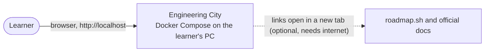
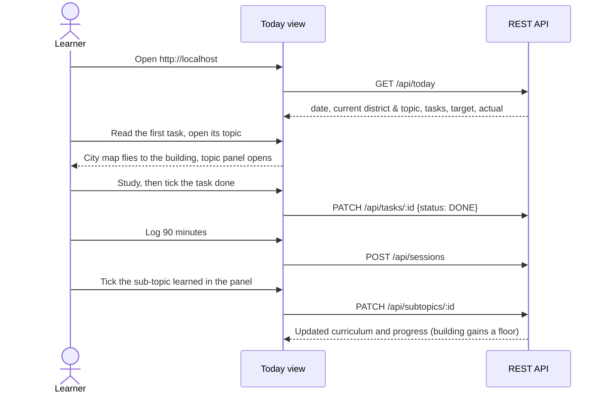
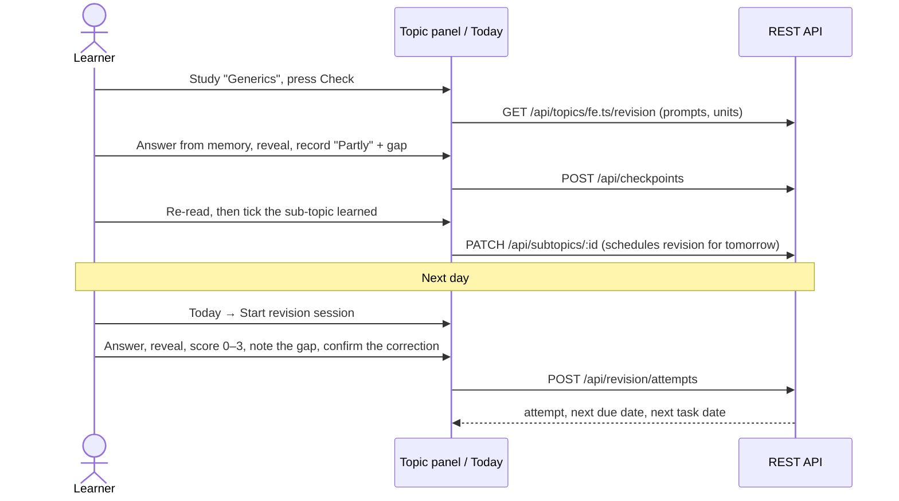

# 1. Introduction

## 1.1 Purpose

This document specifies the requirements for **Engineering City**, a local-first, single-user web application that turns a researched nine-month software-engineering curriculum into a daily, executable plan, and makes long-term progress visible through the existing isometric "city" map.

The SRS is the reference for the High-Level Design (`HLD.md`) and the Low-Level Design (`LLD.md`). Requirement identifiers (for example `FR-TODAY-03`) are used in both of those documents and in the test plan.

## 1.2 Project overview

Engineering City already exists as a single self-contained HTML page: an isometric city in which each **district** is a skill domain, each **building** is a topic and each ticked **sub-topic** adds a floor. A car on the road marks the district the learner is working in. Progress lives in `localStorage`.

This project turns that page into a maintainable full-stack application:

- **React + TypeScript (Vite)** frontend that keeps the existing visual identity and map engine.
- **Node.js + Express** REST backend.
- **PostgreSQL** database accessed through **Prisma**.
- The whole system runs locally through **Docker Compose** at `http://localhost`.

## 1.3 Objectives

| ID | Objective |
|---|---|
| OBJ-1 | Provide a **researched learning direction** for 17 Nov 2026 – 17 Aug 2027, built from the roadmap.sh Backend, System Design and AI Engineer roadmaps and the learner's existing curriculum. |
| OBJ-2 | Break the direction into **daily assignments** that fit a four-hour study day, Monday to Saturday. |
| OBJ-3 | Help the learner **execute and track** the plan: complete tasks, record time, reschedule honestly. |
| OBJ-4 | Make **demonstrated learning progress** visible on the map, separately from the calendar. |
| OBJ-5 | Serve as a realistic practice project in full-stack development, database engineering, software architecture and Docker. |

## 1.4 Problem statement

The learner often gets distracted by new technologies, AI news and uncertainty about career direction. Without a fixed, researched plan, every study session starts with a decision about *what* to study, and that decision is where focus is lost.

Engineering City removes that daily decision. When it is opened on any day it answers five questions:

1. Am I following the right learning direction?
2. What should I study today?
3. What am I expected to complete this week?
4. How much progress have I made?
5. What comes next?

## 1.5 Intended audience and users

- **Single user:** the learner (a software-engineering student). They are the only user. There are no roles, accounts or sign-in.
- **Readers of this document:** the learner as developer and maintainer of the system.

## 1.6 Definitions

| Term | Meaning |
|---|---|
| District | A skill domain (for example Backend Engineering). Rendered as a raised platform on the map. Seven in total. |
| Topic / building | A unit of curriculum within a district. Rendered as a building. |
| Sub-topic / floor | A concept within a topic. Each sub-topic marked as learned adds one floor to the building. |
| Classification | `CORE`, `IMPORTANT` or `OPTIONAL`. Only core topics move the car. |
| Learned | All sub-topics of a topic are marked as learned (learning activity completed). |
| Demonstrated | The learner confirms they independently completed the topic's practical exercise (skill demonstrated). Adds a roof cap. |
| Stage | A calendar period of the roadmap (for example *Backend + Database, Jan – Mar 2027*). |
| Task / assignment | A scheduled study activity on a specific date, with an estimate in minutes. |
| Study session | A recorded block of actual study time on a date. |
| Study day | Monday to Saturday. Sunday is a rest day. |
| Buffer day | A study day inside a stage that has no planned tasks; reserved for catching up. |
| Berlin date | The calendar date in the `Europe/Berlin` time zone. |
| Revision unit | What revision is scheduled for: one sub-topic, or one whole topic (integration across its sub-topics). |
| Retrieval / active recall | Bringing knowledge back from memory without notes, then checking it against the source. |
| Learning checkpoint | A recall check during initial study of a sub-topic. Recorded, but it never schedules anything or changes learned status. |
| Recall score | The learner's assessment of one attempt: 0 Forgot, 1 Struggled, 2 Recalled, 3 Mastered this attempt. |
| Revision schedule | The current state of one revision unit: next due date, interval, success and failure counts, correction state. |
| Weak unit | A revision unit with two or more consecutive attempts scored 0–1. |
| Revision allowance | Over-target revision minutes: at most 30 per day and 120 per week by default. Revision first uses free time; only what doesn't fit goes over a day's 4 h target. |

## 1.7 References

| Reference | Location |
|---|---|
| Existing application | `Engineering City — Full-stack Roadmap.html` |
| Visual specification | `DESIGN.md` |
| Backend roadmap | `Roadmaps/backend.pdf`, <https://roadmap.sh/backend> |
| System Design roadmap | `Roadmaps/system-design.pdf`, <https://roadmap.sh/system-design> |
| AI Engineer roadmap | `Roadmaps/ai-engineer.pdf`, <https://roadmap.sh/ai-engineer> |
| Revision and active recall specification v1.0 (18 Nov 2026) | `docs/Revision-Spec.md`. Its rules REV-01 to REV-20, NFR-REV-01 to NFR-REV-07 and scenarios A–G apply in full. |
| Revision experience enhancement (18 Nov 2026) | Product-owner request: a dedicated Revision section, indicators and analytics kept apart from learning progress. Requirements FR-REV-19 to FR-REV-23. It supersedes the v1.0 note that revision should avoid a new navigation section. |

# 2. Overall description

## 2.1 Product perspective

Engineering City is a self-contained monolithic web application that runs on the learner's own computer. It has no cloud components, no remote services and no external authentication. After the Docker images are built, it works offline; only external documentation links need the internet.

## 2.2 Existing system: what is preserved and what changes

An inspection of the current HTML artifact found:

| Aspect | Current state | Decision |
|---|---|---|
| Visual identity | Muted colour tokens, single accent `#3f5a66`, system font stack, isometric 2:1 projection | **Preserve exactly** (`DESIGN.md` §2–§3). |
| Map engine | Pure functions that emit SVG strings (`box`, `platform`, `building`, `badge`, road, car), pan/zoom with a view box, a 650 ms fly animation | **Preserve**, ported to typed TypeScript modules. |
| Districts | 7 platforms in a zigzag (`ORIGINS`), 4 layers | **Preserve geometry**. The districts are renamed to the seven required districts (§3.1); *Practices* is replaced by *Engineering Consolidation*, and *Data* becomes *Database*. A fifth layer, *05 Consolidation*, is added. |
| Buildings | One per topic, floor per ticked item, dashed target outline, roof cap when complete | **Preserve**. The roof cap now means *demonstrated* (§3.6). |
| Topic data | Hard-coded `DISTRICTS` array with names, items and district-level resources | **Replace** with a researched curriculum stored in PostgreSQL. |
| Sidebar | Overall progress, Next up, layer groups with district cards | **Preserve** and add a compact *Today* card. |
| Detail panel | Stripe, kicker, title, floors, checklist, goal box, resources, prev/next | **Preserve** and extend with description, hours, classification, status, exercise and demonstration. |
| Progress | `localStorage` set of item IDs | **Replace** with PostgreSQL persistence. |
| Car | Static in the gap before the first incomplete district | **Make interactive**: it advances with demonstrated core progress (§3.6). |
| Calendar | None | **Add** stages, daily tasks, weekly schedule and month signposts on the road. |

## 2.3 Constraints

| ID | Constraint |
|---|---|
| C-1 | Stack: React, TypeScript, Vite, the existing CSS, Node.js, Express, PostgreSQL, Prisma, REST, Docker, Docker Compose. |
| C-2 | One repository with `frontend/` and `backend/`. A monolithic backend. |
| C-3 | No microservices, Kubernetes, cloud hosting, Redis, Kafka, message brokers or complex state-management libraries in the application. |
| C-4 | Services are bound to `127.0.0.1` only. |
| C-5 | No paid or third-party services, with one exception: the optional AI check of revision answers (§3.10), which is off by default, needs the learner's consent and works on a provider's free tier. No other LLM integration. |
| C-6 | Time zone `Europe/Berlin`. The current date is always derived from the clock, never hard-coded. |

## 2.4 Assumptions

- The learner has Docker Desktop installed and port 80 is free on the machine. If it isn't, `HTTP_PORT` in `.env` selects another loopback port.
- The learner already has some Angular and NestJS experience, so frontend and backend fundamentals can be revised quickly.
- University coursework in software architecture runs from December 2026.

# 3. Functional requirements

Each requirement has a priority: **M** (must), **S** (should) or **C** (could).

## 3.1 Curriculum (FR-CUR)

| ID | Requirement | Pri |
|---|---|---|
| FR-CUR-01 | The system shall hold a curriculum of exactly seven districts, in this road order: Frontend Engineering, Backend Engineering, Database, Software Architecture and System Design, Cloud Engineering, AI Engineering, Engineering Consolidation. | M |
| FR-CUR-02 | Each topic shall have a name, short description, ordered sub-topics, estimated study hours, classification (Core / Important / Optional), practical exercise, resources and optional dependencies on other topics. | M |
| FR-CUR-03 | Each topic shall include at least one resource link, taken from the roadmap.sh references or official documentation. | M |
| FR-CUR-04 | The curriculum shall be delivered as seed data, so that the learner never has to search elsewhere to know what to study. | M |
| FR-CUR-05 | Backend and Database topics shall be sequenced alternately: backend fundamentals → database fundamentals → API development → SQL and relationships → backend/database integration → transactions → authentication → indexes and performance → advanced backend. | M |
| FR-CUR-06 | Redis and message brokers shall appear only as curriculum topics, classified no higher than Important. | M |
| FR-CUR-07 | System-design topics shall follow the structure of the System Design roadmap. Cloud design patterns are overview topics, and implementing every pattern is not required. | M |
| FR-CUR-08 | The AI Engineering district shall follow the structure of the AI Engineer roadmap. | M |
| FR-CUR-09 | Re-seeding shall update curriculum text without losing the learner's progress. | S |

## 3.2 Engineering map (FR-MAP)

| ID | Requirement | Pri |
|---|---|---|
| FR-MAP-01 | The map shall preserve the existing isometric projection, district zigzag, road, platforms, building shading, checkpoint badges and colour tokens. | M |
| FR-MAP-02 | The map shall support drag to pan, scroll to pan, Ctrl/Cmd + scroll and pinch to zoom (0.3–2.6), plus **+**, **−**, **Whole city** and **Where am I** controls. | M |
| FR-MAP-03 | Clicking or pressing Enter on a building shall open the topic panel. | M |
| FR-MAP-04 | The topic panel shall show the topic name, description, sub-topics (checkable), estimated hours, classification, learning status, practical exercise, resources, dependencies, completion status and the district goal. | M |
| FR-MAP-05 | A building's height shall equal the number of learned sub-topics. A dashed outline shall show the finished height. | M |
| FR-MAP-06 | A demonstrated topic shall show a roof cap (and is drawn at full height). A learned but undemonstrated topic shall show full floors without a cap. | M |
| FR-MAP-07 | The current building shall be marked with a subtle accent outline at its base. | M |
| FR-MAP-08 | Completed districts shall show a ✓ checkpoint, the current district an ink ring, and later districts a thin tinted ring. | M |
| FR-MAP-09 | Stage months shall be shown on the road as small signposts in road-text style. | S |
| FR-MAP-10 | The topic panel shall let the learner add a topic task to a chosen date (for example to schedule an optional topic). | S |

## 3.3 Vehicle progression (FR-CAR)

| ID | Requirement | Pri |
|---|---|---|
| FR-CAR-01 | The car's position shall be computed only from **learning progress** on **core** topics, never from the calendar. | M |
| FR-CAR-02 | A district's checkpoint shall be passed only when every core topic in that district is **demonstrated**. | M |
| FR-CAR-03 | Within the current district, the car shall advance toward the checkpoint in proportion to that district's weighted core progress (§5.4). | M |
| FR-CAR-04 | A passed deadline shall never complete a district or move the car. | M |
| FR-CAR-05 | When all districts are passed, the car shall stand at the goal flag. | M |
| FR-CAR-06 | Overall road progress shall be shown as a percentage. | M |

## 3.4 Daily Mission Control (FR-TODAY)

| ID | Requirement | Pri |
|---|---|---|
| FR-TODAY-01 | The Today view shall show today's Berlin date, the current district and current topic. | M |
| FR-TODAY-02 | It shall list today's assigned tasks with their estimated time, topic and status. | M |
| FR-TODAY-03 | It shall show the daily target (four hours from Monday to Saturday), the actual time recorded today and the remaining assignments. | M |
| FR-TODAY-04 | The learner shall be able to mark a task complete or reopen it. Tasks shall never be completed automatically. A revision task is completed by recording an assessed attempt, not by ticking it (FR-REV-08). | M |
| FR-TODAY-05 | The learner shall be able to edit a task's title, notes and estimate. | M |
| FR-TODAY-06 | The learner shall be able to reschedule a task to another date. | M |
| FR-TODAY-07 | The learner shall be able to record time spent, with or without a linked task, and delete a wrong entry. | M |
| FR-TODAY-08 | Each task shall link to its curriculum topic on the map. | M |
| FR-TODAY-09 | Unfinished tasks from earlier days shall be listed as *carried over*, with the number of days overdue. | M |
| FR-TODAY-10 | The learner shall be able to move all carried-over tasks to the next study days with spare capacity, in one explicit action. | S |
| FR-TODAY-11 | The learner shall be able to add a manual task. | S |
| FR-TODAY-12 | The learner shall be able to browse to previous and next days. | S |
| FR-TODAY-13 | On a Sunday or buffer day, the view shall offer optional activities (carried-over tasks, due revisions, topics marked for review) without showing a target or a deficit. | M |

## 3.5 Weekly schedule (FR-WEEK)

| ID | Requirement | Pri |
|---|---|---|
| FR-WEEK-01 | The default weekly targets shall be 4 h Monday to Saturday and 0 h (rest) on Sunday, giving 24 h a week. | M |
| FR-WEEK-02 | The Week view shall show for each day the planned hours, actual hours, completed and remaining tasks. | M |
| FR-WEEK-03 | It shall show the weekly totals: target hours, planned hours, actual hours, completed assignments and remaining work. | M |
| FR-WEEK-04 | It shall list upcoming milestones: practice tasks this week and stage deadlines in the next 14 days. | M |
| FR-WEEK-05 | Sunday shall never contribute to the target or show a shortfall. Time recorded on Sunday counts as actual time. Days outside the journey have no target. | M |
| FR-WEEK-06 | The learner shall be able to change the per-weekday target minutes. | C |

## 3.6 Calendar and timeline (FR-CAL)

| ID | Requirement | Pri |
|---|---|---|
| FR-CAL-01 | The journey shall start on 17 Nov 2026 and end on 17 Aug 2027. | M |
| FR-CAL-02 | The initial stages shall be: Frontend (17 Nov – 31 Dec 2026), Architecture coursework (parallel, Saturdays, 1 Dec 2026 – 31 Mar 2027), Backend + Database (1 Jan – 31 Mar 2027), Architecture consolidation (1 Apr – 15 May 2027), Cloud (16 May – 19 Jun 2027), Applied AI (20 Jun – 24 Jul 2027), Engineering Consolidation (25 Jul – 17 Aug 2027). | M |
| FR-CAL-03 | An initial plan of tasks shall be generated from the curriculum into the stages. Core and important topics are scheduled; optional topics are not. | M |
| FR-CAL-04 | The plan shall never assign tasks to Sundays, exceed a day's target, or create a task longer than 2 hours. | M |
| FR-CAL-05 | When a stage's end date passes with unfinished tasks, the system shall show the stage as delayed by N days, keep the unfinished tasks and never mark them done. | M |
| FR-CAL-06 | Every task shall keep its original planned date. Rescheduling changes only the scheduled date and increments a reschedule counter. | M |
| FR-CAL-07 | The learner shall be able to edit stage dates. | S |
| FR-CAL-08 | "Today" shall be computed from the server clock in `Europe/Berlin`. | M |

## 3.7 Progress tracking (FR-PROG)

| ID | Requirement | Pri |
|---|---|---|
| FR-PROG-01 | Show the total planned hours and the total actual hours. | M |
| FR-PROG-02 | Show the weekly and monthly actual hours for the journey so far. | M |
| FR-PROG-03 | Show progress per district: sub-topics learned, topics learned, topics demonstrated, and core topics demonstrated. | M |
| FR-PROG-04 | Show the number of completed core topics and completed practical assignments. | M |
| FR-PROG-05 | Always show *learning activity completed* (learned) separately from *skill independently demonstrated*. | M |
| FR-PROG-06 | Progress visuals shall be simple bars and numbers. There shall be no XP, badges, streaks or rankings. | M |
| FR-PROG-07 | Show stage status: on track, delayed (by N days) or complete. | M |

## 3.8 Settings (FR-SET)

| ID | Requirement | Pri |
|---|---|---|
| FR-SET-01 | Store the journey start, journey end and time zone. | M |
| FR-SET-02 | Store the per-weekday target minutes (FR-WEEK-06). | M |
| FR-SET-03 | Store the over-target revision allowance per day (0–240 minutes, default 30) and per week (0–720 minutes, default 120), editable in the Revision view. Both 0 gives a strict 4 h day. | S |

## 3.9 Revision and active recall (FR-REV)

Derived from `docs/Revision-Spec.md`. Revision is a third dimension next to *learned* and *demonstrated*: it measures whether knowledge can still be **retrieved**. It never changes the other two.

| ID | Requirement | Pri |
|---|---|---|
| FR-REV-01 | Revision shall operate on the existing curriculum units: every sub-topic and every topic (REV-01). Topic and sub-topic units shall never share or overwrite a schedule. | M |
| FR-REV-02 | Marking a sub-topic learned shall make it eligible and schedule its first revision for the next day. Unticking it shall pause (suspend) the unit and remove its open revision task; its history stays. Ticking it again resumes it (REV-02). | M |
| FR-REV-03 | A topic-level unit shall become eligible once two of its sub-topics are learned, or earlier when the topic is demonstrated. Its first revision is due three days later. It tests how the sub-topics fit together (REV-03). | M |
| FR-REV-04 | Prompts shall come from three sources: one curriculum prompt per topic (83, seeded, with evaluation criteria), eight reusable templates rendered for any unit (Explain, Why, How, Compare, Scenario, Debug, Design, Write from memory), and the learner's own questions. Each prompt has a question, unit, retrieval method, expected answer or criteria, source, active flag and optional difficulty. Curriculum and template prompts can only be switched off; learner prompts can be edited, and deleted while unused. | M |
| FR-REV-05 | Retrieval methods shall be: Explain, Answer, Write from memory, Draw, Build or solve, Compare or decide. Each prompt suggests one; the learner may change it per attempt. | M |
| FR-REV-06 | During initial study the learner shall be able to run a **recall check** on any sub-topic (learned or not): prompt, answer from memory, reveal, record *Recalled / Partly / Couldn't recall*, whether help was needed, gaps and the answer. A check never changes learned status or any schedule (REV-04, REV-05). | M |
| FR-REV-07 | A revision attempt (and a recall check) shall run in three steps: **Retrieve** (unit, method, question, answer; the expected answer is hidden), **Compare** (the learner's answer beside the expected answer and criteria; note gaps), **Assess** (score 0–3 or check result, hints, notes or documentation, gaps, correction where applicable, duration, comment). Moving between steps keeps every input. No score is preselected; saving is disabled until one is chosen and the API rejects a missing or invalid score (REV-06). A score of 0–1 requires the gap to be described. | M |
| FR-REV-08 | A revision task shall be completed only by recording an assessed attempt. It cannot be ticked, skipped, deleted or reopened by hand; it can be moved to another day. Recording an attempt completes the unit's open task and places it on the day it was done (its due date stays as the original date). At most one attempt per unit per day is recorded. | M |
| FR-REV-09 | The next due date shall follow the adaptive policy of BR-15 (REV-09 to REV-12). | M |
| FR-REV-10 | A failed attempt (0–1) shall require a correction: after a 0 that is not yet corrected nothing is scheduled; after a 1 the next revision is scheduled, but no further attempt can be recorded until the correction is confirmed (REV-08). | M |
| FR-REV-11 | Every attempt shall be kept with the prompt text as it was shown. Attempts are immutable; the only permitted change is confirming the correction (REV-07). | M |
| FR-REV-12 | Revision tasks shall be placed on study days within the revision allowance (BR-18), by priority, never on Sunday, never moving or removing learning tasks. Each task keeps its due date as its original date, so overdue status survives any move (REV-13, REV-18, REV-19). | M |
| FR-REV-13 | Today shall show revision tasks distinctly (no tick box, a *Revise* action, due date, *Weak* and *Correction pending* markers), the revision minutes, a notice when revision pushes the day past its target, revisions already due but planned later, an interleaved revision session and a link to the Revision section. On Sunday, due revisions are listed as optional. Revision rows offer only *Revise* and *Reschedule*. | M |
| FR-REV-14 | Week shall show planned and completed revision minutes, revisions due this week, overdue revisions, and the revision minutes per day. | M |
| FR-REV-15 | Recall analytics (attempts, share recalled (score 2–3), score distribution, attempts and average score per month, recall checks, revision allowance) shall be shown in the Revision section, not mixed into learning and demonstration progress; Progress shows only a one-line pointer. No XP, streaks or points. | S |
| FR-REV-16 | The topic panel shall show, per unit, its status (not learned, next date, due, overdue, awaiting correction, paused), the date and score of the last attempt and the weak flag, with *Check* and *Revise* actions, the attempt and check history, and the topic's questions. | M |
| FR-REV-17 | A revision session shall order overdue weak units first, then by due date, and interleave topics so that two items of the same topic do not follow each other when another topic is available. Only learned units can be in a session, so prerequisites are always met. | S |
| FR-REV-18 | Revision shall never change learned status, demonstration, a topic's planned hours or estimate, district progress or the car (REV-15, REV-16, spec §9.3). | M |
| FR-REV-19 | A dedicated **Revision** view (`#/revision`) shall sit next to Today and Week. It shows counts (due now, overdue, weak, next 14 days, units in revision, paused), and lists: units needing a correction, overdue (weak first, then oldest due), due today, weak units not yet due, upcoming in the next 14 days, and the history of attempts and recall checks across all topics. Each row shows the unit, its topic, the due or overdue state, the last attempt date and score, and one action. | M |
| FR-REV-20 | The Revision view shall start an interleaved session over every unit due now (overdue and due today) that is not blocked by a correction, and allow a single unit to be revised, revised early, or its correction confirmed. | M |
| FR-REV-21 | The Revision view shall be read-only over the one revision schedule: it creates, moves or deletes nothing, and every action goes through the existing attempt and correction APIs. | M |
| FR-REV-22 | In-app indicators: the Revision tab shows a badge with the number of revisions due by today (accent when any is overdue), and the sidebar's Today card shows "N revisions due · M overdue" linking to the Revision view. No notifications leave the app. | M |
| FR-REV-23 | Task rows shall label their kind as a small tag (Study, Practice, Revision), so the three activities are distinguishable at a glance without adding text to the rows. | S |
| FR-REV-24 | Revision status shall use one vocabulary on every screen: exactly one primary state, chosen in the order *Paused → Correct the gap first → Done today → Overdue → Due today → Upcoming*, plus an independent *Weak* flag (a unit can be weak and overdue). Overdue and correction are shown in bold, due today in the accent colour, the rest muted; at most one outlined *Weak* tag. | M |
| FR-REV-25 | Week shall show over-target minutes per day and for the week against the weekly allowance, and the revision minutes still to do this week. Today's over-target notice names both allowances and how much of the week's is used. | M |

## 3.10 AI check and voice (FR-AI)

Source: `docs/AI-Voice-Design.md` v2.2. The AI only *suggests*; the learner's own score is what is saved and scheduled.

| ID | Requirement | Priority |
|---|---|---|
| FR-AI-01 | The AI check shall be off unless enabled in the backend configuration, and shall be usable only after the learner accepts a first-use notice naming the provider(s), what is sent and, on a free tier, that the provider may keep and review it. | M |
| FR-AI-02 | In the Retrieve step of a revision, the learner can answer by voice: a bounded recording (at most `AI_MAX_RECORDING_SECONDS`, default 120 s) with start, stop, cancel, a timer and a level meter, converted in the browser to 16 kHz mono WAV and transcribed by the backend. The transcript fills the answer box and stays editable. Typing always works. | M |
| FR-AI-03 | Before seeing any feedback the learner commits a self-score (0–3); only then can the answer be checked. | M |
| FR-AI-04 | The check judges the answer against the prompt's own expected points (`expectedAnswer`, split on `·` or new lines): each point is Covered, Partly, Missing or Incorrect, Covered and Partly with a quote from the answer; misconceptions are listed with a correction. Prompts without expected points cannot be checked. | M |
| FR-AI-05 | Every quote is verified against the answer in code; an unverifiable Covered or Partly verdict becomes Missing, and a result whose quotes are mostly invented is rejected. | M |
| FR-AI-06 | The suggested score is computed by code from the verdicts (all covered → 3; at least half covered without errors → 2; any error or under half → 1; nothing relevant → 0). | M |
| FR-AI-07 | At most one follow-up question about one gap, which may be answered by voice or text. A point recovered only after the follow-up is marked and pre-ticks *I used hints*, so the existing rule counts a 3 as 2. | M |
| FR-AI-08 | The Assess step shows the self-score and the suggestion side by side and pre-fills *what was missing*; the learner still chooses the score (no default) and can edit everything. | M |
| FR-AI-09 | A check links to the saved attempt only if it finished, belongs to the same unit and was made on exactly the saved answer; otherwise the attempt is saved without it. | M |
| FR-AI-10 | Limits: per-hour limits for checks and transcriptions, an optional daily request limit (set below the free quota) and a monthly budget when prices are configured. Reaching a limit only hides the AI for that attempt. | M |
| FR-AI-11 | Repeating a check of the same answer returns the stored result without calling the provider again; a failed check can be retried. | S |
| FR-AI-12 | The Revision analytics show how often the self-score matched the saved score (and the average difference), how often the saved score matched the suggestion (higher/lower overrides), and spoken vs typed attempts with their average scores. | S |
| FR-AI-13 | Questions and the AI's feedback can be read aloud with the browser's own speech synthesis; text always stays on screen. | C |

# 4. Non-functional requirements

| ID | Category | Requirement |
|---|---|---|
| NFR-01 | Deployment | `docker compose up --build` starts the database, backend and frontend. The application is served at `http://localhost`. |
| NFR-02 | Security | Published ports bind to `127.0.0.1` only. PostgreSQL is not published to the host. |
| NFR-03 | Offline | No runtime dependency on internet services. No web fonts, CDNs or analytics. The optional AI check (§3.10) is the only feature that calls out, and every screen works without it. |
| NFR-04 | Persistence | Data survives `docker compose down` and `up` (named volume). It is lost only after `down -v`. |
| NFR-05 | Backup | Documented `pg_dump` backup and `pg_restore` restore commands. |
| NFR-06 | Performance | Typical API responses take under 200 ms locally. Map interactions run at 60 fps on a typical laptop, for 7 districts and 83 buildings. |
| NFR-07 | Accessibility | Buildings, badges and controls are keyboard reachable with descriptive labels. Animation is reduced under `prefers-reduced-motion`. Text contrast meets WCAG AA. |
| NFR-08 | Responsiveness | Usable from 360 px wide (drawer sidebar, bottom-sheet panel) up to desktop. |
| NFR-09 | Visual identity | Complies with `DESIGN.md`: one accent colour, muted district colours, no glows, confetti or bounce. |
| NFR-10 | Maintainability | TypeScript strict mode, input validation at the API boundary, versioned migrations, automated tests for the domain logic and the API. |
| NFR-11 | Reliability | Invalid input never corrupts data. Multi-row updates such as bulk rescheduling run in a transaction. |
| NFR-12 | Simplicity (YAGNI) | No features beyond those listed in §3. |
| NFR-14 | AI check | Off unless `AI_ENABLED=true`; provider keys only in the backend environment; raw audio never stored or logged; transcripts and prompts never logged; every state-changing request from a browser must be same-origin and carry `X-Blueprint: 1`; unknown Host names are dropped by Nginx; hourly, daily and monthly limits (FR-AI-10). |
| NFR-13 | Revision engine | Deterministic for the same inputs and policy (pure domain functions), multi-record updates in one transaction, dates in `Europe/Berlin`, testable without the UI, no external services (NFR-REV-01 to NFR-REV-07). |

# 5. Business rules

| ID | Rule |
|---|---|
| BR-01 | **Study days** are Monday to Saturday. Sunday is a rest day with a 0-minute target. |
| BR-02 | The daily target is 240 minutes on study days. The weekly target is the sum of the weekday targets (default 1,440 minutes). |
| BR-03 | **Topic status** is derived, not stored: `DEMONSTRATED` if a demonstration is recorded; else `LEARNED` if all sub-topics are learned; else `IN_PROGRESS` if any sub-topic is learned, any linked task is done or any time is recorded; else `NOT_STARTED`. |
| BR-04 | **Core topic score:** demonstrated → 1.0, otherwise 0.8 × (learned sub-topics ÷ sub-topics). Learning without demonstration never exceeds 80%. |
| BR-05 | **District road progress** = Σ(score × estimated hours) ÷ Σ(estimated hours) over the district's core topics. A district is passed when all of its core topics are demonstrated. |
| BR-06 | **Current district** = the first district in road order that is not passed. **Overall road progress** = (passed districts before the current one + current district progress) ÷ 7. |
| BR-07 | **Current topic** = the topic of the first unfinished task today. If there is none, the first non-demonstrated core topic of the current district. |
| BR-08 | A task is **overdue** when its status is `TODO` and its scheduled date is before today. |
| BR-09 | A stage is **delayed** when today is after its end date and it still has `TODO` tasks. Delay = today − end date, in days. A stage is **complete** when it has no `TODO` tasks. |
| BR-10 | Plan tasks (generated) cannot be deleted. They can be skipped. Manual tasks can be deleted. |
| BR-11 | A study session is 1–720 minutes on a single date. Sessions are not limited per day. |
| BR-12 | Marking a task done does not mark any sub-topic as learned, and does not record time. Each is an explicit learner action. |
| BR-13 | Demonstration is explicit and reversible. It may be recorded before all sub-topics are learned, for knowledge the learner already has. |
| BR-14 | **Revision units.** A sub-topic unit exists once the sub-topic is learned; a topic unit once two sub-topics are learned or the topic is demonstrated. First due: next day (sub-topic), three days later (topic). Losing eligibility suspends the unit. |
| BR-15 | **Adaptive interval.** A 3 achieved with hints or notes counts as 2. Score 0–1: interval 1 day, success count reset, failure count + 1. Score 2: interval 3 days, success count kept, failure count reset. Score 3: 7, 14, then 30 days for the first three consecutive successes; afterwards double the longer of the previous interval and the days actually elapsed, capped at 60. Policy values live in one constant (`REVISION_POLICY`) and are product defaults, not proven optima. |
| BR-16 | A unit is **weak** after two consecutive attempts scored 0–1. A score of 2 or 3 clears it. |
| BR-17 | Unit status is derived: *awaiting correction* (no due date), *overdue* (due date < today), *due* (= today), *scheduled* (later), *paused* (suspended). |
| BR-18 | **Revision inside the planned workload.** Revision estimates (10 min per sub-topic, 20 per topic) count in a day's and a week's planned minutes. A revision is placed, from max(due date, today) to the Saturday of that week, on the first study day where it fits in free time (target − planned learning − planned revision); otherwise on the first day where the day's revision stays within max(daily allowance, free time) **and** the week's over-target minutes stay within the weekly allowance; otherwise the next week is tried. Defaults: 30 min a day, 120 min a week, so a full week plans at most 26 h. Sundays and 0-target days accept none. Learning tasks are never moved. |
| BR-19 | Revision tasks are excluded from a topic's planned minutes, done-task count and planned window. Time recorded with an attempt is a normal study session, so it counts as actual time for the topic and the day. |
| BR-20 | At most one open revision task exists per unit (enforced by a partial unique index). Attempts for one unit are serialised with a row lock, and a second attempt on the same day is refused, so a double submission can neither create a duplicate task nor consume the next cycle's task. |
| BR-21 | Confirming a correction is not a successful retrieval: it changes neither the success count nor the weak flag, and the failed attempt keeps its score. Only a later attempt scored 2–3 counts as recall. |

# 6. Scheduling requirements

1. The plan generator walks every stage in order and fills its eligible days, from the start date to the end date, with task chunks:
   - **Main stages** use all study days, except Saturdays that are claimed by a parallel stage.
   - The **parallel architecture stage** uses only Saturdays from 1 Dec 2026 to 31 Mar 2027.
2. Each scheduled topic is split as follows. About 30% of its estimated time becomes a **practice** task for the topic's exercise. The rest is shared across its sub-topics as **study** tasks, in 30-minute units.
3. A chunk is at most 120 minutes and never crosses the remaining capacity of a day. A sub-topic that needs more time becomes "Part 1", "Part 2" and so on.
4. Study days in a stage that are left after its topics are planned are **buffer days**.
5. All architecture topics form one queue. The parallel Saturdays take topics from the start of the queue, and the April–May stage continues where they stopped.
6. The plan must fit: the total planned time of a stage never exceeds its capacity. This is enforced by an automated test. The generated figures are in Appendix A.1: 679 h planned out of 940 h of capacity, in 542 tasks.
7. The plan is generated once, at first seed. It is never regenerated over existing tasks.
8. **Bulk rescheduling** (FR-TODAY-10) walks the overdue tasks in their original order and places each on the first study day from today onward whose planned minutes plus the task's estimate fit within the day target. Sundays are never used. Overdue revision tasks are re-placed by revision priority within the revision allowance instead (rule 10).
9. **Revision is scheduled separately from the curriculum plan** (spec §13.2). The plan decides what to learn; the revision scheduler decides what to retrieve again. Revision never moves, skips or deletes a learning task.
10. **Revision placement.** Whenever a unit gets a due date and has no open task (after a sub-topic is ticked, a topic demonstrated, an attempt recorded or a correction confirmed), a revision task is created on a study day chosen by BR-18 (free time in the due week first, then the daily and weekly allowances, then the next week). Several units placed together are ordered: overdue weak units first, then oldest due date, lowest last score, longest since the last attempt. Already placed tasks are not reshuffled, so the plan the learner sees stays stable.
11. A revision due on a Sunday is placed on the next study day with room. On the Sunday itself it is offered as optional; skipping it changes nothing.

# 7. Data requirements

| Entity | Key data | Persistence rule |
|---|---|---|
| District | slug, road position, name, subtitle, layer, colour, columns, goal, note | Seeded; text updatable by re-seed |
| Topic | slug, district, position, name, description, classification, hours, exercise, demonstration timestamp and note, review flag | Seeded; learner-owned fields never overwritten |
| Sub-topic | topic, position, name, learned timestamp | Seeded; learned state never overwritten |
| Resource | topic, label, URL, kind | Seeded |
| Topic dependency | topic, prerequisite topic | Seeded |
| Stage | slug, name, kind (main/parallel), start, end, districts | Seeded; dates editable |
| Task | topic?, sub-topic?, stage?, title, notes, kind, estimate, original date, scheduled date, status, completed timestamp, source, reschedule count | Plan tasks generated once; then learner-owned |
| Study session | date, minutes, task?, topic?, note | Learner-owned |
| Settings | journey start/end, time zone | Seeded singleton |
| Weekly target | weekday (1–7), target minutes | Seeded; editable |
| Revision prompt | key?, topic, sub-topic?, title, question, method, expected answer, difficulty?, source, template key?, active | Curriculum prompts seeded by key (active flag never overwritten); template prompts created on first use; learner prompts learner-owned |
| Revision schedule | unit key, scope, topic, sub-topic?, eligible since, next due date, last attempt, last score, previous interval, success and failure counts, correction pending, suspended | Learner-owned state, created and updated by the revision scheduler |
| Revision attempt | schedule, prompt?, task?, prompt text, score, effective score, method, timestamp and date, duration?, hints, notes, answer, mistakes, correction (and when), comment, resulting interval and due date | Learner-owned, immutable except confirming the correction |
| Learning checkpoint | topic, sub-topic, prompt?, prompt text, result, needed help, gaps, answer, date | Learner-owned |

Tasks gain an optional link to a revision schedule and a third source, `REVISION`. Settings gain the daily revision allowance.

All dates are calendar dates (`DATE`) interpreted in `Europe/Berlin`. All timestamps are stored in UTC (`TIMESTAMPTZ`).

# 8. User workflows

## 8.1 Morning check-in (primary workflow)

## 8.2 Demonstrate a skill

The learner opens a topic panel, completes the practical exercise outside the app, then presses **Mark as demonstrated** and optionally adds a note (for example a repository link). The building gets its roof cap. If this was the last core topic of the district, the checkpoint shows ✓ and the car moves on to the next district's road.

## 8.3 Falling behind

On a later day, unfinished tasks appear under **Carried over** with their days overdue. The learner either reschedules a single task to a chosen date or presses **Move carried-over tasks forward**, which places them on the next days with free capacity. The original planned dates remain visible as "planned 12 Jan".

## 8.4 Sunday

The Today view shows "Rest day". It lists optional work: carried-over tasks, revisions that are already due (planned for Monday or later) and topics marked *needs review*. There is no target bar and no shortfall. Whatever is left stays due.

## 8.5 Weekly review

On Saturday or Sunday the learner opens **Week**: planned vs actual per day, completed assignments, remaining work, revision workload and next week's milestones.

## 8.6 Study with a recall check, then revise

# 9. Scope

## 9.1 In scope

Curriculum, map with vehicle progression, Today, Week, Progress and timeline views, tasks, study sessions, stages and settings, revision and active recall (phases 1–7 of the revision specification), local Docker deployment, backup and restore, and documentation. Phase 8 of the revision specification (scheduling tuned from accumulated data) is deliberately deferred until there is real attempt data. Calendar integrations, cloud services and external notifications stay out of scope for revision too. The optional AI check and voice answers of §3.10 are in scope (AI design v2.2).

## 9.2 Explicit exclusions (YAGNI)

AI chatbots or LLM features other than the optional answer check of §3.10; AI-generated plans; multiple users, registration or login; social sharing; gamification, XP, badges, streaks or leaderboards; notifications; cloud sync or hosting; a mobile app; calendar integrations (iCal, Google); general note-taking; project-management features unrelated to the journey; analytics that do not support a learning decision; Redis, message brokers, microservices or Kubernetes in the application. For revision in particular: AI-generated questions or answers, external flashcard services, scraping documentation, a standalone flashcard app, a separate revision calendar, machine-learning scheduling and any claim of permanent mastery.

# 10. Acceptance criteria

| ID | Criterion | Verifies |
|---|---|---|
| AC-01 | `docker compose up --build` on a clean machine results in a working app at `http://localhost` within the build time. The app is not reachable from other machines. | NFR-01, NFR-02 |
| AC-02 | Opening the app shows today's Berlin date and today's tasks. | FR-TODAY-01/02, FR-CAL-08 |
| AC-03 | Each of the seven districts can be reached on the map and in the sidebar. Each building opens a panel with description, sub-topics, hours, classification, status and resources. | FR-MAP-03/04 |
| AC-04 | Completing a task persists after a page reload and after `docker compose down` and `up`. | FR-TODAY-04, NFR-04 |
| AC-05 | Recorded time appears in today's actual hours and in the week view. | FR-TODAY-07, FR-WEEK-02 |
| AC-06 | Rescheduling an overdue task moves it to the new date and keeps the original date and an incremented counter. | FR-TODAY-06, FR-CAL-06 |
| AC-07 | Learning every sub-topic of a core topic advances the car but does not pass the checkpoint. Demonstrating all core topics of the district passes the checkpoint and moves the car to the next district. | FR-CAR-01–03 |
| AC-08 | Setting the clock after a stage's end date with tasks left shows "Delayed by N days" and leaves those tasks as `TODO`. | FR-CAL-05, FR-CAR-04 |
| AC-09 | No generated task falls on a Sunday. No study day is planned beyond 240 minutes. No task is longer than 120 minutes. Every stage plan fits its capacity. | FR-CAL-04 |
| AC-10 | Sundays show no target and no shortfall. | FR-TODAY-13, FR-WEEK-05 |
| AC-11 | The backend unit and integration tests and the frontend tests pass. | NFR-10 |
| AC-12 | A recall check on an unlearned sub-topic is recorded and leaves it unlearned; revising it is refused until it is marked learned (scenario A). | FR-REV-06 |
| AC-13 | Marking a sub-topic learned creates a revision due the next day; an attempt scored 3 records it, completes the task and schedules the next one 7 days later (scenario B). | FR-REV-02/07/08/09 |
| AC-14 | A score of 0 without correction schedules nothing and blocks a new attempt; confirming the correction schedules it for the next day and the success count is 0 (scenario C). | FR-REV-10 |
| AC-15 | Consecutive 3s extend the interval 7 → 14 days; all attempts stay in the history; a 3 with notes counts as 2 (scenario D). | FR-REV-09/11 |
| AC-16 | A revision due on Sunday is listed as optional on Sunday with no target, is planned for Monday and shows as overdue there if not done (scenario E). | FR-REV-12/13 |
| AC-17 | Nine revisions due together are spread so that no study day exceeds its revision allowance, nothing lands on Sunday and no learning task changes (scenario F). | FR-REV-12 |
| AC-18 | After an attempt, road progress, learned counts, topic status and the topic's planned minutes are unchanged (scenario G). | FR-REV-18 |
| AC-19 | The Revision view lists each active unit in exactly one of overdue / due today / upcoming, puts overdue weak units first, starts a session with every unit due now that is not awaiting a correction, and reading it changes no data. | FR-REV-19–21 |
| AC-20 | With revisions due, the Revision tab shows a badge with their number (accent when overdue) and the sidebar Today card links to the Revision view. | FR-REV-22 |
| AC-21 | An attempt cannot be saved without a score; the API refuses a missing or invalid score; moving between Retrieve, Compare and Assess keeps the answer and the gaps. | FR-REV-07 |
| AC-22 | A double submission records one attempt and leaves exactly one open task; a recorded revision cannot be reopened. | FR-REV-08, BR-20 |
| AC-23 | Confirming a correction leaves the success count at 0 and the failed score unchanged; the next successful attempt starts the ladder at 7 days. | BR-21 |
| AC-24 | With both allowances at 0, no study day is planned beyond its target; with the defaults, a week's over-target time never exceeds 120 minutes. | BR-18 |
| AC-25 | With AI off, no AI control appears and every revision flow works as before; with AI on, nothing is sent before the notice is accepted. | FR-AI-01, NFR-03 |
| AC-26 | *Check with AI* stays disabled until a self-score is chosen; the result lists every expected point with a verdict, and every shown quote appears in the answer. | FR-AI-03–05 |
| AC-27 | Saving a different score from the suggestion saves the learner's score and schedules by it; an answer edited after the check saves without the link. | FR-AI-08/09 |
| AC-28 | A point recovered only in the follow-up pre-ticks *I used hints*; a second follow-up is refused. | FR-AI-07 |
| AC-29 | A cross-site POST, a request from an unknown Host name and a non-WAV or over-long upload are refused before any provider call. | NFR-14 |
| AC-30 | An AI check never changes learned or demonstrated status, tasks or schedules. | FR-AI-09, FR-REV-18 |

# Appendix A — Curriculum and plan

The curriculum is the researched learning direction (OBJ-1). It was built from the three roadmap.sh references (`Roadmaps/backend.pdf`, `system-design.pdf`, `ai-engineer.pdf`) plus the learner's existing Engineering City content for frontend and cloud. The roadmaps are treated as references for technical coverage, not as mandatory checklists.

**Classification rules**

- **Core:** needed to build and reason about a production full-stack application with the chosen stack, or central to the district's goal. Core topics drive the car.
- **Important:** commonly needed in industry, scheduled in the plan, but not required to pass a checkpoint (for example Redis, message brokers, DDD, Kubernetes basics).
- **Optional:** useful context, not scheduled (for example GraphQL/gRPC, NoSQL landscape, multimodal AI, infrastructure as code, fine-tuning). It is available in the curriculum and can be added to a day manually.

**Roadmap coverage decisions**

| Roadmap section | Where it lives | Decision |
|---|---|---|
| Backend: Internet, HTTP, DNS, hosting, browsers | Backend › How the web works | Core |
| Backend: pick a language | Node.js runtime | Node.js + TypeScript only. Other languages excluded. |
| Backend: relational databases | Database district | PostgreSQL only. MySQL, MS SQL and Oracle excluded. |
| Backend: APIs (REST, JSON, OpenAPI) | REST API design | Core. GraphQL and gRPC are Optional. SOAP is excluded. |
| Backend: authentication (JWT, OAuth, cookie, token, OpenID) | Authentication, Authorisation | Core / Important. SAML excluded. |
| Backend: caching (Redis, CDN, client) | Caching with Redis; Architecture › Caching strategies | Important (FR-CUR-06). Memcached excluded. |
| Backend: web security, hashing, OWASP, CORS, CSP | Web security; Authentication | Core |
| Backend: testing, CI/CD | Backend testing; Cloud › CI/CD | Core |
| Backend: ORMs, ACID, transactions, N+1, normalisation, indexes, replication, sharding, CAP | Prisma and data access; Database district | Core; scaling is Important |
| Backend: architectural patterns, GoF, DDD, TDD, CQRS, event sourcing, twelve-factor | Architecture district | Core / Important |
| Backend: containers, web servers, Kubernetes | Cloud district | Core; Kubernetes is Important |
| Backend: message brokers (RabbitMQ, Kafka) | Message brokers | Important (FR-CUR-06) |
| Backend: search engines (Elasticsearch, Solr), service mesh, LXC | — | Excluded: no current need |
| Backend: NoSQL (document, key-value, column, graph, time series) | NoSQL landscape | Optional |
| Backend: real-time (WebSockets, SSE, polling) | Real-time communication | Optional |
| Backend: building for scale, mitigation, observability | Architecture › Reliability patterns, Monitoring | Core |
| System Design: introduction, performance vs scalability, latency vs throughput, CAP, consistency and availability patterns | System design fundamentals; Consistency and availability | Core |
| System Design: DNS, CDN, load balancers, application layer, microservices, service discovery | Networking and communication; Load balancing and scaling; Architectural styles | Core |
| System Design: databases (replication, federation, sharding, denormalisation, SQL tuning, NoSQL) | Data at scale | Core |
| System Design: caching (types, strategies) | Caching strategies | Core |
| System Design: asynchronism, idempotency, communication (HTTP, TCP, UDP, RPC, REST, gRPC, GraphQL) | Asynchronism; Networking and communication | Core |
| System Design: performance antipatterns | Performance antipatterns | Optional |
| System Design: monitoring | Monitoring and observability | Core |
| System Design: cloud design patterns (design and implementation, data management, messaging) | Cloud design patterns | Important, overview only (FR-CUR-07) |
| System Design: reliability patterns (circuit breaker, retry, bulkhead, throttling, health endpoint, compensating transaction) | Reliability patterns | Core |
| AI Engineer: introduction, roles, AI vs ML engineer | AI engineering foundations | Core |
| AI Engineer: LLMs, inference, training, pre-trained models, OpenAI/Claude/Gemini, open-source models, Hugging Face, Ollama | LLM fundamentals; Models and providers | Core / Important |
| AI Engineer: prompt engineering, token management, pricing | Prompt engineering; Calling LLM APIs | Core |
| AI Engineer: AI safety and ethics, prompt injection, moderation, bias | AI safety and security | Core |
| AI Engineer: embeddings, semantic search, use cases, vector databases | Embeddings; Vector databases | Core |
| AI Engineer: RAG, chunking, retrieval, RAG vs fine-tuning, LangChain/LlamaIndex | RAG; AI agents | Core / Important |
| AI Engineer: agents, ReAct, function calling, Assistants API | Structured outputs and tool calling; AI agents | Core / Important |
| AI Engineer: multimodal (vision, Whisper, DALL·E, TTS) | Multimodal AI | Optional |
| AI Engineer: AI code editors, development tools | — | Excluded: tooling, not engineering skill |

## A.1 Plan capacity (generated from the planner)

| Stage | Study days | Capacity | Planned | Load | Last planned day |
|---|---:|---:|---:|---:|---|
| Frontend Engineering | 35 | 140 h | 102 h | 73% | 2026-12-18 |
| Architecture coursework (Saturdays) | 17 | 68 h | 68 h | 100% | 2027-03-27 |
| Backend + Database | 64 | 256 h | 175 h | 68% | 2027-03-03 |
| Architecture consolidation | 39 | 156 h | 74 h | 47% | 2027-04-22 |
| Cloud Engineering | 30 | 120 h | 90 h | 75% | 2027-06-11 |
| Applied AI Engineering | 30 | 120 h | 108 h | 90% | 2027-07-21 |
| Engineering Consolidation | 20 | 80 h | 62 h | 78% | 2027-08-12 |
| **Total** | | **940 h** | **679 h** | | 542 tasks |

## A.2 Curriculum by district (generated from `backend/src/curriculum`)

| District | Topics | Core | Important | Optional | Sub-topics | Hours (all) | Hours (planned) |
|---|---:|---:|---:|---:|---:|---:|---:|
| Frontend Engineering | 13 | 9 | 3 | 1 | 50 | 106 | 102 |
| Backend Engineering | 14 | 9 | 3 | 2 | 57 | 114 | 103 |
| Database | 9 | 6 | 2 | 1 | 35 | 78 | 72 |
| Architecture & System Design | 17 | 13 | 3 | 1 | 72 | 147 | 142 |
| Cloud Engineering | 9 | 7 | 1 | 1 | 45 | 98 | 90 |
| AI Engineering | 15 | 10 | 3 | 2 | 60 | 119 | 108 |
| Engineering Consolidation | 6 | 5 | 1 | 0 | 23 | 62 | 62 |

## A.3 Topics per district

### A.3.1 Frontend Engineering

| Topic | Class | Hours | Sub-topics | Builds on |
|---|---|---:|---|---|
| TypeScript | Core | 10 | Generics; Utility types; Narrowing and discriminated unions; Async programming with promises; Modules and project config | — |
| Angular fundamentals | Core | 12 | Components and inputs/outputs; Templates and control flow; Dependency injection; Directives; Pipes | fe.ts |
| Reactivity | Core | 12 | Signals and computed values; Effects; RxJS observables and operators; Interop between signals and RxJS | fe.ng-fundamentals |
| Angular architecture | Core | 8 | Feature-based structure; Standalone components; Smart vs presentational components; Lazy loading | fe.ng-fundamentals |
| Forms | Core | 8 | Reactive forms; Built-in and custom validators; Dynamic form arrays | fe.ng-fundamentals |
| Routing | Core | 6 | Routes and parameters; Guards; Resolvers; Nested routes | fe.ng-architecture |
| API integration | Core | 8 | HttpClient; Interceptors; Error handling; Loading and empty states | fe.reactivity |
| State management | Important | 6 | Signal-based services; Store concepts (NgRx SignalStore); Choosing where state lives | fe.reactivity |
| UI engineering | Core | 8 | Responsive layout with grid and flexbox; Accessibility and ARIA; Keyboard navigation and focus; Reusable component APIs | — |
| Frontend testing | Core | 10 | Unit tests for services and pipes; Component tests; Mocking HTTP; End-to-end tests with Playwright | fe.http |
| Performance | Important | 6 | Change detection and zoneless; Rendering and deferrable views; Bundle analysis and optimisation | fe.ng-architecture |
| React with TypeScript | Important | 8 | Components and JSX; State and hooks; Effects and data fetching; Vite tooling | fe.ts |
| Browser fundamentals | Optional | 4 | Critical rendering path; Event loop in the browser; Storage and caching | — |

### A.3.2 Backend Engineering

| Topic | Class | Hours | Sub-topics | Builds on |
|---|---|---:|---|---|
| How the web works | Core | 6 | HTTP requests and responses; DNS and domain names; HTTPS and TLS basics; Hosting and the request lifecycle | — |
| Node.js runtime | Core | 10 | Event loop; Asynchronous I/O and promises; Streams and buffers; Modules and npm; Processes and environment variables | — |
| Express fundamentals | Core | 8 | Routing; Middleware; Request and response lifecycle; Error-handling middleware; Project structure in TypeScript | be.node |
| REST API design | Core | 12 | Resources and HTTP methods; Status codes and error contracts; Pagination, filtering and sorting; Input validation with zod; OpenAPI specifications | be.express |
| Prisma and data access | Core | 10 | Prisma schema and models; Migrations workflow; Relation queries; The N+1 problem; Seeding data | be.api, db.modelling |
| Errors and logging | Core | 6 | Typed errors and error contracts; Central error handler; Structured logging | be.express |
| Authentication | Core | 12 | Password hashing with bcrypt or argon2; Cookie-based sessions; JWT access and refresh tokens; OAuth 2.0 and OpenID Connect concepts | be.api, db.transactions |
| Authorisation | Important | 5 | Role-based access control; Ownership and resource checks; Authorisation middleware | be.auth |
| Web security | Core | 8 | OWASP Top 10; CORS; Security headers and CSP; Rate limiting; Secrets management | be.auth |
| Backend testing | Core | 10 | Unit tests with Vitest; Integration tests with Supertest; Test databases and fixtures; Functional and end-to-end tests | be.api |
| Caching with Redis | Important | 8 | Cache-aside pattern; TTL and invalidation; Redis data structures; Rate limiting with Redis | be.api |
| Message brokers | Important | 8 | Queues and RabbitMQ; Kafka concepts; Background jobs and workers; Idempotent consumers | be.errors |
| Real-time communication | Optional | 6 | WebSockets; Server-sent events; Long and short polling | — |
| GraphQL and gRPC | Optional | 5 | GraphQL schemas and resolvers; gRPC and protocol buffers; Choosing between REST, GraphQL and gRPC | — |

### A.3.3 Database

| Topic | Class | Hours | Sub-topics | Builds on |
|---|---|---:|---|---|
| Relational fundamentals | Core | 8 | Relational model; Tables, types and constraints; Primary and foreign keys; Normalisation (1NF–3NF) | — |
| SQL querying | Core | 16 | SELECT, filtering and sorting; Joins; Aggregation and GROUP BY; Subqueries and CTEs; Window functions | db.relational |
| Data modelling and relationships | Core | 8 | One-to-many relationships; Many-to-many and join tables; ER diagrams; Denormalisation trade-offs | db.relational |
| Schema migrations | Core | 5 | Versioned migration workflow; Safe schema changes; Seed and reference data | db.modelling |
| Transactions and concurrency | Core | 12 | ACID; Isolation levels; Locks and deadlocks; Optimistic concurrency control | db.sql |
| Indexes and query performance | Core | 12 | B-tree indexes; Reading EXPLAIN ANALYZE; Composite and partial indexes; Connection pooling | db.sql |
| Backup, restore and roles | Important | 5 | pg_dump and pg_restore; Roles and privileges; Basic monitoring (pg_stat views) | db.migrations |
| Scaling databases | Important | 6 | Replication; Partitioning; Sharding strategies; CAP trade-offs in practice | db.indexes |
| NoSQL landscape | Optional | 6 | Document stores (MongoDB); Key-value stores; Wide-column stores; Graph and time-series databases | — |

### A.3.4 Architecture & System Design

| Topic | Class | Hours | Sub-topics | Builds on |
|---|---|---:|---|---|
| Design principles | Core | 8 | SOLID; Coupling and cohesion; DRY, KISS and YAGNI; Twelve-factor apps | — |
| Design patterns | Important | 8 | Creational patterns; Structural patterns; Behavioural patterns; Patterns in TypeScript codebases | ar.principles |
| Architectural styles | Core | 10 | Layered architecture; Modular monolith; Microservices and service boundaries; Event-driven architecture; Serverless and SOA overview | ar.principles |
| Domain-driven design | Important | 8 | Ubiquitous language and bounded contexts; Entities and value objects; Aggregates; Anti-corruption layer | ar.styles |
| Documenting architecture | Core | 6 | C4 model diagrams; Architecture decision records; Requirements to quality attributes | ar.styles |
| System design fundamentals | Core | 8 | How to approach system design; Performance vs scalability; Latency vs throughput; Availability vs consistency | — |
| Consistency and availability | Core | 10 | CAP theorem (CP vs AP); Weak, eventual and strong consistency; Fail-over and replication patterns; Availability in numbers (nines) | ar.fundamentals |
| Networking and communication | Core | 8 | TCP vs UDP; HTTP, REST, RPC, gRPC and GraphQL; DNS in system design; CDNs (push vs pull) | ar.fundamentals |
| Load balancing and scaling | Core | 8 | Horizontal vs vertical scaling; Layer 4 and layer 7 load balancing; Load balancer vs reverse proxy; Load-balancing algorithms | ar.communication |
| Caching strategies | Core | 8 | Cache-aside; Write-through and write-behind; Refresh-ahead; Where to cache | ar.scaling |
| Data at scale | Core | 10 | Replication (master-slave, master-master); Sharding and federation; Denormalisation and SQL tuning; SQL vs NoSQL | ar.consistency |
| Asynchronism | Core | 8 | Message queues; Task queues and background jobs; Back pressure; Idempotent operations | ar.communication |
| Reliability patterns | Core | 10 | Circuit breaker; Retry with backoff and retry storms; Bulkhead; Throttling; Health endpoint monitoring; Compensating transactions | ar.async |
| Monitoring and observability | Core | 8 | Logs, metrics and traces; Health, availability and performance monitoring; Instrumentation; Visualisation and alerts | — |
| Cloud design patterns | Important | 8 | CQRS and event sourcing; Strangler fig and anti-corruption layer; Sidecar and ambassador; Gateway routing, offloading and aggregation; Backends for frontends | ar.reliability |
| Design case studies | Core | 16 | URL shortener; Rate limiter; Chat system; News feed; Notification system | ar.data, ar.caching, ar.reliability |
| Performance antipatterns | Optional | 5 | Busy database and busy frontend; Chatty I/O and extraneous fetching; Noisy neighbour and retry storm; Synchronous I/O and no caching | — |

### A.3.5 Cloud Engineering

| Topic | Class | Hours | Sub-topics | Builds on |
|---|---|---:|---|---|
| Linux and networking | Core | 12 | Shell, processes and services; Permissions and environment variables; IP addresses, ports and DNS; HTTP/HTTPS and TLS certificates; Firewalls, proxies and reverse proxies; SSH | — |
| Docker | Core | 10 | Images and containers; Dockerfiles and layers; Volumes and networks; Docker Compose; Multi-stage builds and image size | — |
| Cloud concepts | Core | 6 | IaaS, PaaS and SaaS; Regions and availability zones; Shared responsibility model; Pricing and cost drivers | — |
| AWS core services | Core | 18 | IAM identities and policies; EC2 virtual machines; VPC networking; S3 object storage; RDS managed PostgreSQL; Load balancers and ECR; ECS container runtime; CloudWatch logs and metrics | cl.docker, cl.concepts |
| CI/CD | Core | 10 | GitHub Actions workflows; Build and test pipelines; Publishing Docker images; Secrets and environments; Automated deployment and rollback | cl.docker |
| Kubernetes basics | Important | 10 | Clusters, nodes and pods; Deployments and services; ConfigMaps and secrets; Ingress; Health checks, resources and scaling | cl.docker |
| Production operations | Core | 8 | Monitoring and alerting; Backups and recovery; Security and IAM hygiene; Cost management | cl.aws |
| Capstone deployment | Core | 16 | Frontend with domain, DNS and TLS; API in containers on AWS; PostgreSQL on RDS; File storage on S3; Pipeline and monitoring | cl.aws, cl.cicd |
| Infrastructure as code | Optional | 8 | Terraform basics; State and modules; Plan and apply workflow | cl.aws |

### A.3.6 AI Engineering

| Topic | Class | Hours | Sub-topics | Builds on |
|---|---|---:|---|---|
| AI engineering foundations | Core | 4 | Roles and responsibilities; AI engineer vs ML engineer; AI vs AGI and common terminology; Impact on product development | — |
| Python for AI work | Important | 8 | Syntax and data structures; Packages and virtual environments; HTTP clients and JSON; Notebooks for experiments | — |
| LLM fundamentals | Core | 8 | Tokens and context windows; Training vs inference; Temperature and sampling; Knowledge cut-off and hallucination; Pricing and token management | — |
| Models and providers | Important | 6 | Closed models (OpenAI, Claude, Gemini); Open models and Hugging Face; Running local models with Ollama; Open vs closed trade-offs | ai.llm |
| Calling LLM APIs | Core | 8 | Chat/messages APIs; Streaming responses; Errors, timeouts and retries; Token counting and cost limits | ai.llm |
| Prompt engineering | Core | 8 | System instructions; Few-shot examples; Structured prompts and delimiters; ReAct prompting | ai.api |
| Structured outputs and tool calling | Core | 10 | Schema-constrained JSON; Validating model output; Function and tool calling; Designing safe tool interfaces | ai.prompting |
| Embeddings | Core | 8 | What embeddings are; Semantic similarity and search; Use cases: classification, recommendation, anomaly detection; Open-source embedding models | ai.api |
| Vector databases | Core | 8 | pgvector in PostgreSQL; Indexing embeddings (HNSW, IVF); Similarity search queries; Dedicated vector databases overview | ai.embeddings, db.indexes |
| Retrieval-augmented generation | Core | 12 | Chunking strategies; Retrieval; Reranking; Context construction and citations; RAG vs fine-tuning | ai.vectordb, ai.prompting |
| AI agents | Important | 10 | Agent use cases and when not to use them; Agent loop and state; Tool orchestration; Frameworks (LangChain, LlamaIndex) vs manual | ai.structured |
| Evaluation | Core | 10 | Test datasets; Quality metrics; Regression tests for prompts; LLM-as-judge and its pitfalls | ai.rag |
| AI safety and security | Core | 8 | Prompt injection attacks; Data leakage and privacy; Moderation and constraining inputs/outputs; Bias, fairness and adversarial testing | ai.rag |
| Multimodal AI | Optional | 6 | Image understanding; Speech-to-text and text-to-speech; Image generation | — |
| Fine-tuning | Optional | 5 | When fine-tuning is worth it; Preparing training data; Evaluating a fine-tuned model | — |

### A.3.7 Engineering Consolidation

| Topic | Class | Hours | Sub-topics | Builds on |
|---|---|---:|---|---|
| Engineering practices | Core | 8 | Git workflows and pull requests; Code review; Clean code and refactoring; Documentation habits | — |
| Debugging and profiling | Important | 6 | Browser DevTools; Node.js debugger and inspector; CPU and memory profiling | — |
| Capstone integration | Core | 22 | Scope and requirements; Frontend and API integration; Data model and migrations; AI feature with evaluation; Deployment and monitoring; Hardening and tests | cl.capstone, ai.evals |
| Portfolio and documentation | Core | 8 | README and setup guide; Architecture documentation; Case-study write-up | ec.capstone |
| Interview readiness | Core | 14 | Data structures and algorithms refresh; System design mock interviews; Behavioural stories; Explaining your projects | — |
| Retrospective and next direction | Core | 4 | Review progress and hours; Identify gaps; Plan the next six months | — |

## A.4 Revision workload (simulation)

Spaced revision of 342 sub-topics and 83 topics competes for the same four-hour days as new learning, so the defaults were chosen from a simulation of the real plan rather than guessed. The simulation learns every sub-topic on the day of its last planned study task, makes each topic eligible when its second sub-topic is learned, attempts every revision on the day it is placed, and applies BR-15 and BR-18.

| Scores | Session lengths | Allowance | Attempts | Average delay after due | 90th percentile | Maximum |
|---|---|---:|---:|---:|---:|---:|
| All 3 | 10 / 20 min | 30 min | 1,352 | 10.8 days | 28 days | 57 days |
| All 3 | 10 / 20 min | 45 min | 1,449 | 8.7 days | 26 days | 56 days |
| All 3 | 15 / 30 min | 30 min | 1,125 | 18.4 days | 44 days | 85 days |
| Mixed (50% 3, 30% 2, 10% 1, 5% 0) | 10 / 20 min | 30 min | 1,687 | 16.1 days | 41 days | 60 days |
| Mixed | 10 / 20 min | 45 min | 1,809 | 14.4 days | 35 days | 58 days |

Average revision minutes actually placed per study day (all 3, 10 / 20 min, 30 min allowance): Nov 24, Dec 57, Jan 30, Feb 30, Mar 157, Apr 90, May 65, Jun 65, Jul 53, Aug 96.

**Findings.**

- On full learning days revision is capped by the allowance, so in January and February (Backend + Database at full load) revisions fall behind their due dates; the buffer days at the end of each stage (March, late April, late July) absorb the backlog.
- Shorter sessions (10 minutes per concept) roughly halve the delay compared with 15 minutes, so the defaults are 10 / 20 minutes with a 30-minute allowance. A full day then plans 4 h 30.
- The Today view states this openly ("Revision is competing with new learning today") and lists revisions that are due but planned later, so the learner can do them early.
- The allowance is configurable (FR-SET-03). Tuning the policy from real attempt data is phase 8 of the revision specification.

**Refinement (18 Nov 2026): revision inside the weekly workload.** The learner chose to keep a small daily allowance but count revision inside the planned week, with a weekly cap and free time used first (BR-18). The same simulation, with the new placement rule:

| Scores | Daily / weekly over-target allowance | Attempts | Average delay | 90th percentile | Maximum | Over-target per week (avg / max) |
|---|---|---:|---:|---:|---:|---:|
| All 3 | 0 / 0 (strict 4 h) | 1,071 | 24.1 days | 54 days | 88 days | 0 / 0 min |
| All 3 | 30 / 60 | 1,193 | 16.9 days | 45 days | 79 days | 47 / 60 min |
| All 3 | 30 / 90 | 1,262 | 13.3 days | 29 days | 70 days | 70 / 90 min |
| **All 3** | **30 / 120 (default)** | **1,303** | **11.9 days** | **27 days** | **56 days** | **88 / 120 min** |
| All 3 | 30 / 180 | 1,353 | 10.5 days | 27 days | 57 days | 123 / 180 min |
| Mixed | 30 / 120 (default) | 1,578 | 17.9 days | 49 days | 65 days | 91 / 120 min |

The default keeps a full week at most 2 h over 24 h (about 1.5 h on average), close to the retention of an unlimited allowance, while a strict 4 h day doubles the delay. Both values can be set to 0 in the Revision view for strict mode.
